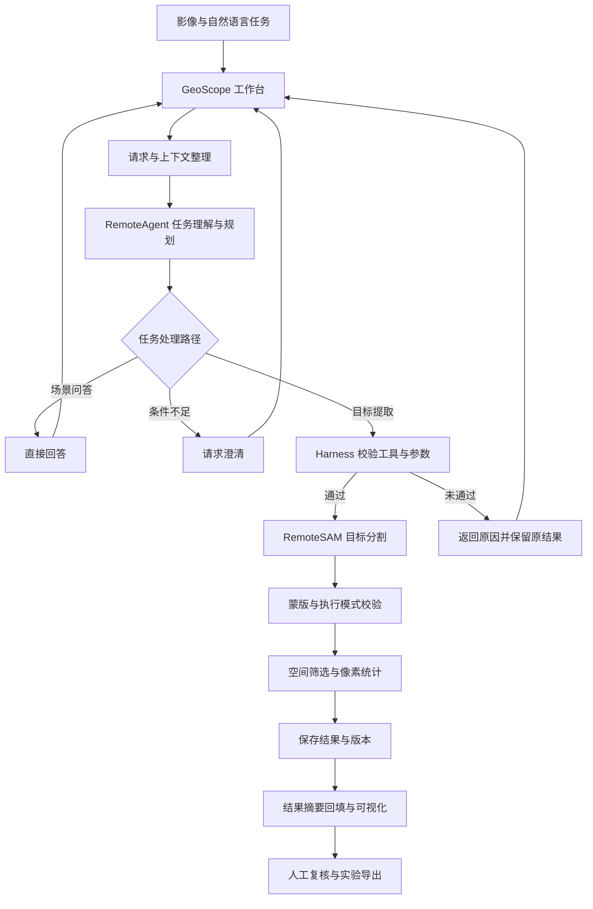

# 观域 GeoScope 自然语言驱动的遥感影像智能分析系统

## 技术说明书

**团队组成：** 系统集成、智能体与执行框架、遥感感知与评测三个方向  
**作品版本：** GeoScope v0.7  
**编写日期：** 2026 年 10 月 9 日

---

## 目 录

1. 系统介绍
   - 1.1 选题背景与意义
   - 1.2 作品功能
2. 系统开发方案
   - 2.1 总体架构与技术路线
   - 2.2 自然语言任务理解与受约束执行
   - 2.3 遥感目标分割与执行模式适配
   - 2.4 空间范围筛选与确定性统计
   - 2.5 连续交互与实验版本管理
   - 2.6 批量处理与结果交付
3. 作品创新点与核心优势
4. 团队介绍与分工
   - 4.1 团队成员介绍
   - 4.2 团队分工
5. 系统测试
   - 5.1 系统运行环境和配置
   - 5.2 系统测试说明
   - 5.3 测试结果与分析
6. 应用前景
7. 参考文献

---

## 1 系统介绍

### 1.1 选题背景与意义

遥感影像能够以直观的空间形式记录地表目标及其分布，为自然资源调查、城市空间分析、交通设施观察、生态环境监测等工作提供基础资料。在教学与科研中，研究者往往需要围绕某一问题开展影像理解、目标提取、空间筛选、统计计算和结果整理。这些步骤之间联系紧密，却通常分散在不同软件、模型接口和分析脚本中。以指定区域的目标提取与覆盖比例计算为例，其处理过程涉及输入准备、模型选择、参数设置、结果检查和数据导出等多个环节，对操作衔接与结果管理提出了要求。

视觉语言模型的发展为自然语言交互提供了新的技术条件。用户可以直接描述分析意图，由模型理解影像内容并规划处理动作。在将视觉语言模型用于定量分析时，工具选择、参数合法性、像素输出一致性和多轮任务状态维护仍是重要问题。为保障分析过程的可靠性，需要建立连接模型决策与实际执行的校验机制，并使结果与其输入条件保持关联。

基于上述问题，本团队开发观域 GeoScope 自然语言驱动的遥感影像智能分析系统。系统以 RemoteAgent 为任务理解与规划核心，以 RemoteSAM 为遥感目标分割工具，通过自主实现的任务执行与校验框架 GeoScope Harness 组织执行、校验参数、计算统计量并保存实验过程，使用户能够围绕同一幅影像连续提出问题、调整条件和复核结果。

本作品的设计着眼于遥感分析任务中共有的处理环节，将“理解需求—调用工具—获取蒙版—空间筛选—统计展示—保存结果”组织为统一流程。作品以建筑和飞机为代表性目标开展功能与性能验证，通过统一任务协议和工具接口为其他目标类别与专业模型的接入提供扩展基础。作品的意义在于降低任务组织与工具操作的门槛，使研究者能够把更多精力用于问题提出、结果判断和实验分析。

### 1.2 作品功能

本作品将影像、对话、分割结果和实验记录集成于同一 Web 工作台。用户选择样例或上传影像后，可通过自然语言描述任务，也可通过框选研究区和快捷操作进一步明确分析条件。

**（1）影像理解与分析任务发起。** 用户可以询问影像主要场景，或直接提出目标提取和统计要求。系统区分影像场景问答与像素级分析任务：前者由 RemoteAgent 回答，后者进入专业工具执行流程。对于目标不明确、条件缺失或超出当前范围的请求，系统返回条件补充要求或执行限制说明。

**（2）目标提取与空间范围筛选。** 系统调用 RemoteSAM 获取目标蒙版，支持全图、左半幅、右半幅、上半幅、下半幅和矩形研究区等范围。用户可以比较不同范围内的目标分布，并查看目标像素面积及其占整幅影像的比例。

**（3）连续对话与条件修改。** 用户在获得结果后，可以继续输入“改成左侧的”“提取全图”或更换执行模式。系统基于所选结果继承目标、影像与适用的空间条件，保存新版本；用户可恢复历史版本，并基于既有条件继续开展分析。

**（4）可视化与人工复核。** 工作台提供原图、蒙版、叠加和对比视图，支持透明度调整及画布缩放。系统检查输出尺寸、范围和文件完整性，用户再结合影像判断目标语义与边界是否符合预期，并记录确认或调整意见。

**（5）多图批量处理。** 用户可选择 2—5 幅已保存影像，按统一任务依次执行分析。每幅影像独立记录任务状态、统计结果与失败原因，单项失败不会直接中止其余影像的处理。

**（6）实验保存与成果导出。** 系统保存输入影像、目标蒙版、叠加图、统计结果、运行日志和版本关系，支持实验包、实验报告及批次统计导出，为实验复核、成果交流与后续分析提供数据依据。

## 2 系统开发方案

### 2.1 总体架构与技术路线

系统采用“交互工作台—任务规划—受约束执行—专业感知—确定性计算—实验管理”的分层结构。各部分围绕同一个任务对象协作，形成从分析意图到实验产物的完整流程。

| 系统组成 | 主要职责 | 实现方式 |
|---|---|---|
| Web 工作台 | 影像输入、任务描述、结果展示与复核 | HTML、CSS、JavaScript 与画布交互 |
| RemoteAgent | 理解影像与指令，生成回答或工具调用 | 视觉语言模型推理服务 [1] |
| GeoScope Harness | 校验请求、约束工具、管理状态和组织执行 | Python 服务及任务协议 |
| RemoteSAM | 根据目标类别或文本提示生成分割蒙版 | 遥感感知模型推理服务 [2] |
| 几何与统计模块 | 范围裁切、像素面积、比例及候选区域统计 | 基于实际二值蒙版的确定性计算 |
| 实验管理模块 | 版本保存、资产关联、历史恢复与结果导出 | 文件存储、JSON 记录与实验包 |



*图 2-1 系统总体技术路线。*

系统采用 RemoteAgent [1] 和 RemoteSAM [2] 作为认知与感知基础，团队负责设计并实现任务协议、执行控制、结果校验和交互管理模块。各模块通过结构化输入输出协作，将模型推理与遥感实验管理衔接起来。

### 2.2 自然语言任务理解与受约束执行

#### 2.2.1 任务表示与上下文组织

以“提取影像右侧的建筑并计算面积占比”为例，系统需要解析目标类别“建筑”、空间条件“右侧”、处理动作“提取”与输出要求“面积占比”。对于后续请求“改成左侧的”，系统还需要继承上一轮的影像和类别，仅修改空间条件。

为描述这一过程，可将第 \(t\) 轮分析任务抽象为：

\[
T_t=(I,c_t,s_t,R_t,q_t,v_{t-1}),
\tag{1}
\]

其中，\(I\) 为当前影像，\(c_t\) 为目标类别，\(s_t\) 为全图或半幅空间范围，\(R_t\) 为可选矩形研究区，\(q_t\) 为执行模式，\(v_{t-1}\) 为本轮引用的结果版本。该状态表示将任务条件与结果版本显式关联，为多轮条件继承和历史恢复提供统一依据。

系统优先采用用户本轮明确给出的条件；对于省略字段，按适用规则继承所选版本的上下文。条件之间出现冲突时，系统停止执行并请求修改，保证实际执行条件与用户意图一致。

#### 2.2.2 任务分流与工具约束

RemoteAgent 根据影像和任务进行规划，工作台将请求组织为场景问答、目标提取、条件澄清等路径。当前分割工具接口包括语义分割与指代表达分割。同一次规划只允许执行一个通过校验的分割动作，批量处理由 Harness 逐项调度。

Harness 在执行前检查以下条件：

1. 工具名称属于当前允许调用的集合；
2. 参数字段、数据类型和目标类别符合约定；
3. 工具使用的影像与当前会话一致；
4. 模型提出的类别与用户明确指定或继承的类别一致；
5. 研究区坐标合法，执行模式不存在冲突。

目标一致性检查同时约束显式类别与继承类别。例如，飞机提取请求对应的工具动作必须保持飞机类别。对于不可解析输出、多工具冲突和影像路径不匹配等情况，系统终止该次调用并记录错误类型，防止异常动作进入感知执行环节。

#### 2.2.3 工具反馈与完成状态判断

工具响应后，系统继续检查业务状态、蒙版可解码性、尺寸和二值编码。有效分割结果须同时满足接口响应与产物校验条件。

经过检查的像素面积、比例、服务信息与产物引用会组成结构化摘要，回填任务解释环节。蒙版以文件形式保存，模型接收结构化结果摘要，以控制上下文规模。界面中的定量结果均由蒙版计算模块提供，确保展示数据与实验产物一致。

任务执行流程如算法 1 所示。

```text
算法 1  自然语言遥感分析任务执行流程
输入：影像 I，用户请求 u，所选版本上下文 C
输出：回答、澄清信息、失败原因或新的实验结果 V

整理请求中的目标、范围、研究区和执行模式
若存在确定性的缺失条件或冲突：返回澄清或拒绝原因
调用 RemoteAgent，获得任务决策
若为允许的场景回答：展示回答
否则：
    检查工具白名单、参数、目标和影像绑定
    未通过校验则结束，保留已有结果
    根据目标能力确定实际感知路径与执行模式
    若满足完整蒙版复用条件：读取已有蒙版
    否则：调用 RemoteSAM 并检查返回值
    对蒙版执行空间筛选与确定性统计
    保存结果文件、运行记录和版本关系
    回填实际执行摘要，展示结果并等待人工复核
```

### 2.3 遥感目标分割与执行模式适配

#### 2.3.1 专业感知工具接入

RemoteSAM 根据当前任务的目标类别或文本提示生成像素级区域。GeoScope 将模型的规划表达转换为服务请求，并对常见类别进行规范化，减少同一类别不同表达造成的接口不一致。例如，飞机提取采用经对比实验确定的 `all planes` 作为标准提示表达。

对于建筑任务，系统将感知调用统一到语义分割路径，减少相同任务因接口选择变化产生的输出差异。该类别适配策略在执行层完成，并与服务请求一同记录，便于复查实际调用方法。

系统将具体感知模型与上层任务组织分离。后续接入建筑、水体或道路等专用模型时，可围绕同一任务协议适配输入输出，继续使用已有的范围筛选、统计、复核和导出流程。模型接入后的评价采用相应类别的独立测试数据与任务指标。

#### 2.3.2 整图推理与飞机细节增强

当前执行方式包含自动选择、稳定整图和针对飞机任务的细节增强。稳定整图方式以整幅影像执行感知，减少切片处理带来的额外计算；飞机细节增强结合切片推理、重叠区域概率融合和阈值处理，改善固定诊断集上的分割表现。

团队在固定飞机诊断集上比较了提示词调整、影像放大和切片等策略。根据平均 IoU 选取的配置为：切片大小 \(1024\times1024\)、相邻切片重叠 256 像素、概率阈值 0.88。重叠区域的预测结果先在原图坐标系下融合，再生成与输入影像对齐的二值蒙版。

系统综合目标类别与执行策略确定可用模式，按任务上下文更新界面选项。服务记录同时保存请求模式、实际执行模式及适配原因，以保证任务配置、服务执行和结果展示的一致性。细节增强的性能与耗时比较见第 5.3.3 节。

#### 2.3.3 输出一致性检查

系统要求返回蒙版与输入影像具有相同宽高，并使用合法的二值编码。概率图或多类标签图须经符合任务定义的转换后才能用于二值统计。对于服务未确认的执行模式，系统记录未确认状态或拒绝该次响应，保证结果元数据准确反映实际执行情况。

### 2.4 空间范围筛选与确定性统计

#### 2.4.1 研究区与像素坐标

设影像大小为 \(W\times H\)，像素坐标原点位于左上角，横轴向右、纵轴向下。右半幅对应 \(x\geq\lfloor W/2\rfloor\)，左半幅对应 \(x<\lfloor W/2\rfloor\)。所有方向条件均采用影像坐标定义。

矩形研究区表示为半开区间：

\[
R=[x_1,x_2)\times[y_1,y_2),
\quad 0\leq x_1<x_2\leq W,
\quad 0\leq y_1<y_2\leq H.
\tag{2}
\]

研究区同时保存绘制或导入来源、原始影像尺寸，用于检查坐标是否属于当前影像，并在恢复历史版本时重现原有条件。

#### 2.4.2 范围约束与面积计算

将模型输出转换为二值指示函数 \(M(x,y)\in\{0,1\}\)，用 \(S(x,y)\) 表示本次有效空间范围，则筛选后的目标蒙版为：

\[
M_S(x,y)=M(x,y)S(x,y).
\tag{3}
\]

目标像素面积及整图覆盖比例分别为：

\[
A=\sum_{y=0}^{H-1}\sum_{x=0}^{W-1}M_S(x,y),
\qquad P=\frac{A}{WH}\times100\%.
\tag{4}
\]

覆盖比例统一以整幅影像像素数为分母，使不同研究范围的统计结果具有一致口径。跨越范围边界的目标按像素裁切，保留位于有效范围内的部分。

本系统采用像素面积作为定量输出。地理面积测量需结合空间参考、地面分辨率及投影条件，作为后续空间分析模块的扩展内容。

#### 2.4.3 候选区域与人工复核

系统对最终蒙版进行八邻域连通区域分析，保存候选区域数量、面积和边界框等信息。多个实例相连可能形成同一个连通区域，一个实例被分割成碎片也可能形成多个区域，因此该统计量定义为蒙版候选区域数，与实例级目标数量分别表述。

可视化复核由原图、蒙版、叠加和对比视图共同完成。系统检查用于确认格式、范围和统计过程；用户确认用于记录结果是否满足当前分析需要，两者承担不同职责。

### 2.5 连续交互与实验版本管理

#### 2.5.1 条件继承与版本恢复

每次有效分析结果均保存对应影像、目标、范围、研究区、执行模式和产物路径。后续任务通过所选版本引用结构化上下文。例如，在“右侧建筑”结果上选择“改成左侧”，系统保留建筑类别、修改空间范围并生成新版本。恢复早期版本后，也可以从该版本继续开展实验。

快捷操作和模式选项随目标类别及版本状态同步更新，保持交互内容与任务上下文一致。执行失败时，画布保留上一次有效结果，并给出本次失败原因。

#### 2.5.2 完整蒙版复用

系统独立保存全图目标蒙版与范围筛选后的蒙版。若后续只改变空间条件，且影像、类别、服务请求、模型版本和文件完整性等复用条件均满足，可以直接从全图蒙版生成派生结果，减少重复推理。

当模型版本未知、文件校验失败、目标或感知参数变化，或用户明确要求重新提取时，系统不直接沿用旧蒙版。复用来源写入运行记录，使派生结果仍能追溯到原始感知过程。

### 2.6 批量处理与结果交付

#### 2.6.1 批量执行与失败隔离

批量实验接收 2—5 个不同的已有影像会话和一条统一任务，由 Harness 串行调度。每幅影像独立完成规划、执行与保存，由执行框架统一维护批次状态。

批量目标须明确，或所有影像具备一致且可继承的目标上下文。共用研究区时，需检查各幅影像尺寸与坐标合法性。若某幅影像处理失败，系统记录该项原因，继续处理后续影像，并在批次结果中分别展示成功与失败项。

#### 2.6.2 实验资产与报告

单次实验保存原图、蒙版、叠加图、统计数据和运行日志；报告由已保存字段生成，包含任务条件、像素统计、候选区域、执行模式与复核状态。主要资产组织关系如下：

```text
影像会话
├─ 原始影像与来源
├─ 结果版本 V1
│  ├─ 用户任务与执行条件
│  ├─ 完整蒙版与范围内蒙版
│  ├─ 叠加图与统计数据
│  └─ 运行日志与复核记录
├─ 结果版本 V2
└─ 后续版本

批量实验
├─ 逐图会话与结果引用
├─ 单项状态与失败原因
└─ 汇总数据与导出表格
```

*图 2-2 影像会话与批次结果的关联结构。*

实验包为结果核对与跨设备复现提供输入输出依据。复现实验时需同步配置相应模型权重、服务版本和运行参数。

## 3 作品创新点与核心优势

本作品基于 RemoteAgent 与 RemoteSAM 构建遥感智能分析系统，在任务编排、执行约束、确定性计算和连续实验管理方面形成以下设计特点与系统创新。

**（1）自然语言实验意图与遥感工具的贯通。** 系统将目标、空间条件和统计要求组织为明确任务，使用户可以在统一界面中完成从提出问题到检查像素结果的连续操作，并通过后续对话调整分析条件。

**（2）规划与执行分离的 Harness 机制。** 模型负责提出动作，执行框架负责校验目标、影像、工具参数和输出。该机制把智能体输出纳入可检查的处理流程，减少错误调用对结果的影响。

**（3）感知结果与确定性计算协同。** 分割模型负责预测目标区域，范围筛选和统计程序负责精确计算已有蒙版中的像素。统计结果与实际蒙版逐项关联，支持数值复算与来源追溯。

**（4）面向连续实验的上下文与版本管理。** 影像、目标、研究区、执行条件和产物共同构成版本状态，使条件修改、结果恢复和蒙版复用具有明确依据，有利于开展对照分析与实验复查。

**（5）面向实际操作的交互与批量能力。** 系统提供目标相关的快捷操作、可视化复核、单项失败隔离和实验导出，承接单次模型调用之外的准备、调整和交付环节。

本作品的核心优势在于将自然语言交互、专业模型调用与实验管理集成于同一工作台，支持分析条件的连续调整和结果的可追溯交付。统一任务协议与模块化工具接口使范围筛选、统计和版本管理等功能可在不同感知任务之间复用，为后续专业模型扩展提供工程基础。

## 4 团队介绍与分工

### 4.1 团队成员介绍

团队由三名成员组成，围绕系统集成、智能体与执行框架、遥感感知与评测三个方向开展协同研发。各成员分别负责相应模块的设计、实现与测试，并共同完成系统联调和结果核验。

- **队长：** 负责总体需求、工作台交互、系统整合、功能验收与作品交付。
- **队员 A：** 负责 RemoteAgent 接入、任务规划优化、Harness 校验及决策层评测。
- **队员 B：** 负责 RemoteSAM 部署、分割接口、推理策略实验与感知层评测。

### 4.2 团队分工

| 成员 | 主要承担的任务 | 主要成果 |
|---|---|---|
| 队长 | 总体设计、前端交互、系统集成、上下文一致性检查、完整链路测试与结果核对 | 交互工作台、系统集成方案与功能验证结果 |
| 队员 A | 模型调用协议、工具白名单、参数与目标校验、ROI 与批量任务控制、异常分析 | Agent 与 Harness 模块、测试任务集及决策层评测结果 |
| 队员 B | 感知服务部署、数据清单与评价口径、提示词及切片实验、分割结果复算 | RemoteSAM 服务、逐图指标、实验汇总与代表性案例 |

团队采用模块化开发与集成测试相结合的协作方式，通过统一输入输出规范、固定测试任务和逐项实验记录检查模块一致性，形成从算法适配到工作台应用的协同开发流程。

## 5 系统测试

### 5.1 系统运行环境和配置

系统采用浏览器工作台与远端模型服务分离的部署方式。用户电脑承担界面和实验组织，模型推理运行在具备相应 GPU 与权重环境的设备上。

| 层次 | 运行配置与部署方式 |
|---|---|
| 交互终端 | Windows 环境及现代浏览器 |
| 工作台后端 | Python 服务，Pillow 10.0 及以上版本 |
| 任务理解服务 | RemoteAgent，Qwen2.5-VL 架构；决策层评测采用 BF16 与 vLLM 0.15.1 |
| 遥感感知服务 | RemoteSAM；基线与飞机改进实验使用服务 1.1.0，后续模式及批量联调使用 1.2.0 |
| 感知计算环境 | 支持 CUDA 的 GPU，FP16 推理 |
| 服务通信 | 网络接口通信，支持 SSH 端口转发；模型端点通过环境配置管理 |
| 实验存储 | 本地会话目录、JSON/JSONL/CSV 记录及影像产物 |

实验分阶段开展。决策耗时、感知模型推理耗时和客户端总耗时分别记录，相关数值对应各次实验的服务版本与运行条件。不同阶段的耗时不作直接横向性能比较。

### 5.2 系统测试说明

系统测试分为任务决策、感知精度、完整流程和工程回归四个层次，分别评价任务理解、分割质量、流程正确性与实现稳定性。

#### 5.2.1 任务理解与路由测试

固定 40 条任务覆盖场景描述、目标提取、空间条件、连续修改、含糊请求及不适用任务。逐条保存模型决策与执行框架处理结果，统计任务路由正确率及失败类型。

设测试任务数为 \(N\)，符合预定路由的任务数为 \(N_c\)，则：

\[
\mathrm{RoutingAccuracy}=\frac{N_c}{N}.
\tag{5}
\]

该指标用于评价任务处理路径的选择正确性；像素级分割质量另采用 IoU 与 Dice 评价。

#### 5.2.2 分割精度测试

使用固定的 20 幅带真值影像开展感知层基线评测，其中建筑与飞机各 10 幅。对预测蒙版与真值蒙版计算 IoU 和 Dice：

\[
\mathrm{IoU}=\frac{TP}{TP+FP+FN},
\qquad
\mathrm{Dice}=\frac{2TP}{2TP+FP+FN}.
\tag{6}
\]

其中，\(TP\) 为正确预测的目标像素，\(FP\) 为误报像素，\(FN\) 为漏检像素。实验同时记录逐图指标和类别均值，以反映总体表现与样本间差异。

在同一 10 幅飞机诊断影像上，进一步比较提示词、放大与切片策略。参数选择与策略比较使用同一诊断集，相关结果反映该数据集上的配置改进；跨场景泛化能力需通过独立测试集进一步评估。

#### 5.2.3 完整链路与异常测试

完整链路测试检查真实 RemoteAgent 规划、Harness 校验、RemoteSAM 推理、范围处理、统计及结果保存。测试用例分别预设分割执行、场景回答、条件澄清和请求拒绝等预期状态，以实际处理状态与预期状态的一致性作为流程验收依据。

异常用例包括工具输出无法解析、类别不一致、研究区缺失或越界、模式冲突、服务失败及批次单项失败。检查重点是：失败项不产生新的有效蒙版，已有版本能够保留，其他合法批次项可以继续。

#### 5.2.4 交互与工程回归

浏览器测试覆盖样例选择、任务执行、条件修改、版本恢复、视图对比、实验导出、故障反馈及移动端显示。工程测试覆盖接口与任务协议、蒙版格式、几何统计和存储关系。工程回归结果与模型精度评测分别统计。

### 5.3 测试结果与分析

#### 5.3.1 RemoteAgent 任务路由改进

在固定 40 条任务集上，对任务指令与执行约束优化前后的决策结果进行比较，结果见表 5-1。

*表 5-1 任务路由优化前后对比。*

| 指标 | 改进前 | 改进后 |
|---|---:|---:|
| 路由正确任务数 | 30/40 | 39/40 |
| 路由正确率 | 75.0% | 97.5% |
| 平均决策耗时 | 2524.8 ms | 1015.6 ms |

评测结果表明，任务路由正确率由 75.0% 提高至 97.5%，增加 22.5 个百分点 [3]。优化后，39 条任务进入预期路径，1 条任务因模型输出无法解析而未通过校验。平均决策耗时在本次对照记录中由 2524.8 ms 降至 1015.6 ms。该结果反映固定任务集上的决策改进，耗时结论限于本次运行条件。

#### 5.3.2 RemoteSAM 基线分割结果

*表 5-2 建筑与飞机分割基线结果。*

| 评测范围 | 影像数 | 接口成功数 | 平均 IoU | 平均 Dice |
|---|---:|---:|---:|---:|
| 建筑 | 10 | 10 | 0.3522 | 0.5115 |
| 飞机 | 10 | 10 | 0.1585 | 0.2281 |
| 全部 | 20 | 20 | 0.2554 | 0.3698 |

20 幅影像均完成感知服务调用，建筑与飞机的平均 IoU 分别为 0.3522 和 0.1585 [4]。飞机类别的误报与漏检较为明显，因此后续实验重点比较提示词和推理策略对飞机分割质量的影响。

#### 5.3.3 飞机分割策略比较

*表 5-3 固定飞机诊断集上的分割策略对比。*

| 策略 | 提示词与主要配置 | 平均 IoU | 平均 Dice |
|---|---|---:|---:|
| 原始提示词整图推理 | `all airplanes` | 0.1585 | 0.2281 |
| 调整提示词整图推理 | `all planes` | 0.2460 | 0.3292 |
| 放大 1.25 倍 | `all planes` | 0.2470 | 0.3300 |
| 重叠切片与阈值处理 | 1024 切片、256 重叠、阈值 0.88 | 0.3056 | 0.4133 |

在同一组 10 幅飞机诊断影像上，采用 `all planes` 后平均 IoU 提升至 0.2460，进一步放大影像的收益较小。重叠切片与阈值处理配置取得平均 IoU 0.3056、平均 Dice 0.4133 [5]。相较原始配置，平均 IoU 增加 0.1471，相对增幅约为 92.8%，增幅按改变量与基线 IoU 的比值计算。

切片方案的平均模型推理耗时约为 5658.79 ms，平均客户端总耗时约为 12388.66 ms，体现了分割质量与处理时间之间的权衡。系统据此为飞机任务保留整图与细节增强两种执行方式，并通过目标类别约束策略的使用范围。

表 5-4 列出该配置下不同 IoU 水平的代表性影像。

*表 5-4 飞机分割代表性案例。*

| 案例 | 影像编号 | IoU | Dice |
|---|---|---:|---:|
| 较好案例 | ISAID_VAL_P1483 | 0.7508 | 0.8577 |
| 中等案例 | ISAID_VAL_P1122 | 0.1895 | 0.3187 |
| 较差案例 | ISAID_VAL_P1143 | 0.0548 | 0.1039 |

代表性案例的 IoU 存在较大差异，表明该策略对影像场景仍具有敏感性，复杂背景下的误报控制与目标边界恢复是进一步优化的重点。

#### 5.3.4 完整流程与批量测试结果

在 2026 年 9 月 30 日开展的 v0.7 完整流程测试中，20 条任务的处理状态均与预设状态一致，累计执行 14 次 RemoteAgent 调用 [6]。测试包含 9 条分割任务、1 条场景回答、4 条澄清任务和 6 条拒绝任务。分割任务中包含 1 个五图批次，共生成并保存 13 个有效蒙版。流程符合率按全部任务的预期状态统计，分割质量依据蒙版精度另行评价。

三图批量测试对同源影像的不同尺寸版本进行处理，结果见表 5-5。

*表 5-5 不同尺寸影像的批量处理结果。*

| 批次项 | 影像尺寸 | 状态 | 从保存蒙版复算的目标像素 |
|---|---|---|---:|
| 原图 | 800×800 | 完成 | 49,215 |
| 裁剪版本 | 700×700 | 完成 | 45,553 |
| 缩放版本 | 640×640 | 完成 | 31,478 |

三幅输入由同一机场影像的原图、裁剪和缩放版本构成，用于验证输入尺寸变化条件下的批量处理与统计一致性。异常隔离测试中，包含不合法研究区的影像被单独标记为失败，其前后两个合法任务均完成处理，验证了批次级失败隔离机制 [7]。

2026 年 10 月 8 日的系统回归测试中，69 项自动化用例全部通过；浏览器测试完成样例选择、条件修改、版本恢复、结果导出和异常反馈等流程检查，未发现页面脚本错误。

#### 5.3.5 综合分析

实验结果表明，GeoScope 已完成从自然语言任务理解到分割结果生成、空间统计和实验保存的系统验证。任务协议优化改善了固定任务集上的路由正确率，飞机分割策略在诊断集上取得平均 IoU 提升，研究区处理与批量异常隔离满足相应功能要求。

系统性能仍受感知模型与影像条件影响，大范围密集建筑和复杂背景小目标场景存在漏检与误报。现阶段的策略比较采用固定诊断集，批量功能测试包含同源影像变换，跨场景泛化能力仍需扩大独立样本验证。用户操作效率尚未进行受控对照评估，后续将结合人工流程、基础 Agent 与完整系统开展任务完成时间和结果质量比较。

后续研究将重点完善类别感知适配、独立场景评测和用户操作验证，在保持执行过程可追溯的基础上提升分割质量与交互效率。

## 6 应用前景

将遥感影像处理与人工智能交互相结合，有助于缩短从分析想法到实验结果的操作路径。GeoScope 已形成任务理解、工具调用、像素统计、交互复核与实验保存的通用流程，后续可在这一基础上接入更多经过验证的感知能力，逐步服务不同学科问题。

**（1）遥感教学与科研实验。** 将影像问答、目标提取、条件修改和实验导出组织为统一操作流程，可用于课程演示、方法验证和案例分析。用户能够对照原图检查模型输出，并从保存记录中理解每一步处理的依据。

**（2）自然资源与城市空间分析。** 随着建筑、道路、水体、植被等专用模型的接入，可进一步支持选定区域的地物覆盖观察、样本整理与初步统计。涉及实际面积和规划指标时，需要继续补充空间参考、数据质量控制和专业核验。

**（3）交通设施与港口场景观察。** 机场、港口等影像中的目标区域提取可为分布观察和预标注提供辅助。结合实例级模型与独立评测，可进一步拓展目标计数和空间关系分析。

**（4）生态环境与灾害影像辅助分析。** 在补充相应模型、任务协议与评测数据后，可探索水体、植被及受影响区域的交互式提取。多时相变化检测和灾损辅助判读是后续可拓展的研究方向。

本作品的发展重点是保持统一交互和执行框架，逐步扩充经过验证的工具能力，使不同遥感问题能够沿用可追溯的分析流程。随着专用模型、空间参考处理和用户评测的完善，GeoScope 有望成为连接自然语言需求与专业遥感工具的交互式工作台。

## 7 参考文献

[1] YAO L, XU S, LIU F, et al. RemoteAgent: Bridging Vague Human Intents and Earth Observation with RL-based Agentic MLLMs[EB/OL]. 2026. [arXiv:2604.07765](https://arxiv.org/abs/2604.07765).

[2] YAO L, LIU F, CHEN D, et al. RemoteSAM: Towards Segment Anything for Earth Observation[EB/OL]. 2025. [arXiv:2505.18022](https://arxiv.org/abs/2505.18022).

[3] GeoScope 项目组. RemoteAgent 任务决策基线与优化评测数据集[DS]. 2026. 固定 40 条任务，含逐任务记录与汇总结果，项目研究资料。

[4] GeoScope 项目组. 建筑与飞机目标分割基线评测数据集[DS]. 2026. 固定 20 幅影像，评测协议版本 sam-eval-v1.0，项目研究资料。

[5] GeoScope 项目组. 飞机分割提示词与推理策略对比实验数据集[DS]. 2026. 固定 10 幅诊断影像，评测协议版本 sam-aircraft-v2.0，含结果复核记录，项目研究资料。

[6] GeoScope 项目组. GeoScope v0.7 完整流程测试数据集[DS]. 2026-09-30. 20 条任务的真实服务调用记录与结果汇总，项目研究资料。

[7] GeoScope 项目组. GeoScope v0.7 接口一致性与批量处理测试报告[R]. 2026-09-30. 项目研究资料。
