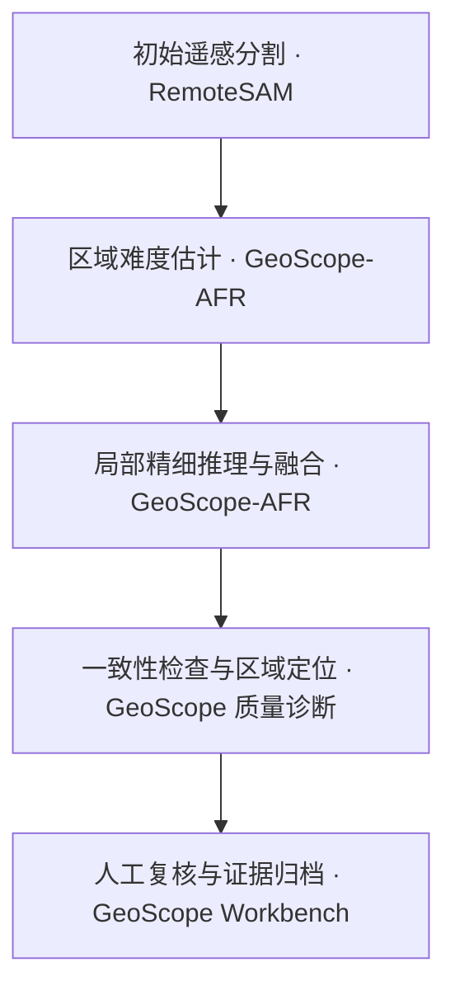
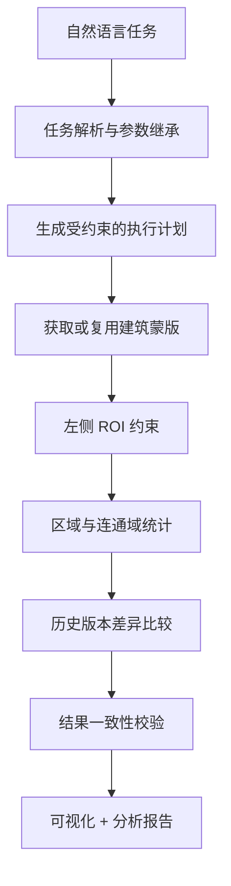
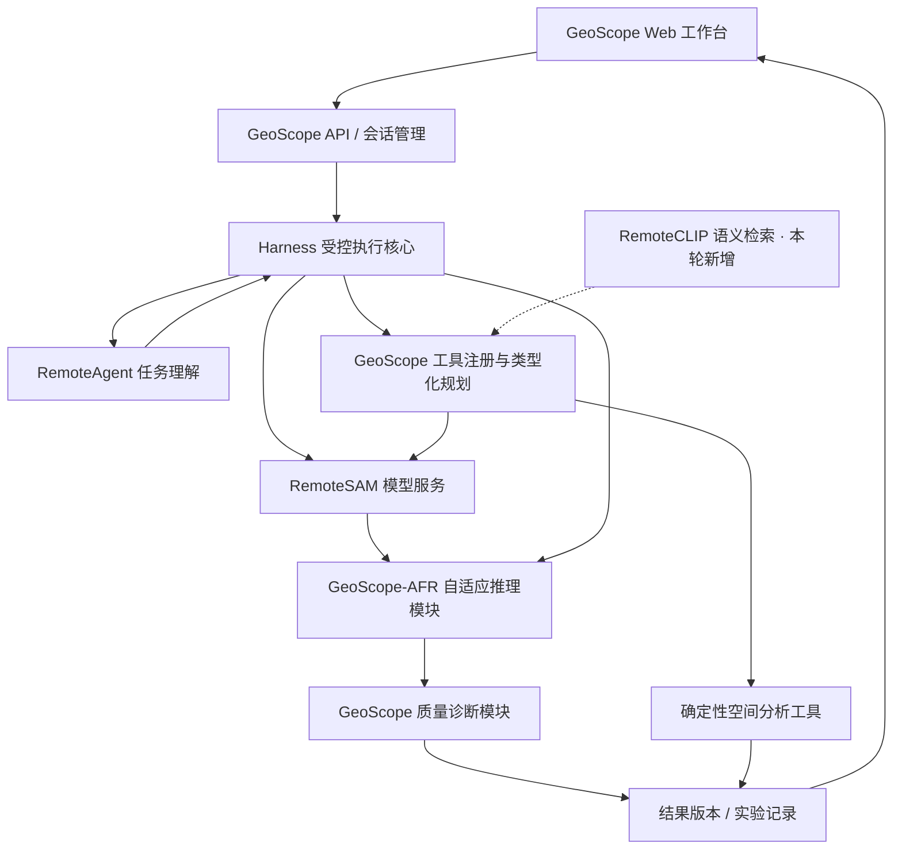
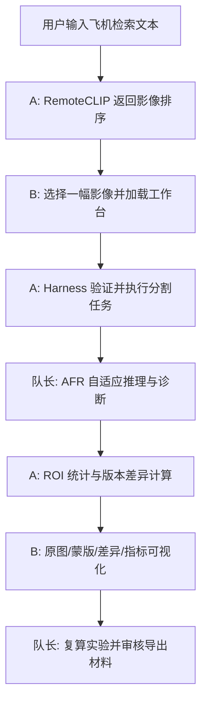

# GeoScope 国赛版本迭代升级建议（完整保留版·RemoteCLIP 确定接入·三人分工版）

> 基于《GeoScope 上一阶段代码、算法与平台功能总结》｜2026 年 11 月 17 日  
> **版本说明**：本文完整整理此前国赛建议中的十二个部分及其中的技术细节、公式、实验设计、网页功能和开发优先级。原答复中的卡片、动态图表和界面示意转换为 Markdown 表格、文字说明及 Mermaid 图；不是删减内容。按团队最新决定，将“可选新增模型”调整为“**仅新增 RemoteCLIP**”，RemoteReasoner、RemoteShield、RemoteZero 均不列入本轮模型集成任务。**工具层建议保持不变。**新增“队长+A+B 分工与集成约束”章节。本文是开发方案，除明确标记的省赛既有能力外，不能作为新增功能已完成的证明。

---

我已经完整审阅了你提供的 MD，包括现有模型接入情况、任务执行链路、分割策略、工作台功能、实验数据、历史原型和目前存在的技术边界。

我的核心判断是：

**GeoScope 省赛版本已经具备较完整的软件工程基础，但目前最需要补强的不是平台功能数量，而是项目自身的算法方法体系。**

你提出的担心非常准确：如果国赛只是继续接入 RemoteCLIP、RemoteReasoner、RemoteShield 等现有模型，即使平台功能更丰富，也容易被评委理解为“开源模型集成平台”。

国赛需要让评委看到三个层次的成果：

1. **基础模型能力：** 使用哪些成熟遥感基础模型解决感知和理解问题。
2. **团队自主算法：** 针对遥感影像的分割误差、尺度差异、不确定性和复杂任务提出了什么新的算法策略。
3. **学科应用闭环：** 如何让模型输出转化为可验证、可交互、可复现的遥感分析结果。

我建议国赛将 GeoScope 的定位从“遥感影像交互式智能分析平台”进一步升级为：

**面向遥感科研任务的多模态协同感知与可信分析工作台。**

其中，“多模态协同感知”对应算法创新，“可信分析”对应验证与质量控制，“科研工作台”对应实际应用价值。

## 一、先明确国赛的评审要求

我专门查阅了本届大赛的官方规则。你们参加的是第八届全球校园人工智能算法精英大赛的**算法创新赛——AI+学科交叉**赛题。

**官方总决赛预选赛提交截止时间：2026 年 11 月 18 日 23:30（北京时间）。** 官方通知要求提交包含 PPT 讲解与作品演示的答辩视频，并允许优化相关材料。预选赛于 11 月 19—22 日评审。

- 官方通知：https://www.aicomp.cn/notice/notice-1/5866.html
- 官方评分规则：https://www.aicomp.cn/tracks/tracks-2/3806.html

### AI+学科交叉赛题评分构成

| 评分维度 | 分值 |
|---|---:|
| 创新性 | 20 |
| 需求分析 | 15 |
| 方案可行性 | 20 |
| 项目实施 | 20 |
| 应用效果 | 20 |
| 总结展望 | 5 |
| **合计** | **100** |

官方明确要求围绕具体学科的科研、实验等真实环节开展创新，并提供技术方案和实际效果验证。

这意味着你们不能只突出算法，也不能只优化网页外观。**真正具有竞争力的方案应该是：原创算法策略、可运行的平台、定量实验和真实遥感科研需求相互支撑。**

尤其要注意，你们目前属于“AI+学科交叉”，而非单纯的“算法模型创新”赛题。因此不一定需要在一天内训练出全新的大模型，但必须拿出能够验证的自主方法改进，而不是仅仅展示模型调用。

---

## 二、省赛版本的技术审视

### 2.1 已经具备的核心基础

**多模态任务理解与受控执行**

RemoteAgent 已经真实接入，能结合图像和自然语言理解任务，并通过 Harness 检查工具、目标和执行参数。任务路由优化已经留下实验记录。

**遥感目标分割与推理策略优化**

RemoteSAM 已完成服务化部署，支持语义分割和文本指代分割。团队已经实现建筑路径约束、飞机切片增强、概率加权融合和阈值选择。

**可追溯的实验执行系统**

已有 ROI、像素统计、蒙版校验、结果缓存、历史版本、批次运行、人工确认、实验报告和执行过程记录。这是进一步建设专业工作台的重要基础。

这三个部分不建议推倒重做。尤其是 Harness 和结果版本体系，后面完全可以发展为你们自己的核心技术架构。

### 2.2 现有实验证明了什么

**RemoteAgent：固定 40 条任务的历史评测**

| 指标 | 原版本 | 优化后 | 变化 |
|---|---:|---:|---|
| 任务路由正确率 | 75.0%（30/40） | **97.5%（39/40）** | 提高 22.5 个百分点 |
| 平均决策耗时 | 2,524.8 ms | **1,015.6 ms** | 降低约 59.8% |

这说明你们在任务分流、协议约束与执行适配方面确实取得了工程和策略改进。

但是，它不能证明 RemoteAgent 模型本身经过训练获得了更强的推理能力。

**RemoteSAM：飞机固定诊断集的历史分割结果**

| 推理策略 | 平均 IoU | 平均 Dice |
|---|---:|---:|
| 原始整图（`all airplanes`） | 0.1585 | 0.2281 |
| 提示词优化整图（`all planes`） | 0.2460 | 0.3292 |
| 1024 切片、256 重叠、概率融合 | **0.3056** | **0.4133** |

你们的切片融合策略将平均 IoU 从 0.1585 提高至 0.3056，绝对提升 0.1471。这个结果值得保留，并作为国赛算法改进的起点。

但当前有两个问题：

- 最终 IoU 仍只有 0.3056，分割精度本身还有明显不足。
- 切片、阈值等配置选择与性能计算使用了同一组 10 张诊断影像，缺少独立测试集验证。

因此，**这项工作有真实改进，但目前还不足以单独支撑一个较强的国赛算法创新叙事。**

### 2.3 我认为影响当前竞争力的五个关键问题

| 问题 | 现状 | 国赛需要的变化 |
|---|---|---|
| 算法主线不够突出 | 主要体现提示词、固定规则与切片融合 | 形成有名称、有输入输出、有数学定义的自主方法 |
| 分割能力不够可靠 | 建筑、飞机存在较明显漏检 | 引入误差评估与针对性精细化 |
| 工具链偏单一 | Agent 当前仅开放两种分割工具 | 增加真正有科研分析价值的工具 |
| 学科分析深度有限 | 主要输出像素面积和候选区域 | 进一步支持空间关系、目标分布与研究区分析 |
| 实验说服力不足 | 小规模历史测试、缺少严格独立验证 | 加入消融、分组测试、失败案例与端到端对照 |

这里最重要的一点是：**系统接口测试通过、模型推理成功、算法预测准确，是三个不同层次的指标。**

例如，你们过去 20 条真实任务均达到预期状态，这证明执行链路可用，但并不代表 20 幅影像的目标分割都是准确的。

这一点国赛报告里应该主动区分，反而能够体现团队科研工作的严谨性。

---

## 三、算法层面：建议建立 GeoScope 自己的核心方法

这是我认为整个国赛迭代中最值得投入精力的部分。

### 3.1 核心建议：不要重新造一个大模型，而是提出一套自主的遥感推理方法

我建议将你们目前的分割配置优化，升级为一个完整的算法框架：

**GeoScope-AFR — Adaptive Focus and Refinement**

**面向多尺度遥感目标的自适应聚焦与可信复核方法（建议命名）**

以预训练遥感分割模型为基础，通过区域难度估计、预算约束下的局部精细推理、跨尺度概率融合与结果一致性检查，实现从固定推理配置向自适应分析流程的升级。

它与现有工作的关系是：

| | 省赛已有方法 | 国赛拟升级方法 |
|---|---|---|
| 推理策略 | 根据目标类别选择固定策略 | 根据类别、图像内容与区域难度选择策略 |
| 图像处理 | 整图或固定重叠切片 | 优先处理疑难区域，控制重复计算 |
| 融合算法 | 固定 Hann 权重融合 | 引入整图与局部预测的一致性约束 |
| 结果质量 | 检查蒙版编码与尺寸 | 增加预测分歧、区域不确定性诊断 |
| 交互机制 | 用户确认结果好坏 | 将可疑区域直接交给用户复核 |
| 实验目标 | 优化单一配置的 IoU | 同时考察精度、计算量与错误定位能力 |

需要强调：**GeoScope-AFR 是建议开发的新方法，不是目前已经实现的算法。** 它的创新应建立在完整的方法设计和消融实验上，不能仅凭起一个新名字就宣称原创。

### 3.2 算法模块 A：区域难度估计

目前的固定切片策略有一个问题：

一幅 4096×4096 的遥感影像中，可能只有少数区域存在难以识别的飞机或密集建筑，但固定切片会对所有区域投入近似相同的计算成本。

我建议新增一个区域难度估计模块。

第一步，利用现有 RemoteSAM 获取初始概率图 $P_0(x,y)$。

第二步，对影像划分候选区域，估计每个区域的分析难度。

可以从三个信息来源着手：

- **预测不确定性：** 模型概率是否集中在难以决策的范围。
- **跨尺度分歧：** 同一区域在整图和局部预测下的结果是否存在明显差异。
- **局部图像复杂度：** 图像纹理、边缘密度和潜在小目标分布是否复杂。

例如，将二分类概率的熵定义为：

$$
H(p)=-p\log(p+\varepsilon)-(1-p)\log(1-p+\varepsilon)
$$

对于候选区域 $R_i$，可以设计区域难度评分：

$$
U_i=\alpha\overline{H}_i+\beta D_i+\gamma C_i
$$

其中：

- $\overline H_i$：区域平均预测熵；
- $D_i$：整图与局部预测的分歧程度；
- $C_i$：归一化的局部图像复杂度；
- $\alpha,\beta,\gamma$：需要通过验证集确定的权重。

注意：上述是**待实现的算法设计公式**，不是已经训练或验证的结果。

而且，模型预测概率并不天然等于校准后的真实置信度。即使不同尺度预测完全一致，也可能同时漏掉目标。因此，难度评分必须作为复核线索，而不能直接宣称是分割正确率。

**明天可以优先落地的简化版：** 先实现预测熵、边缘密度和空蒙版回退机制；跨尺度分歧可以在局部精细推理返回后再计算。这样无需新增神经网络训练，也能形成可运行的区域评估流程。

### 3.3 算法模块 B：预算约束下的自适应精细推理

你们目前是整图推理或固定切片推理。

新方法可以根据区域难度对候选切片排序，在给定推理预算内优先细化困难区域。

设候选区域集合为：

$$
\mathcal R=\{R_1,R_2,\ldots,R_n\}
$$

对每个区域计算 $U_i$，然后根据难度和推理成本选择需要进行局部精细推理的区域：

$$
\max_{\mathcal S\subseteq\mathcal R}\sum_{R_i\in\mathcal S}U_i,
\quad \text{s.t.}\ \sum_{R_i\in\mathcal S}c_i\le B
$$

其中 $c_i$ 是区域推理成本，$B$ 是最大计算预算。

实际实现时无需引入复杂求解器，可以先采用按评分排序、逐个选择的贪心策略，并记录最终选中的切片数量。

这里的创新潜力是：

**在相同计算预算下，提高困难目标的识别效果；或者在可接受的精度损失下减少不必要的推理调用。**

但是，区域选择评分若不能预测真实错误位置，就可能导致漏检。特别是建筑物整图预测完全漏掉时，单靠分割概率熵无法发现问题。

因此必须设计兜底机制，例如对复杂区域保留少量探索性切片，并对建筑和飞机分别验证触发策略。

### 3.4 算法模块 C：整图与局部预测的跨尺度融合

省赛已经实现：

$$
P_{\text{tile}}(x,y)=\frac{\sum_iw_i(x,y)P_i(x,y)}{\sum_iw_i(x,y)}
$$

建议在此基础上引入整图预测：

$$
P_f(x,y)=[1-\lambda(x,y)]P_0(x,y)+\lambda(x,y)P_{\text{tile}}(x,y)
$$

其中 $\lambda(x,y)$ 为局部融合系数，可根据区域信息和验证集结果选取。

这样可以同时利用：

- 整图预测的大范围语义信息；
- 局部切片保留的小目标细节；
- 两种预测之间的一致性信息。

你们现有 Hann 加权融合代码可以继续使用，不需要重新实现基础切片覆盖。

不过，不能直接认为融合一定优于局部结果。建筑与飞机的最佳权重可能不同，需要通过对照实验判断。即使最终发现某一类目标只适合单一路径，也应将这一结论保留为算法设计依据。

### 3.5 算法模块 D：结果一致性与可信复核

这是我建议你们新增的另一个算法特色。

过去用户只能看到最终蒙版，然后点击“符合预期”或“需要调整”。

现在可以让系统主动指出：

“哪些区域的预测值得人工复核？”

例如定义两种预测蒙版之间的差异区域：

$$
D(x,y)=\left|M_{\text{whole}}(x,y)-M_{\text{tile}}(x,y)\right|
$$

这里假设蒙版已统一编码为 0/1。

通过差异区域聚合，可以在网页上突出显示整图与局部分割存在分歧的位置。

这会形成一个可见的算法闭环：



> 建议建立的算法执行链路示意，并非当前完成状态。

对于不确定区域，还可以将已有版本与精细化版本同时显示，用户确认后生成新的结果版本。

但要区分：

- **一致性检验**衡量不同推理结果之间的差异；
- **真实准确率评估**需要标注数据；
- **人工确认**用于业务复核，不等于系统已经具备自动真值判断能力。

这三个概念在报告里不能混用。

### 3.6 怎样证明这是自己的算法，而不是 RemoteSAM 的功能？

**RemoteSAM 提供：** 原始语义分割、文本指代分割和像素概率预测。其原论文已经拥有多任务统一与遥感像素级感知能力，不能计为团队贡献。

**GeoScope 团队需要提供：** 困难区域评估、计算预算分配、跨尺度预测融合、结果分歧分析和人工复核机制。

最终需要交付自己的算法源码、公式、消融结果和应用界面。

关于创新程度，我建议在技术报告中使用：

“提出了一种面向多尺度遥感目标的区域自适应精细推理与一致性复核方法。”

而不是声称“提出全新的遥感基础模型”。

如果有严格实验支持，再进一步描述其在精度、计算量或错误定位方面的优势。

---

## 四、Agent 算法层面：从单次分割调用升级为可验证的多工具分析

这是师兄“再加一些工具”的建议最有价值的实现方向。

但我建议不要单纯增加模型工具数量，而是让 **RemoteAgent 从一次性分割调用，扩展为面向遥感分析任务的受控工具编排入口**。

### 4.1 为什么不建议照搬 RemoteAgent 原始功能？

RemoteAgent 的原论文已经覆盖模糊意图理解、能力分流和专用工具调用，本身就是一个面向地球观测任务的智能体框架。

因此，单纯增加 Agent 工具调用功能，很难被认为是全新的算法思想。

我更建议在现有 Harness 基础上开发：

**GeoScope-VerifiedPlan：面向遥感分析任务的类型化规划与可验证执行方法。**

这个名称也只是建议。其核心应当是你们自己定义的工具类型、依赖约束、结果检查和失败回退机制。

### 4.2 当前工具与建议新增工具

| 工具名称 | 作用 | 开发优先级 |
|---|---|---|
| `semantic_segmentation` | 按类别提取目标 | 已实现 |
| `referring_expression_segmentation` | 按文本描述提取目标 | 已实现 |
| `region_statistics` | 研究区面积、占比及目标分布 | P0 |
| `connected_region_analysis` | 候选连通区域分析、过滤和分布统计 | P0 |
| `mask_compare` | 比较两个分割版本并生成差异区域 | P0 |
| `spatial_relation_analysis` | 左右、上下、相交、邻近等空间关系 | P1 |
| `adaptive_refinement` | 调用自适应局部精细推理 | P1 |
| `semantic_image_retrieval` | 基于 RemoteCLIP 的图文检索 | P2（本轮确定接入，按模型就绪情况独立验收） |
| `geo_measurement` | 基于地理参考信息的实际面积测算 | P2 |
| `report_generation` | 根据真实计算产物生成分析报告 | P1 |

其中 P0 应优先做，P1 根据主线进度推进，P2 是条件允许时的扩展。**本轮模型选型已确定仅新增 RemoteCLIP，因此 `semantic_image_retrieval` 从“可选模型扩展”改为“计划交付的独立功能”，但不得以它未完成为由破坏主链路。**

特别注意：前三个新增分析工具可以直接复用现有蒙版和结果版本，不需要重复调用 RemoteSAM，因此实现风险比新接入大型模型低得多。

### 4.3 建议实现的多工具任务示例

用户输入：

> 提取影像左侧的建筑物，分析其分布情况，并与上一版本比较。

系统不再只返回一个蒙版，而是形成结构化执行计划。



这里不应让大模型直接生成可执行的任意 Python 代码，而应该先转化为有限的结构化操作，再由 Harness 调用对应实现。

可以定义类似下面的工具调用合同：

```json
{
  "image_id": "img_001",
  "task": "region_comparison",
  "target": "building",
  "scope": "left_half",
  "steps": [
    "get_segmentation",
    "apply_scope",
    "region_statistics",
    "compare_versions"
  ],
  "reference_version": "result_002"
}
```

这是建议新增的接口结构，不是已有代码中的实际请求格式。

每个工具都要声明输入和输出类型、前置条件、允许操作以及失败状态。例如 `compare_versions` 必须确保两个蒙版能够在相同像素坐标空间中比较。

有了这些约束之后，可以将自然语言任务表示为一个有限的有向无环执行图（DAG）。

这比简单地把模型生成的多个工具名称依次执行更可靠，因为依赖关系、参数继承和工具执行顺序都能被确定性检查。

### 4.4 这个方向的自主创新应该放在哪里？

不是“使用大模型调用多个工具”，而是：

- 通过**类型化任务合同**减少非法组合与参数错误。
- 通过**结果依赖图**组织多步遥感分析。
- 通过**确定性计算与模型推理分离**避免语言模型虚构统计数字。
- 通过**局部重算和结果复用**避免每次交互都重新分割。
- 通过**失败隔离与版本回溯**保证多步任务可以检查和恢复。

不过，你们原有 Harness 已经有上述部分基础，例如工具白名单、参数校验和版本缓存。国赛要做的是扩展和验证，而不能把已有功能重新包装成新增成果。

为了控制明天的开发风险，我建议先保留 RemoteAgent 原来的分割路由，再新增可确定执行的分析工具链。等新增工具测试通过后，再决定是否将它们全部开放给 Agent 自主选择。

---

## 五、剩余 Remote 模型到底该不该接入？（团队最终选择：仅新增 RemoteCLIP）

我根据相关论文和项目资料重新梳理了这些模型的定位。

| 模型 | 公开研究侧重点 | 对 GeoScope 的实际价值 | 本次决定 |
|---|---|---|---|
| RemoteAgent | 模糊意图理解、工具调用 | 继续担任任务入口 | **保留** |
| RemoteSAM | 遥感语义/文本指代分割 | 继续担任像素感知底座 | **保留并优化** |
| RemoteCLIP | 图文表征对齐、零样本分类、检索 | 建立影像语义检索与候选场景分析 | **确定新增** |
| RemoteReasoner | 目标、区域与像素级地理空间推理 | 复杂空间指代任务 | **本轮不接入** |
| RemoteShield | 图像及文本扰动条件下的多模态鲁棒性 | 鲁棒理解与对照评估 | **本轮不接入** |
| RemoteZero | 无框标注的地理空间推理训练 | 长期弱监督研究 | **本轮不接入** |

RemoteCLIP 的图文检索能力、RemoteReasoner 的多粒度空间推理能力，以及 RemoteShield 的跨扰动鲁棒性都能从其公开论文中得到支持，但这些是**模型自身能力**，不是 GeoScope 已经完成的成果。

### 5.1 本轮新增模型：RemoteCLIP

团队已确定：在 RemoteAgent 和 RemoteSAM 之外，**本轮只新增 RemoteCLIP**。

如果你们的服务器上已经有 RemoteCLIP 权重和可用环境，我建议优先把它用于**语义检索，而不是继续充当一个普通问答模型**。

例如用户可以输入：

“在已有遥感样例中查找机场或飞机密集区域。”

系统通过 RemoteCLIP 计算影像与文本的相似度，返回候选影像，用户选择其中一幅后继续调用 RemoteSAM 分割。

这是一条完整的新工作流：

**文本检索目标 → RemoteCLIP 相似度排序 → 候选影像选择 → RemoteSAM 分割 → GeoScope 定量分析**

这里的团队贡献应体现在跨工具工作流、检索与分割任务联动、结果追踪以及实验验证上，而不是把 RemoteCLIP 的视觉语言编码网络称为自主算法。

另外，RemoteCLIP 给出的相似度并不能直接解释为目标存在概率；检索到机场场景，也不等于精确定位了每架飞机。

### 5.2 RemoteReasoner 为什么本轮不接入

RemoteReasoner 支持复杂地理空间推理，原论文采用强化学习和多粒度任务转换，确实具有很强的研究价值。

但你们当前缺少相应的空间关系执行合同和验证集。

如果直接接入，就会出现：

Agent 会回答“靠近道路的建筑物”，但后端实际上无法检查这个空间关系是否成立。

因此我建议先完成几何关系工具，再考虑未来是否引入 RemoteReasoner 处理更复杂的空间指代。本轮不新增该模型。

### 5.3 RemoteShield 为什么本轮不接入

RemoteShield 研究的是多模态模型在视觉退化和文本表达变化下的鲁棒性，而不仅仅是简单去雾或图像增强。

你们可以先在评测模块中加入：

- 原图与轻微模糊图的输出差异；
- 同一任务的不同中文表达；
- 云雾或亮度扰动前后的任务路由稳定性；
- 分割结果在扰动条件下的变化。

但是这些实验应称为“GeoScope 多模态鲁棒性评测”，不能称为已经实现 RemoteShield 模型，也不能将两次蒙版的 IoU 误认为对真实分割准确率的衡量。本轮不新增该模型。

### 5.4 RemoteZero 为什么本轮不接入

RemoteZero 的研究重点是无人工框标注条件下的自验证地理空间推理训练。它属于一个较重的训练研究方向。

在当前提交节点引入，不但难以形成独立成果，还有可能干扰已有推理服务。本轮不新增该模型。

**最终确定的国赛模型架构是：RemoteAgent + RemoteSAM + RemoteCLIP。**

RemoteAgent 和 RemoteSAM 是现有感知/决策底座；RemoteCLIP 是本轮唯一新增的论文模型工程。你们真正应该重点展示的，是位于这些模型之上的 GeoScope 自主推理、质量诊断和可信分析方法。

---
## 六、工作台网页开发：从模型演示界面升级为遥感科研工作台

我认为你们的网页开发不应再以“新增几个功能按钮”为目标，而应该以**科研人员真正完成一次遥感分析实验的流程**为中心。

你们省赛已经有上传、聊天、分割、统计、历史版本、实验导出等功能。国赛最需要做的，是让这些功能形成完整、专业且有辨识度的交互体验。

### 6.1 推荐的国赛工作台整体布局

**建议的网页名称：GeoScope · 智能遥感科研工作台**

以下为建议的界面信息架构，并不是当前 GeoScope 网页的真实截图。原答复中的示意图包含左侧任务规划、中间机场遥感影像画布、右侧算法结果和底部过程记录，现用文字框图完整转写。示例画布图像仅用于展示画布位置。

```text
┌───────────────────────────────────────────────────────────────────────────────┐
│ GeoScope · 智能遥感科研工作台                                                │
│ 项目空间                    影像库                    算法实验       结果报告 │
├───────────────────┬──────────────────────────────────┬────────────────────────┤
│ 任务规划          │          影像分析画布            │ 算法结果               │
│                   │                                  │                        │
│ 分析目标          │ 高分辨率遥感原图 / 叠加 / 蒙版    │ 目标面积：计算结果     │
│ 提取机场飞机      │ / 差异 / 局部复核                │ 区域分布：连通域分析   │
│                   │                                  │ 质量诊断：待复核区域   │
│ 推理模式          │ 图像缩放、透明度、ROI、框选      │ 实验版本：原始 / 优化  │
│ 自适应精细分析    │ 原图 / 分割 / 差异 / 复核        │                        │
│                   │                                  │                        │
│ 任务步骤          │                                  │                        │
│ ✓ 任务解析        │                                  │                        │
│ ✓ 初始分割        │                                  │                        │
│ · 局部复核        │                                  │                        │
├───────────────────┴──────────────────────────────────┴────────────────────────┤
│ 实验过程与模型执行记录                                                       │
│ 任务解析 → 选择算法 → 执行感知 → 结果验证 → 实验归档                           │
└───────────────────────────────────────────────────────────────────────────────┘
```

推荐采用四个主要工作区域：

| 页面区域 | 核心内容 | 对评委体现的价值 |
|---|---|---|
| 左侧任务面板 | 自然语言、目标、模式、工具计划 | 智能体任务规划 |
| 中间影像画布 | 原图、蒙版、区域、差异与交互 | 算法效果可视化 |
| 右侧分析面板 | 定量统计、质量诊断、版本对比 | 科学分析与可信性 |
| 底部执行面板 | 工具调用、推理参数、执行日志 | 过程可解释、可复现 |

### 6.2 网页最值得新增的六项功能

**功能一：原始结果与优化结果的滑动对比**

支持并排对比或滑块叠加，展示 RemoteSAM 原始推理与 GeoScope 优化推理的差异。这是国赛最应该突出的一项算法展示功能。

**优先级 P0｜需要同图、同尺寸、同坐标系的两个结果版本。**

**功能二：算法分歧与待复核区域显示**

在影像上叠加整图与局部分割差异图，点击疑难区域后查看两种结果及局部细节。不能将其直接显示为已经校准的真实置信度。

**优先级 P1｜与 GeoScope-AFR 配套开发。**

**功能三：科研统计分析面板**

除像素面积外，展示 ROI 内占比、整图占比、候选连通区域面积分布、区域外接框与中心点。将分析指标和对应蒙版版本绑定。

**优先级 P0｜主要复用已有确定性统计代码。**

**功能四：结构化工具执行流程**

用可视化步骤展示调用的工具、输入参数、执行状态和实际产物，而不仅是显示一段大模型文字回答。

**优先级 P1｜可直接消费现有任务过程事件。**

**功能五：语义影像检索与样例库**

接入 RemoteCLIP 后，增加文字检索、相似度排序与一键进入分割工作台。需展示检索结果，而不能假装已经完成目标像素定位。

**优先级 P2（本轮确定新增模型能力）｜依赖 RemoteCLIP 新增服务。**

**功能六：算法实验对比中心**

展示同一影像在不同算法配置下的结果、IoU、Dice、推理耗时和参数。没有真值标注时，仅展示可计算的统计与一致性指标。

**优先级 P0/P1｜直接服务算法创新展示。**

> 原答复的六项功能配有示意图片，分别为：①原图与分割蒙版的左右对照；②遥感影像上的分歧热力图；③科研统计仪表盘；④任务工具链流程图；⑤卫星影像检索图库；⑥算法对照实验表格。图片为界面概念参考，并非已有系统截图。该说明在 Markdown 中保留了每张示意图所传达的信息，不引入虚构成品图。

### 6.3 现在的统计功能还可以进行一次重要升级

当前文档明确记录：

$$
R_{\text{full}}=\frac{A_{\text{target}}}{W\times H}
$$

即使用户选择 ROI，分母依然是整图面积。

这在代码定义上没有错误，但实际遥感分析时很容易产生理解歧义。

例如用户问：

“这个研究区内有多少比例是建筑物？”

用户通常想知道的是**研究区内部的建筑覆盖率**，而不是建筑面积占整幅原图的比例。

建议同时计算并明确展示两个指标：

$$
R_{\text{full}}=\frac{A_{\text{target}\cap\text{ROI}}}{A_{\text{image}}}
$$

$$
R_{\text{ROI}}=\frac{A_{\text{target}\cap\text{ROI}}}{A_{\text{ROI}}}
$$

其中 ROI 面积为零时应返回无效范围提示，而不是产生除零结果。

这样既保留之前的统计定义，又增加实际科研中更常用的研究区覆盖率。

### 6.4 关于真实地理面积的扩展

目前平台只能统计像素面积。

如果希望让“遥感科研工作台”的专业性更明显，可以将 GeoTIFF 地理参考支持作为重要扩展项。

例如：

- 识别影像的 CRS 与仿射变换；
- 在适用的投影坐标系统下将像素面积转换为物理面积；
- 支持平方米、公顷和平方千米；
- 导出包含地理参考信息的矢量结果。

但是不能简单把所有影像的像素数量乘以一个固定分辨率。

对于地理坐标系、旋转影像、不等尺度像元以及有投影面积畸变的情况，需要采用合适的面积计算方法或等积投影。

**我会把这个功能列为下一阶段重点，而不是让它挤占明天最重要的算法验证工作。**

---

## 七、实验层面：建立真正能够支撑国赛创新点的实验体系

在你们现有基础上，我认为新增实验的重要性不亚于新增功能。

尤其是现在已经有历史基线，完全可以利用这些结果构建清晰的对照实验，而不必从零开始。

### 7.1 算法消融实验设计

建议在同一组独立测试影像上开展如下实验。

| 实验组 | 使用的方法 | 要验证的问题 |
|---|---|---|
| A0 | RemoteSAM 原始整图推理 | 基础模型效果 |
| A1 | 原始模型 + 目标提示规范化 | 提示词优化的实际作用 |
| A2 | A1 + 固定重叠切片 | 固定切片是否有效 |
| A3 | A1 + 自适应区域选择 | 区域选择是否提高效率或精度 |
| A4 | A3 + 跨尺度融合 | 融合策略是否有实际贡献 |
| A5 | A4 + 一致性复核 | 能否有效定位需要复核的区域 |

A3—A5 只有在对应算法真正实现并完成测试后才能写入“已完成实验”。

建议至少统计：

| 指标 | 作用 |
|---|---|
| IoU / Dice | 目标分割精度 |
| Precision / Recall | 分析误检和漏检 |
| 平均推理耗时 | 计算效率 |
| 模型调用次数 / 切片数量 | 分析额外计算成本 |
| GPU 峰值显存 | 资源开销 |
| 困难区域错误发现率 | 检验质量诊断是否有价值 |

对于飞机等小目标，如果拥有真实实例标注，还可以增加按目标尺寸分组的召回率。

这里尤其建议关注 Recall。因为目前省赛已经存在明显漏检，如果国赛方法只是通过较高阈值减少误检，却进一步增加漏检，实际价值可能不高。

### 7.2 数据集应该怎样组织

我建议把当前数据分成三个用途：

**第一组：历史诊断集。** 保留原先 10 张飞机和 10 张建筑影像，作为与省赛工作连续性的证明。

**第二组：算法开发验证集。** 使用一部分影像测试区域选择、融合参数与阈值，所有参数选择都在这里完成。

**第三组：独立测试集。** 使用未参与参数选择的影像评估最终算法。

不能把同一机场的不同裁剪或缩放图像随机拆分后称为独立样本。应尽量按原始场景或区域划分，避免数据泄漏。

如果今天无法获得足够的新标注数据，至少应明确哪些实验属于探索性验证，哪些是真正独立测试。

不要为了国赛报告好看，把样本规模写得比实际更大。

### 7.3 Agent 工具链也要做消融

建议设计三组执行方式：

| 组别 | 方案 | 评价重点 |
|---|---|---|
| B0 | 直接大模型回答 | 是否正确理解任务，是否虚构数据 |
| B1 | 原有 RemoteAgent + 分割工具 | 单步任务完成率 |
| B2 | GeoScope 类型化工具编排 | 多步任务完成率、参数合法性、错误恢复 |

对于 B2，重点构造以下任务：

- 提取后统计；
- 研究区限制后统计；
- 两个版本的差异比较；
- 同一影像中多种目标的顺序分析；
- 工具调用失败后的部分结果保留。

其中多目标任务必须在实现相应的多步执行合同后再纳入正式测试，不能把目前的单目标处理能力算作已完成。

另外，一个很重要的实验是**局部重算效率**。

因为现有平台已经有缓存机制，你们可以比较：

- 修改 ROI 后重新进行模型推理；
- 复用原始完整蒙版、仅重新进行区域统计。

这可能直接带来很明显的用户操作效率差异，而且实现基础已经存在。

### 7.4 将测试数据直接融入网页

我建议工作台增加一个“算法实验”页面，而不是只在 PPT 中展示结果。

例如：

**算法效果对照 — 历史固定诊断集 · 非独立测试**

| 方法 | IoU | Dice |
|---|---:|---:|
| RemoteSAM 原始整图 | 0.1585 | 0.2281 |
| 优化提示词整图 | 0.2460 | 0.3292 |
| 固定切片融合 | 0.3056 | 0.4133 |

仅展示 MD 中已经记录的历史数据。国赛新增算法需要实际复测后再添加相应结果。

评委不仅能看到结果，还能看到测试图像、参数、运行记录以及对应的实验报告。这比单独展示一个“精度提升 XX%”更有说服力。

---

## 八、工程架构层面：保留原架构，增加三个自主模块

你们目前的架构已经可用，没有必要为了国赛重新开发一个后端。

我建议保持 RemoteAgent、RemoteSAM 与 Harness 现有主链路不变，增加三个可独立测试的模块。



建议的代码组织方式如下。它是新增模块的组织建议，不是现有目录的真实结构。

```text
geoscope-v07-integration/
├── server.py
├── agent_bridge.py
├── v07_contract.py
│
├── geoscope_algorithms/        # 新增：自主算法层
│   ├── region_scoring.py       # 区域难度估计
│   ├── adaptive_refinement.py  # 自适应精细推理
│   ├── fusion.py               # 跨尺度融合
│   └── consistency.py          # 一致性和分歧诊断
│
├── geoscope_tools/             # 新增：遥感工具层
│   ├── registry.py             # 工具注册与合法性检查
│   ├── planner.py              # 类型化任务计划
│   ├── statistics.py           # ROI与分布统计
│   ├── region_analysis.py      # 候选区域分析
│   └── version_compare.py      # 结果版本比较
│
├── services/
│   └── remoteclip/             # 新增：RemoteCLIP 语义检索服务
│
├── evaluation/
│   ├── ...                     # 原有实验保留
│   └── national_final/         # 国赛新增实验
│       ├── configs/
│       ├── results/
│       └── ablation_summary.json
│
└── web/
    ├── app.js
    └── ...
```

这里有三个工程原则非常重要。

**第一，保留原有模型服务接口。** 当前 RemoteSAM 的 `/predict`、`/health`、`/ready` 和 `/model-info` 已经完成。自适应推理最好在包装层进行编排，尽量不要破坏现有接口。

**第二，模型输出和算法产物需要分别保存。** 每个结果至少记录模型版本、影像哈希、推理参数、使用的切片、融合方式、生成时间、原始蒙版以及最终蒙版。

**第三，实验代码必须能独立运行。** 不应只能通过点击网页才能验证算法。最好同时具有单独的评测脚本，可以直接生成 JSON/CSV 结果，供报告复算。

---

## 九、针对学科交叉赛道，需要进一步强化遥感实际应用价值

你们现在的功能基本能够说明“系统可以分析影像”。

但国赛还需要回答：

**“为什么遥感科研人员需要 GeoScope，而不仅仅是自己使用分割模型？”**

我建议不要把平台定位为一个包罗万象的通用 GIS 产品，而是聚焦于：

> 遥感科研中的地物提取、区域定量分析、预测结果复核与可复现实验。

这四个问题正好与现有系统能力以及拟新增算法契合。

### 推荐场景一：机场遥感影像中的飞机目标提取与分析

**适合作为国赛算法创新的主演示场景。**

原因是你们已经有飞机诊断集、切片融合代码和实验数据。

国赛可以重点展示整图与局部推理差异、疑难区域定位、自适应精细化、ROI 统计及版本对比。

具体演示可以采用这样的任务：

> 请提取这幅机场遥感影像中的飞机目标，重点检查可能漏检的区域，比较优化前后的分割结果，并给出研究区内的像素覆盖率。

这样一次任务就可以展示自然语言理解、模型执行、自主推理策略、质量诊断和定量分析。

注意不要把候选连通区域数直接称为准确飞机数量，除非另有实例级验证。

### 推荐场景二：城市高分辨率遥感影像中的建筑分布分析

**适合作为系统应用价值和局限性分析场景。**

重点体现建筑覆盖率、研究区划分、空间分布、候选建筑区域分析及结果复核。

不建议把密集建筑高精度提取作为未经验证的重点卖点，因为这是你们目前的已知薄弱环节。

如果能在国赛前证明针对密集建筑确实有改进，那么这一场景可以进一步成为算法验证案例。否则就将其作为真实应用与待解决问题进行展示。

两个场景就足够构成比较完整的叙事：一个强调**小目标精细感知**，一个强调**复杂场景定量分析**。

> 原答复的两张应用配图分别为“机场停机坪高分辨率俯视遥感影像”和“城市密集建筑屋顶正射影像”，均是场景示意，不是 GeoScope 实际输出截图。最终材料应使用团队自有实验影像与真实运行截图。

---

## 十、国赛提交前的具体开发优先级

这里我把建议整理为可直接用于团队任务分配的开发清单。

| 优先级 | 开发任务 | 原建议类别 | 本轮负责人（新确定） | 验收结果 |
|---|---|---|---|---|
| P0 | 保留省赛稳定版本，创建国赛开发分支 | 工程 | **队长** | 旧版可回退、国赛分支独立 |
| P0 | 增加蒙版版本对比与差异计算 | 算法/后端 | **队员 A** | 同图对比正确、差异图可复算 |
| P0 | 补充 ROI 内占比和连通域分布分析 | 算法/后端 | **队员 A** | 统计口径、边界条件测试通过 |
| P0 | 工作台展示算法前后对照、参数和来源 | 前端 | **队员 B** | 真实结果可交互展示 |
| P0 | 复算已有基线并保存国赛实验包 | 测试 | **队长主责，B 协助材料归档** | 可复算 JSON/CSV/图 |
| P1 | 实现区域难度估计与自适应切片选择 | 算法 | **队长** | 新算法可执行且有日志 |
| P1 | 实现整图与局部结果融合及失败回退 | 算法 | **队长** | 公式、运行代码、单测与回退 |
| P1 | 实现类型化多工具分析计划 | Agent/后端 | **队员 A** | 工具注册、依赖校验、成功/失败路径 |
| P1 | 新增独立图像测试与算法消融 | 测试 | **队长** | 数据划分、指标、实验复算 |
| P1 | 工作台分歧区、工具过程和实验页 | 前端 | **队员 B** | 真实执行事件驱动 UI |
| P2（本轮唯一新增模型） | 接入 RemoteCLIP 影像语义检索 | 模型 | **队员 A** | 检索 API、真实 embedding、样例检索 |
| P2 | GeoTIFF 地理面积与矢量导出 | GIS/后端 | 后续版本 | 本次不强行承诺完成 |
| P2 | 完整鲁棒性测试及更大规模多模型实验 | 测试 | 后续版本 | 本次不强行承诺完成 |

### 10.1 三人团队可以怎样分工（按队长负责核心算法重新确定）

原建议把三人抽象为“算法负责人 / Agent 后端负责人 / 前端材料负责人”。现在团队分工明确：你是队长，负责**最核心的自主算法、科研验证和总体集成**；另外两名队员分别负责能够独立交付的工具后端与前端展示。

| 人员 | 主要工作 | 最终交付 |
|---|---|---|
| **队长（你）** | GeoScope-AFR 关键算法；难度评分、预算选择、跨尺度融合、一致性诊断；算法消融与论文创新论证；国赛主分支集成、最终验收 | 自主算法源码、数学定义、消融实验、整体可运行系统、最终技术材料定稿 |
| **队员 A** | GeoScope-VerifiedPlan 工具注册、类型化多工具分析、ROI 统计、蒙版对比；新增 RemoteCLIP 检索服务及与工作台主链路衔接 | 工具 API、RemoteCLIP 推理服务、单元/接口测试、接口文档、真实检索与分析产物 |
| **队员 B** | 国赛工作台交互体验、算法对照与差异可视化、工具执行过程、实验页面、CLIP 检索图库；协助演示和材料归档 | 完整网页页面、真实接口联调、前端测试、演示流程、截图与交付证据 |

材料负责人并不意味着只负责美化 PPT。必须充分理解算法流程，确保演示中所展示的能力确实已经实现。

具体的队员 A/B 交付目录、接口合同、验收项、联调门槛、失败处理和签收表请参见独立文件《GeoScope_队员A与B交付验收说明.md》。

### 10.2 提交前建议设置三条硬性验收标准

**验收一：主链路必须保持稳定。**

任何新算法失败，都不能导致用户无法使用原始 RemoteSAM 推理；实验历史、原有版本和已有结果也不能丢失。

**验收二：新增算法必须有可观察的实际行为。**

例如，自适应推理模块确实选择了不同的局部区域；质量诊断确实产生了差异图；工具链确实执行了统计和比较。不能只有界面文案发生变化。

**验收三：对外宣称的指标必须可以复算。**

国赛报告中的每个提升结果，都应该能找到对应的配置、数据集、预测产物和评测脚本。

如果某项新算法没有通过验证，宁可先保留为实验性功能，也不要让它影响原有稳定版本。

---

## 十一、国赛作品材料应该怎样重构

我建议你们不要沿用省赛 PPT 的全部叙事顺序，只增加几页内容。

国赛更适合围绕**问题—方法—验证—应用**来组织。

| 章节 | 建议展示内容 |
|---|---|
| 1. 项目背景 | 遥感目标尺度差异、模型预测不稳定、科研分析链路复杂 |
| 2. 学科真实需求 | 为什么需要可交互、可验证、可复现的遥感研究工具 |
| 3. 系统总体架构 | Remote 基础模型与 GeoScope 自主算法层的边界，明确三模型架构 |
| 4. 核心算法创新一 | 区域自适应精细推理与跨尺度融合 |
| 5. 核心算法创新二 | 类型化工具规划与可验证执行 |
| 6. 核心算法创新三 | 一致性诊断与可信复核闭环 |
| 7. 实验与消融 | 分割精度、效率、鲁棒性、工具任务完成率 |
| 8. 工作台展示 | 完整科研任务的交互与运行，增加 RemoteCLIP 检索工作流 |
| 9. 真实应用价值 | 机场目标与城市建筑研究区分析 |
| 10. 总结与展望 | 团队自主贡献、当前边界与拓展方向 |

这里的三项算法创新并不是说它们现在已经全部完成，而是建议围绕这一体系组织开发。**最终只有实际完成并经过验证的部分才能列入国赛成果。**

### 技术报告的创新点可以这样表述

下面给出一份可用于国赛报告的拟定版本。相应算法完成后，才能把措辞从“设计方案”调整为“已提出并实现”。

#### 核心创新点（国赛拟定版本）

**创新点一：面向多尺度遥感目标的区域自适应精细推理方法。**

针对高分辨率遥感影像中目标尺度差异显著、固定推理策略难以兼顾精度与效率的问题，设计融合区域难度估计、局部精细推理和跨尺度概率融合的自适应推理方法。通过识别需要重点处理的局部区域，在受限计算预算下优化遥感目标提取流程，提高模型对复杂区域的适应能力。

**创新点二：面向遥感科研任务的类型化多工具规划与可验证执行机制。**

针对自然语言任务执行中存在的工具调用不确定、参数传递错误及多步计算结果难以追踪等问题，设计基于结构化任务合同、工具依赖关系和确定性执行约束的分析机制，实现遥感目标提取、研究区统计、区域分析与结果比较的协同处理，提高复杂科研任务的可检查性与执行可靠性。

**创新点三：面向遥感智能解译结果的多尺度一致性诊断与人机协同复核机制。**

针对传统遥感智能分析系统缺乏结果质量诊断与实验复核能力的问题，设计结合不同推理尺度结果分歧、局部差异定位、人工确认和版本化管理的分析流程，将模型预测结果转化为可检查、可对比、可追溯的科研产物，形成智能感知与人工复核协同的实验闭环。

这套叙事有一个优势：既体现算法方法，也自然对应实际系统，不会把比赛作品描述成若干互不相关的开源模型集合。

### 演示视频也需要调整重心

按照大赛通用材料规则，演示视频为 MP4，要求 3—5 分钟，普通赛题材料还包含技术方案和 PDF 版答辩 PPT；本次预选赛具体提交方式应以 11 月 15 日最新通知及其附件、报名系统为准。

我建议演示按以下顺序展开：

1. 用实际遥感影像展示原始分割存在的漏检或尺度适应问题。
2. 介绍 GeoScope 的自主算法主线，讲清楚为什么采用区域精细化与结果复核。
3. 展示工作台执行任务：输入自然语言、选择推理方法、运行分析。
4. 展示原始结果与改进结果的对比，以及对应的真实实验数据。
5. 展示科研统计、历史版本、实验复现和最终报告。

重点应放在**观众能否看见算法造成的实际差异**，而不是模型名称出现了多少次。

另外，大赛通用规则禁止在材料中出现参赛学校名称及 Logo、指导教师等身份信息。你们之前的技术材料如果包含学校标识，需要在提交前检查并按当前官方要求处理。

---

## 十二、我对 GeoScope 国赛版本的最终技术路线建议

### 第一核心：算法方法

在现有 RemoteSAM 切片融合的基础上，建立自主的区域自适应推理与一致性诊断方法。这应当是国赛最重要、最具有技术含量的开发方向。

### 第二核心：工具协同

在原有 Harness 基础上增加真正有遥感科研价值的工具，形成结构化任务计划与可验证执行，而不是单纯增加模型调用入口。

### 第三核心：科研工作台

重点建设算法对照、区域复核、科研统计、工具执行可视化和实验管理，让所有算法创新在网页上有实际对应的功能和结果。

### 第四核心：实验验证

使用独立数据、分组对照、消融实验和可复算产物证明每一项算法改进的贡献，明确精度、效率和适用条件。

从技术路线看，我认为你们国赛最值得形成的不是“六个 Remote 模型融合平台”，而是：

**以 Remote 系列预训练模型为感知与认知底座，以 GeoScope 自主的自适应推理、受控工具规划和可信复核方法为核心的遥感科研智能分析系统。**

这样既保留了师兄团队已有论文工程的技术优势，又能把属于你们自己的算法工作明确地抽离出来。

还有一个需要说明的核查边界：本次我审视的是你上传的完整 MD 总结，并核对了相关论文和大赛规则；我尚未直接读取 `geoscope-v07-integration/` 实际源码，也没有重新运行模型。因此，以上对现有能力的判断以 MD 中的核查记录为依据，新算法、目录结构和功能模块则属于明确标注的开发建议。

**在明天提交这个节点，我最建议先做成三件能够真实运行、相互支撑的成果：原有分割与新推理策略的对照、受约束的多工具科研分析、工作台上的结果差异与实验验证。** 这三件事如果形成闭环，对 GeoScope 从省赛版本升级为国赛作品的帮助，会比仓促增加三个尚未充分验证的大模型更大。

---

## 十三、新增：三人分工下的最终集成方案（国赛执行补充）

> 这一章为此次沟通追加内容；前述十二章为原方案的完整正文。所有新增模型工作限于 RemoteCLIP，工具清单不删减。

### 13.1 队长：核心方法、独立评测与总集成

你负责绝对核心部分，不能只做项目管理。

- **算法方案权**：定义 GeoScope-AFR 的 $U_i$、$B$、区域选择、融合系数、阈值及回退逻辑；判断每个构件是否实际完成。
- **算法实现权**：维护 `geoscope_algorithms/` 及评测入口，给队员 A/B 提供稳定的算法输出合同。
- **实验主导权**：数据集独立划分、A0—A5 消融、分割与时间指标、实验复算；决定报告是否能使用“提高”“优化”等结论。
- **主线集成权**：维护主分支、审查提交的 PR、解决算法与工具冲突、统一对外演示路径。
- **最终提交权**：审核 PPT、视频与所有材料是否和实际功能匹配、是否存在虚构指标和不正确成果归属。

**队长的交付标准**：至少保留一个稳定可回退的省赛基线；自主算法能够在真实模型输出上运行；同图对照可复算；每条被宣称的创新都能对应源码、参数、产物与实验。算法若未达到预期性能，应如实报告，不得编造增益。

### 13.2 队员 A：工具后端与 RemoteCLIP 专项

队员 A 不负责改写 AFR 核心算法，也不应私自修改现有 RemoteSAM 权重与服务行为。

- 复用现有 Harness 实现 `region_statistics`、`connected_region_analysis`、`mask_compare`。
- 开发 `registry.py` 和 `planner.py`，落实受控任务序列、输入输出类型、依赖检查与失败隔离。
- 将 `spatial_relation_analysis`、`adaptive_refinement`（调用队长提供的算法入口）、`report_generation` 做为接口清晰的 P1 工具；未实现时必须显式不可用。
- 本轮唯一新增模型：RemoteCLIP。建立真实图文 embedding、样例库索引、相似度排序与检索结果返回，保证没有模型时不会伪造检索分数。
- 交付 OpenAPI/字段表、单测、接口联调示例和可核查日志。

### 13.3 队员 B：国赛工作台、系统演示与呈现

队员 B 不只做视觉美化，必须消费后端真实数据、真实执行事件。

- 算法前后对比、分歧图、ROI 比例、连通域分布、历史版本。
- 工具执行步骤及实际参数展示，失败/澄清/拒绝也要按真实状态显示。
- RemoteCLIP 文本检索 → 候选影像 → 打开影像 → 分割的工作流。
- 算法实验页面：显示已有真实基线与最新可复算结果，禁止填入预设的虚假增益。
- 演示视频素材、操作脚本和必要的页面截图；整站不出现不符赛事要求的学校/教师身份标识。

### 13.4 三人模块边界

| 模块 | 唯一主责 | 其他人允许的改动 |
|---|---|---|
| `geoscope_algorithms/**` | 队长 | A/B 通过接口消费，不得直接改核心算法 |
| `evaluation/national_final/**` | 队长 | A 提供工具日志，B 提供截图与前端演示记录 |
| `geoscope_tools/**`、CLIP 服务 | A | 队长审查方案、签收 PR；B 不改业务计算 |
| `web/**` | B | 队长审查呈现口径，A 提供接口 mock 与 schema |
| 原始 `server.py`、`agent_bridge.py`、合同文件 | 队长统筹 | A 必须通过小范围提交申请集成，B 不随意修改 |
| 说明书、PPT、演示视频 | 队长终审，B 组织素材 | A 提供工具证据和 CLIP 示例 |

### 13.5 依赖与接入顺序

1. **先冻结省赛基线**：复制或打标签 `geoscope-v07-integration/`，保留已通过的测试记录与原实验结果。
2. **队长公布最小接口合同**：算法结果的 `image_id`、`result_id`、`mask`、`width`、`height`、`model_info`、`algorithm_info`、`status`，并注明像素坐标和蒙版编码。正式字段要与现有服务核对，不得强行替换旧协议。
3. **A 先完成 P0 纯计算工具**：不依赖新增模型即可测试；同时推进 CLIP 独立服务。
4. **B 用 A 的 mock JSON 开发页面**：保证在无 GPU/无 CLIP 时仍能展示合法空状态和已保存结果，不得生成假图冒充真实预测。
5. **队长把 AFR 接入 Harness**：新模式以开关或新版本启用，失败时退回现有稳定模式。
6. **A 与 B 对接真实 API，队长统一集成验收**：先单图、再多任务、再可复算导出与视频录制。

### 13.6 最终演示最小闭环

一条主线即可贯穿所有职责：



如果 CLIP 因环境问题暂时无法运行，省赛“打开影像→分割→统计”主链路必须仍可正常完成；CLIP 页面只显示真实故障/未就绪信息，不得声称已接入。

---

## 附录 A：上一阶段 MD 核查要点（作为开发基线）

- 当前主链路实际接入 **RemoteAgent、RemoteSAM**；RemoteCLIP 等此前尚未进入主链路。
- Agent 已有 40 任务固定集记录，任务路由正确率 75.0%→97.5%，平均决策耗时 2524.8→1015.6 ms；它们不是重新训练模型的指标。
- RemoteSAM 20 图历史基线：建筑 10 图，平均 IoU 0.3522、Dice 0.5115；飞机 10 图，IoU 0.1585、Dice 0.2281；合计平均 IoU 0.2554、Dice 0.3698，基于旧服务版本 1.1.0。
- 飞机历史诊断集的固定切片配置 1024×1024、重叠 256、Hann 加权融合、阈值 0.88；平均服务耗时约 5.66 s/图、客户端总耗时约 12.39 s/图。
- 六类目标的协议识别不意味着六类均完成精度验证；当前主要有建筑和飞机的基线实验。
- ROI 和半幅当前为像素坐标处理；上下左右不代表真实地理方向。连通区域不是可靠实例数量，面积单位目前为像素。
- 当前小批量是 2—5 幅影像、批内串行，不等于并行 GPU 调度。
- 当前 69 项测试通过记录是历史记录，不能表述为在国赛修改后重新运行验证。

以上内容均来自用户提供的《GeoScope 上一阶段代码算法与平台功能总结》，应在正式开发完成后据新的运行记录更新。

## 附录 B：出处与真实性说明

- 省赛现状与实验数字：`GeoScope_上一阶段代码算法与平台功能总结.md`（用户上传）。
- 大赛预选赛公告：<https://www.aicomp.cn/notice/notice-1/5866.html>。
- AI+学科交叉赛题评分规则：<https://www.aicomp.cn/tracks/tracks-2/3806.html>。
- RemoteAgent / RemoteSAM / RemoteCLIP / RemoteReasoner / RemoteShield / RemoteZero：各自研究成果和开源模型仅作为上游技术背景；在没有证据时，不将上游论文贡献算作 GeoScope 团队成果。
- 当前方案涉及的 GeoScope-AFR、GeoScope-VerifiedPlan、实验分组、网页方案和模块目录为开发建议，须经实现和验证之后才能在竞赛材料中写成既有成果。
