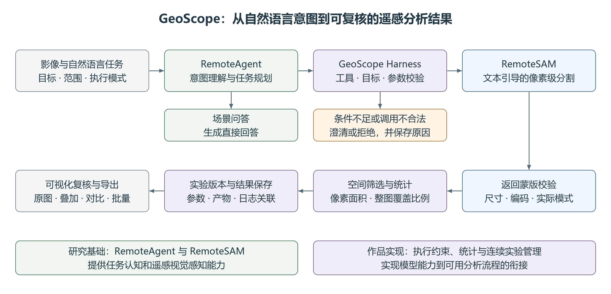
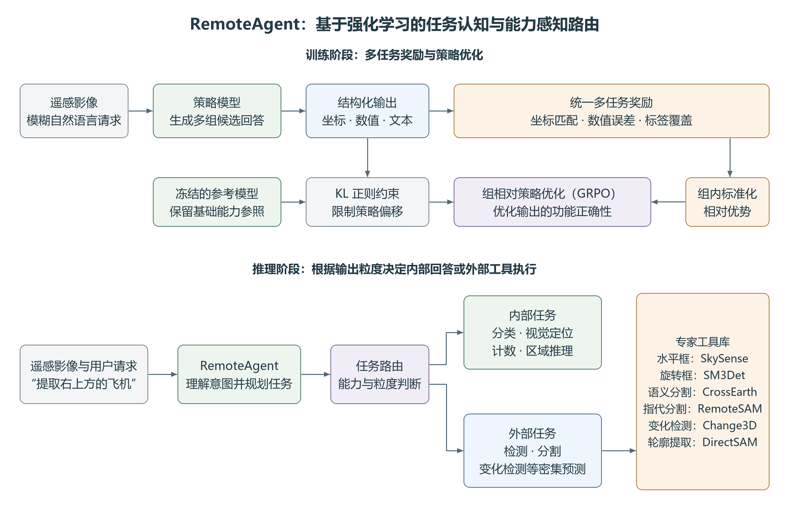
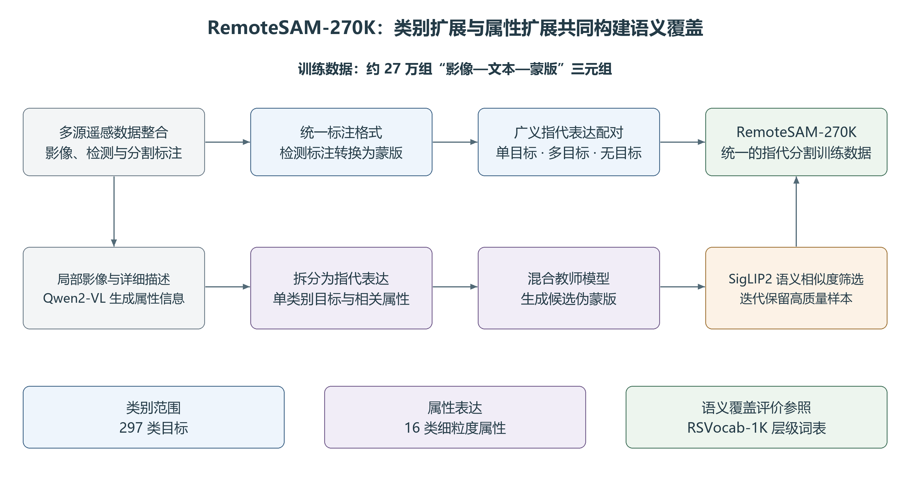
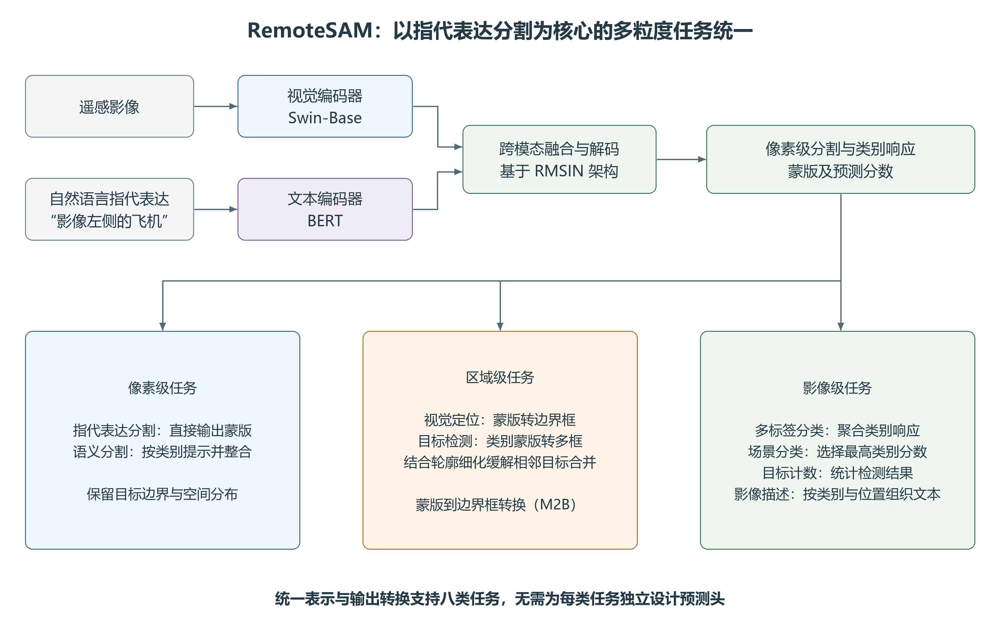

# 观域 GeoScope 自然语言驱动的遥感影像智能分析系统

## 技术说明书

**技术方向：** 遥感智能体与交互式影像分析  
**作品版本：** GeoScope v0.7  
**编写日期：** 2026 年 10 月 9 日

---

## 摘要

观域 GeoScope 是一套面向交互式遥感分析的智能体工作台，针对自然语言任务执行中存在的条件继承不一致、模型调用难以约束、统计结果与实验过程难以追溯等问题，构建任务规划、工具执行、空间计算与实验管理协同的分析流程。作品以 RemoteAgent 和 RemoteSAM 为认知与感知基础，重点实现三个方面的系统设计：以结构化任务状态约束目标、影像和空间条件的一致性；以真实蒙版为依据组织确定性统计及结果追溯；依据目标类别适配执行策略，并对批量任务实施单项失败隔离。用户可通过连续对话与图形操作调整任务，完成影像理解、目标区域提取、覆盖比例计算、结果复核及实验导出。在固定 40 条任务集上，任务指令与执行约束联合优化后的路由正确率由 75.0% 提升至 97.5%；在 10 幅飞机诊断影像上，提示词与切片配置改进后的平均 IoU 由 0.1585 提升至 0.3056。系统已完成包含分割、回答、澄清与拒绝等状态的完整流程验证，为遥感教学科研与多类别影像分析提供可扩展、可复核的实验工作台。

**关键词：** 遥感智能体；自然语言交互；多模态大模型；指代表达分割；空间统计；可追溯实验

---

## 目 录

1. 系统介绍
   - 1.1 选题背景与意义
   - 1.2 作品功能
   - 1.3 技术基础与作品定位
2. 系统开发方案
   - 2.1 总体架构与技术路线
   - 2.2 RemoteAgent：意图理解与能力感知路由
   - 2.3 RemoteSAM：文本引导的多粒度视觉感知
   - 2.4 自然语言任务理解与受约束执行
   - 2.5 遥感目标分割与执行模式适配
   - 2.6 空间范围筛选与确定性统计
   - 2.7 连续交互与实验版本管理
   - 2.8 批量处理与结果交付
3. 作品创新设计与技术贡献
   - 3.1 任务状态驱动的一致性执行机制
   - 3.2 感知与计算分离的结果追溯机制
   - 3.3 类别适配与批量失败隔离
   - 3.4 技术贡献与验证依据
4. 团队介绍与分工
5. 系统测试
   - 5.1 系统运行环境和配置
   - 5.2 系统测试说明
   - 5.3 测试结果与分析
   - 5.4 后续对照与消融验证方案
6. 应用前景
7. 参考文献

附录 A 实验记录索引

---

## 1 系统介绍

### 1.1 选题背景与意义

遥感影像能够以直观的空间形式记录地表目标及其分布，为自然资源调查、城市空间分析、交通设施观察、生态环境监测等工作提供基础资料。在教学与科研中，研究者往往需要围绕某一问题开展影像理解、目标提取、空间筛选、统计计算和结果整理。这些步骤之间联系紧密，却通常分散在不同软件、模型接口和分析脚本中。以指定区域的目标提取与覆盖比例计算为例，其处理过程涉及输入准备、模型选择、参数设置、结果检查和数据导出等多个环节，对操作衔接与结果管理提出了要求。

视觉语言模型的发展为自然语言交互提供了新的技术条件。用户可以直接描述分析意图，由模型理解影像内容并规划处理动作。在将视觉语言模型用于定量分析时，工具选择、参数合法性、像素输出一致性和多轮任务状态维护仍是重要问题。为保障分析过程的可靠性，需要建立连接模型决策与实际执行的校验机制，并使结果与其输入条件保持关联。

基于上述问题，本团队开发观域 GeoScope 自然语言驱动的遥感影像智能分析系统。系统围绕任务状态组织认知模型、感知服务、空间计算和实验管理，通过团队实现的 GeoScope Harness 约束执行并保存结果依据。RemoteAgent 承担任务理解与规划，RemoteSAM 是当前接入并开展评测的分割专家；范围筛选、面积统计、候选区域分析和结果管理由独立的计算与管理模块完成。

本作品的设计着眼于遥感分析任务中共有的处理环节，将“理解需求—调用工具—获取蒙版—空间筛选—统计展示—保存结果”组织为统一流程。作品以建筑和飞机为代表性目标开展功能与性能验证，通过统一任务协议和工具接口为其他目标类别与专业模型的接入提供扩展基础。作品的意义在于降低任务组织与工具操作的门槛，使研究者能够把更多精力用于问题提出、结果判断和实验分析。

### 1.2 作品功能

本作品将影像、对话、分割结果和实验记录集成于同一 Web 工作台。用户选择样例或上传影像后，可通过自然语言描述任务，也可通过框选研究区和快捷操作进一步明确分析条件。

**（1）影像理解与分析任务发起。** 用户可以询问影像主要场景，或直接提出目标提取和统计要求。系统区分影像场景问答与像素级分析任务：前者由 RemoteAgent 回答，后者进入专业工具执行流程。对于目标不明确、条件缺失或超出当前范围的请求，系统返回条件补充要求或执行限制说明。

**（2）目标提取与空间范围筛选。** 系统调用 RemoteSAM 获取目标蒙版，支持全图、左半幅、右半幅、上半幅、下半幅和矩形研究区等范围。用户可以比较不同范围内的目标分布，并查看目标像素面积及其占整幅影像的比例。

**（3）连续对话与条件修改。** 用户在获得结果后，可以继续输入“改成左侧的”“提取全图”或更换执行模式。系统基于所选结果继承目标、影像与适用的空间条件，保存新版本；用户可恢复历史版本，并基于既有条件继续开展分析。

**（4）可视化与人工复核。** 工作台提供原图、蒙版、叠加和对比视图，支持透明度调整及画布缩放。系统检查输出尺寸、范围和文件完整性，用户再结合影像判断目标语义与边界是否符合预期，并记录确认或调整意见。

**（5）多图批量处理。** 用户可选择 2—5 幅已保存影像，按统一任务依次执行分析。每幅影像独立记录任务状态、统计结果与失败原因，单项失败不会直接中止其余影像的处理。

**（6）实验保存与成果导出。** 系统保存输入影像、目标蒙版、叠加图、统计结果、运行日志和版本关系，支持实验包、实验报告及批次统计导出，为实验复核、成果交流与后续分析提供数据依据。

### 1.3 技术基础与作品定位

RemoteAgent 与 RemoteSAM 分别从任务认知和视觉感知两个层次，为本作品提供研究基础。RemoteAgent 关注模糊自然语言意图与专业遥感任务之间的映射，采用能力感知的任务路由机制，将适合多模态大模型直接完成的理解任务与需要专家工具处理的密集预测任务区分开来 [1]。RemoteSAM 关注遥感视觉任务的统一表示，以文本引导的像素级分割为基础，通过输出转换衔接像素级、区域级和影像级任务 [2]。

两项研究具有互补性：前者确定分析目标和执行路径，后者提供可用于空间分析的像素预测。GeoScope 在这一基础上实现面向用户的工作台，并通过执行校验、确定性统计和实验管理衔接模型输出与实际操作需求。

| 技术层次 | 研究或实现内容 | 在 GeoScope 中的作用 |
|---|---|---|
| 认知模型基础 | RemoteAgent、VagueEO 数据集、GRPO 强化学习与能力感知路由 | 提供任务理解、场景回答和工具规划的模型基础 |
| 感知模型基础 | RemoteSAM、RemoteSAM-270K 数据集、以指代分割为核心的任务统一 | 提供文本条件下的目标蒙版及感知服务基础 |
| 作品系统实现 | GeoScope Harness、交互工作台、空间统计、版本管理与批量处理 | 将模型能力组织为可执行、可检查、可保存的分析流程 |

作品的一般性主要体现在任务表示、工具接口与分析流程的复用：不同目标可沿用同一套条件表达、蒙版处理、统计与导出机制。当前版本以场景问答和目标分割分析作为主要应用入口，并以建筑、飞机进行代表性验证；多粒度任务统一与专家工具协同机制为后续扩展提供技术基础。

## 2 系统开发方案

### 2.1 总体架构与技术路线

系统采用“交互工作台—任务规划—受约束执行—专业感知—确定性计算—实验管理”的分层结构。各部分围绕同一个任务对象协作，形成从分析意图到实验产物的完整流程。

| 系统组成 | 主要职责 | 实现方式 |
|---|---|---|
| Web 工作台 | 影像输入、任务描述、结果展示与复核 | HTML、CSS、JavaScript 与画布交互 |
| RemoteAgent | 理解影像与指令，生成回答或工具调用 | 视觉语言模型推理服务 [1] |
| GeoScope Harness | 校验请求、约束工具、管理状态和组织执行 | Python 服务及任务协议 |
| RemoteSAM | 根据目标类别或文本提示生成分割蒙版 | 遥感感知模型推理服务 [2] |
| 几何与统计模块 | 范围裁切、像素面积、比例及候选区域统计 | 基于实际二值蒙版的确定性计算 |
| 实验管理模块 | 版本保存、资产关联、历史恢复与结果导出 | 文件存储、JSON 记录与实验包 |



图 2-1 GeoScope 系统分析流程

系统采用 RemoteAgent [1] 和 RemoteSAM [2] 作为认知与感知基础，团队负责设计并实现任务协议、执行控制、结果校验和交互管理模块。各模块通过结构化输入输出协作，将模型推理与遥感实验管理衔接起来。

#### 2.1.1 分层工具体系与当前实现

系统按输出类型组织工具能力：感知工具输出目标预测，空间计算模块处理蒙版与区域约束，实验管理模块保存参数和产物。RemoteSAM 负责当前分割专家服务，几何计算和实验管理保持独立；模块间通过任务字段和结构化结果衔接。

| 能力层 | 当前实现 | 输入与输出 | 接入与验证状态 |
|---|---|---|---|
| 认知层 | RemoteAgent 场景回答与任务规划 | 影像和请求 → 回答或结构化工具动作 | 已接入；有固定任务集决策记录 |
| 感知工具层 | 语义分割、指代表达分割接口 | 影像和类别／描述 → 目标蒙版 | 两个接口均已接入 RemoteSAM；建筑与飞机有定量评测 |
| 空间计算层 | 半幅筛选、矩形研究区、像素面积与覆盖比例 | 蒙版和范围 → 筛选蒙版与统计量 | 已实现；有范围约束及数值复算记录 |
| 区域分析层 | 八邻域连通区域分析 | 二值蒙版 → 候选区域、面积及边界框 | 已实现；输出定义为候选区域而非实例级准确计数 |
| 实验管理层 | 版本保存、蒙版复用、批量调度及导出 | 任务、产物和日志 → 可追溯实验记录 | 已实现；已验证批量单项失败隔离 |
| 扩展感知层 | 独立检测器、变化检测或类别专用分割模型 | 通过对应任务协议适配结果 | 当前工作台尚未完成这些专家模型的接入验证 |

计算与管理模块由 Harness 确定性调用，当前没有将它们全部作为可由大模型自由选择的 MCP 工具暴露。已开放给智能体的分割工具接口为 `semantic_segmentation` 和 `referring_expression_segmentation`，这两个接口对应同一专家服务中的不同任务路径。

类别协议已定义建筑、飞机、道路、水体、植被和船舶六类目标。类别可被协议识别与其分割质量达到应用要求属于不同评价层次；当前量化精度结论限于已有建筑与飞机测试集。

#### 2.1.2 新工具接入与结果约束

新增感知能力需要完成任务定义、服务适配、结果校验和独立测试。对于输出与原图对齐的二值蒙版的工具，可继续使用现有范围筛选、统计与版本管理流程；检测框、旋转框和多时相变化图等输出类型，则需要新增相应的数据结构与评价规则。RemoteAgent 的专家工具协同机制为扩展提供技术参考 [1]，工作台实际开放范围由已部署接口与验收结果共同确定。

### 2.2 RemoteAgent：意图理解与能力感知路由

#### 2.2.1 模糊意图到专业任务的映射

遥感分析需求通常以自然语言表达，其描述形式与模型接口要求并不相同。例如，“找出右侧的飞机区域”同时包含类别、空间关系和输出粒度要求，而服务端需要明确的工具名称、影像输入与参数。RemoteAgent 将这一问题表述为模糊人类意图与多粒度地球观测任务之间的衔接，并提出基于多模态大模型的智能体框架 [1]。

给定遥感影像 $I$ 与用户请求 $Q$，该方法将任务分为内部任务集合 $\mathcal{T}_{\mathrm{in}}$ 和外部任务集合 $\mathcal{T}_{\mathrm{ex}}$。前者包括分类、视觉定位、计数和区域推理等适合模型直接处理的理解与稀疏输出任务；后者包括检测、分割和变化检测等需要精细空间输出的任务。其混合动作空间可表示为：

$$
O=\begin{cases}
R_{\mathrm{ans}}, & (I,Q)\in\mathcal{T}_{\mathrm{in}},\\
T_{\mathrm{call}}(e_k,p), & (I,Q)\in\mathcal{T}_{\mathrm{ex}},
\end{cases}
\tag{1}
$$

其中，$R_{\mathrm{ans}}$ 为直接回答，$e_k$ 为选定的专家工具，$p$ 为工具参数。该机制根据任务所需的能力与输出粒度选择处理路径，使语言理解与专业视觉计算形成分工。



图 2-2 RemoteAgent 训练与推理机制 [1]

#### 2.2.2 VagueEO 数据与 GRPO 强化学习

RemoteAgent 采用 VagueEO 数据集开展任务适应训练，将模糊自然语言请求与遥感基准中的结构化标注配对，以支持贴近实际分析需求的意图理解。其训练数据包括场景分类、多标签分类、视觉定位、目标计数和地理空间区域推理五类任务，每类构建 1,000 组请求与标注；测试覆盖十类地球观测任务，用于考察内部能力和对未见外部任务的路由能力 [1]。

RemoteAgent 以 Qwen2.5-VL-7B-Instruct 为基础，采用组相对策略优化（Group Relative Policy Optimization，GRPO）进行强化学习。对于同一输入，策略模型采样多组输出，并按功能正确性计算奖励。设第 $i$ 个输出的奖励为 $r_i$，同组奖励均值和标准差分别为 $\mu_r$、$\sigma_r$，则其相对优势为：

$$
A_i=\frac{r_i-\mu_r}{\sigma_r}.
\tag{2}
$$

训练时，将序列级优势用于相应输出的各个生成位置，并采用带截断的策略优化目标及 KL 正则项。前者限制单次策略更新幅度，后者约束当前模型相对冻结参考模型的偏移，以兼顾任务适应与基础推理能力保持。

统一奖励按照答案格式选择评价分支，不依赖额外的任务标签。其主要机制如下。

| 输出类型 | 奖励计算依据 | 对应能力 |
|---|---|---|
| 坐标集合 | 基于候选框与真值框的 IoU 进行匈牙利匹配，并汇总匹配质量 | 视觉定位与区域推理 |
| 数值 | 根据计数相对误差评分，对过大误差进行抑制 | 目标计数 |
| 标签文本 | 规范化为标签集合，按参考标签覆盖情况评分 | 场景分类与多标签分类 |

缺失或不合法的答案字段不获得奖励。上述方法使训练目标直接关联输出的可验证功能，而不仅依赖与参考语句的表面一致性 [1]。GeoScope 使用这一研究成果形成的推理模型，在应用层进一步实现任务指令适配、调用约束与错误分类。

#### 2.2.3 专家工具协同与作品接入

RemoteAgent 通过模型上下文协议（Model Context Protocol，MCP）连接专家工具，按任务调用检测、分割或变化分析服务。例如，指代表达分割由 RemoteSAM 执行。智能体负责选择工具并生成参数，专家模型返回检测框或蒙版，从而分离意图理解与密集预测 [1]。

GeoScope 采用这一认知与感知分工，将当前开放任务收敛到经过验证的服务接口，由后端适配器组织结构化工具请求与服务通信。对于场景问答，系统展示允许的直接回答；对于目标区域提取，系统调用 RemoteSAM 并计算空间统计量。系统采用明确的能力配置与工具白名单组织服务，当前可执行任务由已接入接口及其验证结果确定。

### 2.3 RemoteSAM：文本引导的多粒度视觉感知

#### 2.3.1 以像素级表示统一视觉任务

RemoteSAM 采用以指代表达分割（Referring Expression Segmentation，RES）为核心的任务统一方法。该方法将“影像与自然语言描述”映射为像素级目标区域，再根据任务需要转换为区域级或影像级结果，避免为每项任务单独设置预测头 [2]。

给定影像 $I$ 和文本描述 $T$，其基础预测可表示为：

$$
\widehat{M}=Q_{\mathrm{fuse}}\bigl(F_v(I),F_t(T)\bigr),
\tag{3}
$$

其中，$F_v$、$F_t$ 分别为视觉与文本编码器，$Q_{\mathrm{fuse}}$ 为跨模态融合与解码模块，$\widehat{M}$ 为预测蒙版。

RemoteSAM 基于 RMSIN 架构，使用 Swin-Base 视觉编码器和 BERT 文本编码器，模型参数规模约为 1.8 亿。其文本编码与视觉融合承担目标指代解析，输出保持像素空间结构，可直接为分割及后续空间计算提供依据 [2]。

#### 2.3.2 RemoteSAM-270K 与语义覆盖扩展

模型面向不同类别和描述形式的适应能力，与训练数据的类别范围及属性表达有关。RemoteSAM-270K 通过多源数据整合、类别扩展与属性扩展，形成约 27 万组影像、文本和蒙版三元组，覆盖 297 类目标、16 类细粒度属性，平均每个样本包含 3.17 个属性 [2]。

类别扩展包括三种配对：单目标描述与对应蒙版、多目标描述与同类实例的联合蒙版，以及不存在目标的描述与全零蒙版。无目标样本使模型学习在描述对象不存在时返回空结果，而非为所有请求生成目标区域。

属性扩展利用 Qwen2-VL-72B-Instruct 生成局部影像描述，并将其解析为包含类别和属性的指代表达；混合教师模型生成伪蒙版后，再以 SigLIP2 评估区域与文本的语义相似度，筛除低质量样本。RSVocab-1K 层级语义词表用于评价数据集的类别覆盖与属性表达 [2]。



图 2-3 RemoteSAM-270K 数据构建与语义覆盖 [2]

#### 2.3.3 多粒度输出转换机制

RemoteSAM 将分割输出作为不同视觉任务共享的基础表示。图 2-4 展示其从像素级预测向其他输出形式的转换关系。



图 2-4 RemoteSAM 多粒度任务统一机制 [2]

**像素级任务。** 指代表达分割直接使用模型输出。语义分割则针对类别集合逐类构造描述，对类别蒙版进行置信度处理和结果整合，形成语义预测。两者保留目标的空间分布与边界信息。

**区域级任务。** 视觉定位可通过蒙版到边界框转换（Mask-to-Bounding-Box，M2B）获取目标坐标。若前景像素坐标集合为 $\Omega$，则边界框为：

$$
B=\left[(\min_{(x,y)\in\Omega}x,\min_{(x,y)\in\Omega}y),
(\max_{(x,y)\in\Omega}x,\max_{(x,y)\in\Omega}y)\right].
\tag{4}
$$

目标检测在类别蒙版基础上获得多个候选区域，RemoteSAM 结合 EPOC 轮廓细化缓解相邻目标合并问题，再转换为边界框 [2]。

**影像级任务。** 多标签分类通过聚合像素级类别响应判断类别是否存在；场景分类选择最高类别分数；计数基于检测结果汇总；影像描述则结合类别、数量与位置，以规则方式组织文本 [2]。这些机制体现了同一像素表示向不同输出形式转换的可扩展性。

GeoScope 当前主要接入上述像素级感知能力，并据实际蒙版开展空间筛选、覆盖比例计算和可视化复核。系统的候选区域统计采用连通区域分析，其含义与论文完整检测流程下的实例计数分别定义。RemoteSAM 的多粒度任务机制为后续能力扩展提供统一表示，工作台通过经过验证的任务接口提供相应功能。

### 2.4 自然语言任务理解与受约束执行

#### 2.4.1 任务表示与上下文组织

以“提取影像右侧的建筑并计算面积占比”为例，系统需要解析目标类别“建筑”、空间条件“右侧”、处理动作“提取”与输出要求“面积占比”。对于后续请求“改成左侧的”，系统还需要继承上一轮的影像和类别，仅修改空间条件。

为描述这一过程，可将第 $t$ 轮分析任务抽象为：

$$
T_t=(I,c_t,s_t,R_t,q_t,v_{t-1}),
\tag{5}
$$

其中，$I$ 为当前影像，$c_t$ 为目标类别，$s_t$ 为全图或半幅空间范围，$R_t$ 为可选矩形研究区，$q_t$ 为执行模式，$v_{t-1}$ 为本轮引用的结果版本。该状态表示将任务条件与结果版本显式关联，为多轮条件继承和历史恢复提供统一依据。

系统优先采用用户本轮明确给出的条件；对于省略字段，按适用规则继承所选版本的上下文。条件之间出现冲突时，系统停止执行并请求修改，保证实际执行条件与用户意图一致。

#### 2.4.2 任务分流与工具约束

RemoteAgent 根据影像和任务进行规划，工作台将请求组织为场景问答、目标提取、条件澄清等路径。当前分割工具接口包括语义分割与指代表达分割。同一次规划只允许执行一个通过校验的分割动作，批量处理由 Harness 逐项调度。

Harness 在执行前检查以下条件：

1. 工具名称属于当前允许调用的集合；
2. 参数字段、数据类型和目标类别符合约定；
3. 工具使用的影像与当前会话一致；
4. 模型提出的类别与用户明确指定或继承的类别一致；
5. 研究区坐标合法，执行模式不存在冲突。

目标一致性检查同时约束显式类别与继承类别。例如，飞机提取请求对应的工具动作必须保持飞机类别。对于不可解析输出、多工具冲突和影像路径不匹配等情况，系统终止该次调用并记录错误类型，防止异常动作进入感知执行环节。

#### 2.4.3 工具反馈与完成状态判断

工具响应后，系统继续检查业务状态、蒙版可解码性、尺寸和二值编码。有效分割结果须同时满足接口响应与产物校验条件。

经过检查的像素面积、比例、服务信息与产物引用会组成结构化摘要，回填任务解释环节。蒙版以文件形式保存，模型接收结构化结果摘要，以控制上下文规模。界面中的定量结果均由蒙版计算模块提供，确保展示数据与实验产物一致。

任务执行流程如算法 1 所示。

```text
算法 1  自然语言遥感分析任务执行流程
输入：影像 I，用户请求 u，所选版本上下文 C
输出：回答、澄清信息、失败原因或新的实验结果 V

整理请求中的目标、范围、研究区和执行模式
若存在确定性的缺失条件或冲突：返回澄清或拒绝原因
调用 RemoteAgent，获得任务决策
若为允许的场景回答：展示回答
否则：
    检查工具白名单、参数、目标和影像绑定
    未通过校验则结束，保留已有结果
    根据目标能力确定实际感知路径与执行模式
    若满足完整蒙版复用条件：读取已有蒙版
    否则：调用 RemoteSAM 并检查返回值
    对蒙版执行空间筛选与确定性统计
    保存结果文件、运行记录和版本关系
    回填实际执行摘要，展示结果并等待人工复核
```

### 2.5 遥感目标分割与执行模式适配

#### 2.5.1 专业感知工具接入

RemoteSAM 根据当前任务的目标类别或文本提示生成像素级区域。GeoScope 将模型的规划表达转换为服务请求，并对常见类别进行规范化，减少同一类别不同表达造成的接口不一致。例如，飞机提取采用经对比实验确定的 `all planes` 作为标准提示表达。

对于建筑任务，系统将感知调用统一到语义分割路径，减少相同任务因接口选择变化产生的输出差异。该类别适配策略在执行层完成，并与服务请求一同记录，便于复查实际调用方法。

系统将具体感知模型与上层任务组织分离。后续接入建筑、水体或道路等专用模型时，可围绕同一任务协议适配输入输出，继续使用已有的范围筛选、统计、复核和导出流程。模型接入后的评价采用相应类别的独立测试数据与任务指标。

#### 2.5.2 整图推理与飞机细节增强

当前执行方式包含自动选择、稳定整图和针对飞机任务的细节增强。稳定整图方式以整幅影像执行感知，减少切片处理带来的额外计算；飞机细节增强结合切片推理、重叠区域概率融合和阈值处理，改善固定诊断集上的分割表现。

团队在固定飞机诊断集上比较了提示词调整、影像放大和切片等策略。根据平均 IoU 选取的配置为：切片大小 $1024\times1024$、相邻切片重叠 256 像素、概率阈值 0.88。重叠区域的预测结果先在原图坐标系下融合，再生成与输入影像对齐的二值蒙版。

系统综合目标类别与执行策略确定可用模式，按任务上下文更新界面选项。服务记录同时保存请求模式、实际执行模式及适配原因，以保证任务配置、服务执行和结果展示的一致性。细节增强的性能与耗时比较见第 5.3.4 节。

#### 2.5.3 输出一致性检查

系统要求返回蒙版与输入影像具有相同宽高，并使用合法的二值编码。概率图或多类标签图须经符合任务定义的转换后才能用于二值统计。对于服务未确认的执行模式，系统记录未确认状态或拒绝该次响应，保证结果元数据准确反映实际执行情况。

### 2.6 空间范围筛选与确定性统计

#### 2.6.1 研究区与像素坐标

设影像大小为 $W\times H$，像素坐标原点位于左上角，横轴向右、纵轴向下。右半幅对应 $x\geq\lfloor W/2\rfloor$，左半幅对应 $x<\lfloor W/2\rfloor$。所有方向条件均采用影像坐标定义。

矩形研究区表示为半开区间：

$$
R=[x_1,x_2)\times[y_1,y_2),
\quad 0\leq x_1<x_2\leq W,
\quad 0\leq y_1<y_2\leq H.
\tag{6}
$$

研究区同时保存绘制或导入来源、原始影像尺寸，用于检查坐标是否属于当前影像，并在恢复历史版本时重现原有条件。

#### 2.6.2 范围约束与面积计算

将模型输出转换为二值指示函数 $M(x,y)\in\{0,1\}$，用 $S(x,y)$ 表示本次有效空间范围，则筛选后的目标蒙版为：

$$
M_S(x,y)=M(x,y)S(x,y).
\tag{7}
$$

目标像素面积及整图覆盖比例分别为：

$$
A=\sum_{y=0}^{H-1}\sum_{x=0}^{W-1}M_S(x,y),
\qquad P=\frac{A}{WH}\times100\%.
\tag{8}
$$

覆盖比例统一以整幅影像像素数为分母，使不同研究范围的统计结果具有一致口径。跨越范围边界的目标按像素裁切，保留位于有效范围内的部分。

本系统采用像素面积作为定量输出。地理面积测量需结合空间参考、地面分辨率及投影条件，作为后续空间分析模块的扩展内容。

#### 2.6.3 候选区域与人工复核

系统对最终蒙版进行八邻域连通区域分析，保存候选区域数量、面积和边界框等信息。多个实例相连可能形成同一个连通区域，一个实例被分割成碎片也可能形成多个区域，因此该统计量定义为蒙版候选区域数，与实例级目标数量分别表述。

可视化复核由原图、蒙版、叠加和对比视图共同完成。系统检查用于确认格式、范围和统计过程；用户确认用于记录结果是否满足当前分析需要，两者承担不同职责。

### 2.7 连续交互与实验版本管理

#### 2.7.1 条件继承与版本恢复

每次有效分析结果均保存对应影像、目标、范围、研究区、执行模式和产物路径。后续任务通过所选版本引用结构化上下文。例如，在“右侧建筑”结果上选择“改成左侧”，系统保留建筑类别、修改空间范围并生成新版本。恢复早期版本后，也可以从该版本继续开展实验。

快捷操作和模式选项随目标类别及版本状态同步更新，保持交互内容与任务上下文一致。执行失败时，画布保留上一次有效结果，并给出本次失败原因。

#### 2.7.2 完整蒙版复用

系统独立保存全图目标蒙版与范围筛选后的蒙版。若后续只改变空间条件，且影像、类别、服务请求、模型版本和文件完整性等复用条件均满足，可以直接从全图蒙版生成派生结果，减少重复推理。

当模型版本未知、文件校验失败、目标或感知参数变化，或用户明确要求重新提取时，系统不直接沿用旧蒙版。复用来源写入运行记录，使派生结果仍能追溯到原始感知过程。

### 2.8 批量处理与结果交付

#### 2.8.1 批量执行与失败隔离

批量实验接收 2—5 个不同的已有影像会话和一条统一任务，由 Harness 串行调度。每幅影像独立完成规划、执行与保存，由执行框架统一维护批次状态。

批量目标须明确，或所有影像具备一致且可继承的目标上下文。共用研究区时，需检查各幅影像尺寸与坐标合法性。若某幅影像处理失败，系统记录该项原因，继续处理后续影像，并在批次结果中分别展示成功与失败项。

#### 2.8.2 实验资产与报告

单次实验保存原图、蒙版、叠加图、统计数据和运行日志；报告由已保存字段生成，包含任务条件、像素统计、候选区域、执行模式与复核状态。主要资产组织关系如下：

```text
影像会话
├─ 原始影像与来源
├─ 结果版本 V1
│  ├─ 用户任务与执行条件
│  ├─ 完整蒙版与范围内蒙版
│  ├─ 叠加图与统计数据
│  └─ 运行日志与复核记录
├─ 结果版本 V2
└─ 后续版本

批量实验
├─ 逐图会话与结果引用
├─ 单项状态与失败原因
└─ 汇总数据与导出表格
```

图 2-5 影像会话与批次结果的关联结构

实验包为结果核对与跨设备复现提供输入输出依据。复现实验时需同步配置相应模型权重、服务版本和运行参数。

## 3 作品创新设计与技术贡献

本团队围绕遥感连续分析中的任务一致性、结果可追溯性与异常处理问题，设计并实现受约束任务执行、蒙版驱动统计和可恢复实验管理机制，将认知模型、专业感知与空间计算组织为完整的交互式分析流程。

### 3.1 任务状态驱动的一致性执行机制

**问题。** 连续对话中的省略表达容易使目标、空间范围或执行模式发生漂移。例如，用户在“右侧建筑”的结果上要求“改成左侧”，需要继承建筑类别；只改变模式时，也不应改变目标。即使模型生成了形式正确的工具请求，错误类别或错误影像仍会导致任务偏离。

**设计。** 系统将影像、目标、范围、研究区、执行模式与所选版本共同保存为结构化任务状态。本轮明确条件优先于历史条件，省略字段按规则继承，冲突条件触发澄清。执行前同时核对用户目标、模型规划目标与当前影像绑定，使上下文维护和工具校验使用同一组任务依据。

**作用与验证。** 该机制将一致性要求落实到实际调用前，而非仅依赖提示词约束。已有完整流程记录覆盖目标不一致、研究区越界、模式冲突等情况，并验证相应拒绝或澄清状态。固定 40 条任务的对照结果反映了任务指令与执行约束联合优化后的整体路由改进。

### 3.2 感知与计算分离的结果追溯机制

**问题。** 分割结果、对话描述与统计数值若由不同环节独立产生，可能出现数值缺乏像素依据、条件变化后沿用旧结果或实验无法复核等问题。

**设计。** 系统以通过尺寸和编码校验的蒙版作为统计输入，独立执行范围裁切、像素计数与比例计算，并将其与任务参数、模型版本和运行日志共同保存。完整蒙版与范围内蒙版分别管理；只有影像、类别、感知请求及模型版本等复用条件一致且文件校验通过时，才复用已有完整蒙版生成空间条件不同的结果。

**作用与验证。** 每个展示数值均可回溯到相应蒙版，条件变化也具有明确的派生关系。已有联调记录对 13 个有效蒙版开展面积与结果 JSON 一致性核对，并验证异常任务不生成有效蒙版。系统将统计一致性检查与语义质量评价分别组织，结合真值对比和人工复核评价感知结果。

### 3.3 类别适配与批量失败隔离

**问题。** 同一推理策略在不同类别上不一定具有相同效果。固定阈值切片策略在飞机诊断集上有效，不能据此推定其对密集建筑同样有效；批量实验中，单幅影像的非法条件也不应使全部实验中断。

**设计。** 系统将模型规划与实际感知请求分别记录。建筑任务统一采用已接入的语义分割路径；飞机任务采用经过诊断实验比较的提示表达，并提供整图与细节增强方式。未完成增强策略验证的类别采用稳定整图路径，同时保存用户请求模式、实际执行模式与适配原因。批次按影像独立执行、保存状态和记录失败原因。

**作用与验证。** 类别策略将实验中观察到的适用条件转化为明确执行规则，避免仅凭“高精度”名称对所有目标采用同一配置。飞机提示词与切片配置已有定量对比；建筑路由策略目前具有实现和样例依据，其跨场景收益仍需独立验证。批量异常测试中，不合法研究区项被单独标记为失败，其前后合法项均完成处理。

### 3.4 技术贡献与验证依据

表 3-1 作品技术贡献及验证范围

| 团队实现的机制 | 已完成验证 | 后续评价重点 |
|---|---|---|
| 任务状态继承与调用一致性校验 | 固定任务集路由记录、目标与参数异常处理记录 | 相对无上下文约束方案的独立贡献 |
| 蒙版驱动统计与结果关联 | 保存蒙版与 JSON 的面积复算一致性 | 对人工复核时间和差错率的影响 |
| 完整蒙版有条件复用 | 图像、参数、模型版本及文件校验的实现 | 相对每轮重新推理的耗时与资源节省 |
| 类别感知的推理策略适配 | 飞机提示词、放大与切片对比；建筑样例问题分析 | 独立场景上的类别适配收益 |
| 批量失败隔离与版本保留 | 合法项继续完成、失败项独立记录的联调结果 | 不同故障比例下的任务完成率和恢复代价 |

上述设计使模型输出进入具有条件约束、数值依据和状态记录的分析流程。作品的可扩展性建立在任务与产物协议上，后续专家模型可在相应输出类型适配完成后复用已有计算和管理能力。

## 4 团队介绍与分工

### 4.1 团队成员介绍

团队由三名成员组成，围绕系统集成、智能体与执行框架、遥感感知与评测三个方向开展协同研发。各成员分别负责相应模块的设计、实现与测试，并共同完成系统联调和结果核验。

- **队长：** 负责总体需求、工作台交互、系统整合、功能验收与作品交付。
- **队员 A：** 负责 RemoteAgent 接入、任务规划优化、Harness 校验及决策层评测。
- **队员 B：** 负责 RemoteSAM 部署、分割接口、推理策略实验与感知层评测。

### 4.2 团队分工

| 成员 | 主要承担的任务 | 主要成果 |
|---|---|---|
| 队长 | 总体设计、前端交互、系统集成、上下文一致性检查、完整链路测试与结果核对 | 交互工作台、系统集成方案与功能验证结果 |
| 队员 A | 模型调用协议、工具白名单、参数与目标校验、ROI 与批量任务控制、异常分析 | Agent 与 Harness 模块、测试任务集及决策层评测结果 |
| 队员 B | 感知服务部署、数据清单与评价口径、提示词及切片实验、分割结果复算 | RemoteSAM 服务、逐图指标、实验汇总与代表性案例 |

团队采用模块化开发与集成测试相结合的协作方式，通过统一输入输出规范、固定测试任务和逐项实验记录检查模块一致性，形成从算法适配到工作台应用的协同开发流程。

## 5 系统测试

### 5.1 系统运行环境和配置

系统采用浏览器工作台与远端模型服务分离的部署方式。用户电脑承担界面和实验组织，模型推理运行在具备相应 GPU 与权重环境的设备上。

| 层次 | 运行配置与部署方式 |
|---|---|
| 交互终端 | Windows 环境及现代浏览器 |
| 工作台后端 | Python 服务，Pillow 10.0 及以上版本 |
| 任务理解服务 | RemoteAgent，Qwen2.5-VL 架构；决策层评测采用 BF16 与 vLLM 0.15.1 |
| 遥感感知服务 | RemoteSAM；基线与飞机改进实验使用服务 1.1.0，后续模式及批量联调使用 1.2.0 |
| 感知计算环境 | 支持 CUDA 的 GPU，FP16 推理 |
| 服务通信 | 网络接口通信，支持 SSH 端口转发；模型端点通过环境配置管理 |
| 实验存储 | 本地会话目录、JSON/JSONL/CSV 记录及影像产物 |

实验分阶段开展。决策耗时、感知模型推理耗时和客户端总耗时分别记录，相关数值对应各次实验的服务版本与运行条件。不同阶段的耗时不作直接横向性能比较。

### 5.2 系统测试说明

系统测试分为任务决策、感知精度、完整流程和工程回归四个层次，分别评价任务理解、分割质量、流程正确性与实现稳定性。

#### 5.2.1 任务理解与路由测试

固定 40 条任务覆盖场景描述、目标提取、空间条件、连续修改、含糊请求及不适用任务。逐条保存模型决策与执行框架处理结果，统计任务路由正确率及失败类型。

设测试任务数为 $N$，符合预定路由的任务数为 $N_c$，则：

$$
\mathrm{RoutingAccuracy}=\frac{N_c}{N}.
\tag{9}
$$

该指标用于评价任务处理路径的选择正确性；像素级分割质量另采用 IoU 与 Dice 评价。

#### 5.2.2 分割精度测试

使用固定的 20 幅带真值影像开展感知层基线评测，其中建筑与飞机各 10 幅。对预测蒙版与真值蒙版计算 IoU 和 Dice：

$$
\mathrm{IoU}=\frac{TP}{TP+FP+FN},
\qquad
\mathrm{Dice}=\frac{2TP}{2TP+FP+FN}.
\tag{10}
$$

其中，$TP$ 为正确预测的目标像素，$FP$ 为误报像素，$FN$ 为漏检像素。实验同时记录逐图指标和类别均值，以反映总体表现与样本间差异。

在同一 10 幅飞机诊断影像上，进一步比较提示词、放大与切片策略。参数选择与策略比较使用同一诊断集，相关结果反映该数据集上的配置改进；跨场景泛化能力需通过独立测试集进一步评估。

#### 5.2.3 完整链路与异常测试

完整链路测试检查真实 RemoteAgent 规划、Harness 校验、RemoteSAM 推理、范围处理、统计及结果保存。测试用例分别预设分割执行、场景回答、条件澄清和请求拒绝等预期状态，以实际处理状态与预期状态的一致性作为流程验收依据。

异常用例包括工具输出无法解析、类别不一致、研究区缺失或越界、模式冲突、服务失败及批次单项失败。检查重点是：失败项不产生新的有效蒙版，已有版本能够保留，其他合法批次项可以继续。

#### 5.2.4 交互与工程回归

浏览器测试覆盖样例选择、任务执行、条件修改、版本恢复、视图对比、实验导出、故障反馈及移动端显示。工程测试覆盖接口与任务协议、蒙版格式、几何统计和存储关系。工程回归结果与模型精度评测分别统计。

### 5.3 测试结果与分析

#### 5.3.1 基础模型公开基准评测

系统评价包括基础模型的公开基准表现与本团队开展的系统实验。公开基准用于分析模型选型和方法特性，系统实验使用固定任务集及影像子集，评价实际部署条件下的任务路由、分割质量与流程可靠性。

**（1）智能体训练策略对比。** RemoteAgent 的公开基准测试比较了零样本、监督微调和强化学习三种训练策略 [1]。表 5-1 展示各策略在视觉定位、指代表达分割及意图识别任务上的表现。

表 5-1 RemoteAgent 训练策略性能对比

| 训练策略 | 视觉定位 Acc@0.5（%） | 指代表达分割 mIoU（%） | 意图识别准确率（%） | 时间（s） |
|---|---:|---:|---:|---:|
| 零样本 | 43.6 | 71.13 | 49 | 0.84 |
| 监督微调（SFT） | 54.2 | 52.19 | 67 | 0.71 |
| 强化学习（RL） | 68.9 | 71.64 | 95 | 0.83 |

在该训练策略对照中，RL 配置的意图识别准确率达到 95%，视觉定位 Acc@0.5 达到 68.9%，指代表达分割 mIoU 为 71.64%。该结果体现了任务适应与工具执行能力的协同，为系统采用强化学习优化的认知模型提供依据。表中时间对应公开基准的运行环境。

**（2）指代表达分割方法对比。** RRSISD 与 RISBench 公开基准测试涵盖多种文本引导分割方法 [2]。表 5-2 给出代表性方法的整体交并比（oIoU）和平均交并比（mIoU），用于比较基础感知模型的目标定位与边界恢复能力。

表 5-2 指代表达分割方法性能对比

| 方法 | RRSISD oIoU（%） | RRSISD mIoU（%） | RISBench oIoU（%） | RISBench mIoU（%） |
|---|---:|---:|---:|---:|
| LAVT | 77.19 | 61.04 | 74.15 | 61.93 |
| CARIS | 77.17 | 62.12 | 75.10 | 65.79 |
| CroBIM | 75.99 | 64.46 | 73.04 | 68.03 |
| RMSIN | 77.88 | 64.26 | 75.24 | 68.25 |
| RemoteSAM | 80.04 | 71.75 | 75.93 | 71.46 |

RemoteSAM 在 RRSISD 和 RISBench 上的 mIoU 分别达到 71.75% 和 71.46%。其语义分割公开基准结果还包括 iSAID 上 64.72% 的 mIoU，以及 Potsdam 上 91.80% 的 mF1 [2]。这些结果支持其作为文本引导分割专家的模型选型。以下系统实验进一步评价该模型在本作品数据与部署条件下的表现。

本团队的任务、逐图预测和流程验证记录见附录 A。

#### 5.3.2 RemoteAgent 任务路由改进

本团队在固定 40 条任务集上，对任务指令与执行约束优化前后的决策结果进行比较，结果见表 5-3。

表 5-3 任务路由优化前后对比

| 指标 | 改进前 | 改进后 |
|---|---:|---:|
| 路由正确任务数 | 30/40 | 39/40 |
| 路由正确率 | 75.0% | 97.5% |
| 平均决策耗时 | 2524.8 ms | 1015.6 ms |

评测结果表明，任务路由正确率由 75.0% 提高至 97.5%，增加 22.5 个百分点（实验记录 A-1）。优化后，39 条任务进入预期路径，1 条任务因模型输出无法解析而未通过校验。平均决策耗时在本次对照记录中由 2524.8 ms 降至 1015.6 ms。该结果反映固定任务集上的任务指令与执行约束联合改进。对照采用前后版本的配对任务记录，耗时对应各次评测的运行条件。


**调用校验审计。** 本团队按 Harness 处理类型统计逐任务运行记录，考察工具异常、参数约束和条件澄清的执行情况，结果见表 5-4。

表 5-4 固定任务集中的调用校验与澄清记录

| 处理类型 | 优化前记录（条） | 优化后记录（条） | 执行框架的实际处理 |
|---|---:|---:|---|
| 工具不在允许集合 | 6 | 0 | 拒绝调用并记录工具错误 |
| 输出无法解析 | 3 | 1 | 终止该次规划，不生成新分割结果 |
| 参数或任务条件不符合约定 | 4 | 3 | 拒绝执行或要求调整条件 |
| 需要像素输出但仅返回文字 | 1 | 1 | 不将文字回答作为分割完成 |
| 确定性条件澄清 | 2 | 2 | 在模型调用前要求补充条件 |
| 合计 | 16 | 7 | 按对应状态结束该次请求 |

该任务集同时包含有效分析请求及预设的拒绝、澄清用例。评价以处理状态是否符合任务预期为准，表中计数反映各类控制路径的触发情况。该项实验采用运行日志审计方式，原始记录见附录 A-1。

#### 5.3.3 RemoteSAM 基线分割结果

表 5-5 建筑与飞机分割基线结果

| 评测范围 | 影像数 | 接口成功数 | 平均 IoU | 平均 Dice |
|---|---:|---:|---:|---:|
| 建筑 | 10 | 10 | 0.3522 | 0.5115 |
| 飞机 | 10 | 10 | 0.1585 | 0.2281 |
| 全部 | 20 | 20 | 0.2554 | 0.3698 |

20 幅影像均完成感知服务调用，建筑与飞机的平均 IoU 分别为 0.3522 和 0.1585（实验记录 A-2）。飞机类别的误报与漏检较为明显，因此后续实验重点比较提示词和推理策略对飞机分割质量的影响。

#### 5.3.4 飞机分割策略比较

表 5-6 固定飞机诊断集上的分割策略对比

| 策略 | 提示词与主要配置 | 平均 IoU | 平均 Dice |
|---|---|---:|---:|
| 原始提示词整图推理 | `all airplanes` | 0.1585 | 0.2281 |
| 调整提示词整图推理 | `all planes` | 0.2460 | 0.3292 |
| 放大 1.25 倍 | `all planes` | 0.2470 | 0.3300 |
| 重叠切片与阈值处理 | 1024 切片、256 重叠、阈值 0.88 | 0.3056 | 0.4133 |

在同一组 10 幅飞机诊断影像上，采用 `all planes` 后平均 IoU 提升至 0.2460，进一步放大影像的收益较小。重叠切片与阈值处理配置取得平均 IoU 0.3056、平均 Dice 0.4133（实验记录 A-3）。相较原始配置，平均 IoU 增加 0.1471，相对增幅约为 92.8%，增幅按改变量与基线 IoU 的比值计算。

切片方案的平均模型推理耗时约为 5658.79 ms，平均客户端总耗时约为 12388.66 ms，体现了分割质量与处理时间之间的权衡。系统据此为飞机任务保留整图与细节增强两种执行方式，并通过目标类别约束策略的使用范围。

表 5-7 列出该配置下不同 IoU 水平的代表性影像。

表 5-7 飞机分割代表性案例

| 案例 | 影像编号 | IoU | Dice |
|---|---|---:|---:|
| 较好案例 | ISAID_VAL_P1483 | 0.7508 | 0.8577 |
| 中等案例 | ISAID_VAL_P1122 | 0.1895 | 0.3187 |
| 较差案例 | ISAID_VAL_P1143 | 0.0548 | 0.1039 |

代表性案例的 IoU 存在较大差异，表明该策略对影像场景仍具有敏感性，复杂背景下的误报控制与目标边界恢复是进一步优化的重点。

#### 5.3.5 完整流程与批量测试结果

在 2026 年 9 月 30 日开展的 v0.7 完整流程测试中，20 条任务的处理状态均与预设状态一致，累计执行 14 次 RemoteAgent 调用（实验记录 A-4）。测试包含 9 条分割任务、1 条场景回答、4 条澄清任务和 6 条拒绝任务。分割任务中包含 1 个五图批次，共生成并保存 13 个有效蒙版。流程符合率按全部任务的预期状态统计，分割质量依据蒙版精度另行评价。

三图批量测试对同源影像的不同尺寸版本进行处理，结果见表 5-8。

表 5-8 不同尺寸影像的批量处理结果

| 批次项 | 影像尺寸 | 状态 | 从保存蒙版复算的目标像素 |
|---|---|---|---:|
| 原图 | 800×800 | 完成 | 49,215 |
| 裁剪版本 | 700×700 | 完成 | 45,553 |
| 缩放版本 | 640×640 | 完成 | 31,478 |

三幅输入由同一机场影像的原图、裁剪和缩放版本构成，用于验证输入尺寸变化条件下的批量处理与统计一致性。异常隔离测试中，包含不合法研究区的影像被单独标记为失败，其前后两个合法任务均完成处理，验证了批次级失败隔离机制（实验记录 A-5）。

2026 年 10 月 8 日的系统回归测试中，69 项自动化用例全部通过；浏览器测试完成样例选择、条件修改、版本恢复、结果导出和异常反馈等流程检查，未发现页面脚本错误。

#### 5.3.6 综合分析

实验结果表明，GeoScope 已完成从自然语言任务理解到分割结果生成、空间统计和实验保存的系统验证。任务协议优化改善了固定任务集上的路由正确率，飞机分割策略在诊断集上取得平均 IoU 提升，研究区处理与批量异常隔离满足相应功能要求。

系统性能仍受感知模型与影像条件影响，大范围密集建筑和复杂背景小目标场景存在漏检与误报。现阶段的策略比较采用固定诊断集，批量功能测试包含同源影像变换，跨场景泛化能力仍需扩大独立样本验证。用户操作效率尚未进行受控对照评估，后续将结合人工流程、基础 Agent 与完整系统开展任务完成时间和结果质量比较。

后续研究将重点完善类别感知适配、独立场景评测和用户操作验证，在保持执行过程可追溯的基础上提升分割质量与交互效率。

### 5.4 后续对照与消融验证方案

本团队计划采用独立场景与冻结任务清单，进一步开展模块消融和人工流程、基础 Agent、GeoScope 三组对照，量化各机制的独立贡献及操作效率。具体实验设计见表 5-9。

表 5-9 后续对照实验的控制条件与评价指标

| 验证问题 | 对照设置 | 主要控制条件 | 评价指标 |
|---|---|---|---|
| 完整工作台是否改善任务完成过程 | 人工流程、基础 Agent、GeoScope 三组 | 同一批影像与任务、相同专家模型和统计定义；交叉安排任务顺序 | 任务完成率、完成时间、人工干预次数、结果复核差错 |
| 任务状态约束是否减少上下文漂移 | 完整系统与移除条件继承约束的版本 | 固定影像、模型版本、提示与连续修改序列 | 类别与范围保持率、澄清正确率、错误执行率 |
| 调用校验如何影响异常执行 | 对同一组规划输出启用／停用校验进行离线重放 | 保持模型输出不变，异常请求仅统计是否会被放行 | 不合法动作放行率、合法动作误拦截率 |
| 完整蒙版复用是否提高效率 | 启用复用与每轮重新推理 | 同一影像、目标、模型版本及范围修改序列 | 专家调用次数、端到端耗时、统计一致性 |
| 类别适配是否优于统一策略 | 类别适配与统一整图／统一增强策略 | 建筑与飞机独立测试集、相同权重，固定参数 | 逐图 IoU、Dice、耗时及类别间差异 |
| 失败隔离能否控制批次影响 | 独立任务隔离与遇错中止 | 固定输入顺序并注入同类单项故障 | 合法项完成率、恢复耗时、历史结果完整性 |

三组流程对照中，基础 Agent 保留相同认知与感知模型，使用基本调用和结果显示；GeoScope 组增加本作品的任务约束、统计、版本和复核机制。人工组按同一分析要求操作工具。结果应同时报告完成状态与像素质量，避免仅以接口成功率评价分析效果。

独立影像按场景划分开发集与测试集，同一原图的裁剪及缩放版本归入同一组，参数选定后冻结。连续任务和用户试用将采用配对记录，结合样本量、逐项结果与差异分布，评价任务效率及跨场景适应能力。

## 6 应用前景

将遥感影像处理与人工智能交互相结合，有助于缩短从分析想法到实验结果的操作路径。GeoScope 已形成任务理解、工具调用、像素统计、交互复核与实验保存的通用流程，后续可在这一基础上接入更多经过验证的感知能力，逐步服务不同学科问题。

**（1）遥感教学与科研实验。** 将影像问答、目标提取、条件修改和实验导出组织为统一操作流程，可用于课程演示、方法验证和案例分析。用户能够对照原图检查模型输出，并从保存记录中理解每一步处理的依据。

**（2）自然资源与城市空间分析。** 结合 RemoteSAM 的文本条件接口与进一步验证的类别能力，并接入相应专用模型，可逐步支持选定区域的地物覆盖观察、样本整理与初步统计。涉及实际面积和规划指标时，需要继续补充空间参考、数据质量控制和专业核验。

**（3）交通设施与港口场景观察。** 机场、港口等影像中的目标区域提取可为分布观察和预标注提供辅助。结合实例级模型与独立评测，可进一步拓展目标计数和空间关系分析。

**（4）生态环境与灾害影像辅助分析。** 在补充相应模型、任务协议与评测数据后，可探索水体、植被及受影响区域的交互式提取。多时相变化检测和灾损辅助判读是后续可拓展的研究方向。

本作品的发展重点是保持统一交互和执行框架，逐步扩充经过验证的工具能力，使不同遥感问题能够沿用可追溯的分析流程。随着专用模型、空间参考处理和用户评测的完善，GeoScope 有望成为连接自然语言需求与专业遥感工具的交互式工作台。

## 7 参考文献

[1] YAO L, XU S, LIU F, et al. RemoteAgent: bridging vague human intents and Earth observation with RL-based agentic MLLMs: arXiv:2604.07765v2[PP/OL]. arXiv (2026-04-12)[2026-10-09]. https://arxiv.org/abs/2604.07765v2. DOI:10.48550/arXiv.2604.07765.

[2] YAO L, LIU F, CHEN D, et al. RemoteSAM: towards segment anything for Earth observation: arXiv:2505.18022v3[PP/OL]. arXiv (2025-06-02)[2026-10-09]. https://arxiv.org/abs/2505.18022v3. DOI:10.48550/arXiv.2505.18022.

## 附录 A 实验记录索引

本团队保存了任务决策、逐图预测、参数配置与完整流程测试记录。各项实验与对应原始数据的关系如下。

| 记录编号 | 内容与对应结论 | 原始记录 |
|---|---|---|
| A-1 | 固定 40 条任务的路由对照与调用审计；优化后数值采用 optimized_v2 版本 | [基线汇总](evaluation/results/agent_summary.json)、[优化后汇总](evaluation/results/agent_summary_optimized_v2.json)、[基线逐任务审计](evaluation/results/agent_full_results_baseline_vs_harness.csv)、[优化后逐任务审计](evaluation/results/agent_full_results_optimized_v2_baseline_vs_harness.csv) |
| A-2 | 建筑与飞机各 10 幅影像的分割基线；协议 sam-eval-v1.0 | [分割基线汇总](evaluation/results/remotesam_summary.json) |
| A-3 | 固定 10 幅飞机诊断影像上的提示词与推理配置比较；协议 sam-aircraft-v2.0 | [独立复核汇总](evaluation/results/aircraft_v2/remotesam_aircraft_experiment_summary_verified.json)、[逐图实验记录](evaluation/results/aircraft_v2/remotesam_aircraft_all_experiments_verified.csv) |
| A-4 | 2026 年 9 月 30 日真实服务完整链路的 20 条任务；含分割、回答、澄清和拒绝 | [完整流程汇总](evaluation/results/v07_agent_full_live_20260930.summary.json)、[逐任务运行记录](evaluation/results/v07_agent_full_live_20260930.jsonl) |
| A-5 | 不同尺寸同源影像的批量处理及失败隔离检查 | [批量复测记录](evaluation/results/v07_live_retest_20260930.json) |

实验复核由任务记录、原始影像、预测蒙版与统计结果共同完成，逐项数据通过对应实验包保持关联。
