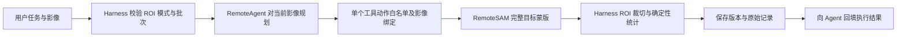

# v0.7 RemoteAgent / Harness 接口与验收

本文件只描述队员 A 负责的决策层与 Harness。真实推理仍需已部署的 RemoteAgent 和 RemoteSAM；离线单元测试不能作为真实模型记录。

## 请求与字段

单图继续使用 `POST /api/run`，在原有 `session_id`、`query`、`mode`、`parent_run_id`、`scope` 上可增加：

```json
{
  "session_id": "<当前影像的会话 ID>",
  "query": "提取框选区域内的飞机",
  "mode": "live",
  "roi": {"xyxy": [100, 400, 400, 700], "source": "drawn", "image_size": [800, 800]},
  "quality_mode": "accurate"
}
```

- `roi.xyxy` 为整数像素半开区间 `[x1,y1,x2,y2]`，满足 `0 <= x1 < x2 <= width`、`0 <= y1 < y2 <= height`。`source` 只允许 `drawn` 或 `imported`。`image_size` 必须与当前影像一致。
- 省略 `roi` 时继承所选版本，或继承该影像最近一次成功结果。传 `{}` 清除 ROI；若文本仍要求框选区域则拒绝。历史版本的 `task.roi` 可恢复当时矩形。
- `quality_mode` 只允许 `fast`、`accurate`、`auto`。省略时从文本或历史上下文解析，首次默认 `auto`。`auto` 遇到明确“小目标/高精度”表达选 `accurate`，否则选 `fast`；记录请求模式、执行模式和来源。显式选项与文字冲突时拒绝。
- 同一任务只允许一种目标类别、一个工具动作。Agent 的 ROI、模式或批量表述不能作为工具参数执行，Harness 用白名单、当前影像绑定、目标、坐标和模式校验后调用 RemoteSAM。
- 显式 `fast` / `accurate` 模式要求 RemoteSAM 在响应中返回一致的 `quality_mode`。旧 `/predict` 响应缺少此字段时本次标记失败，以免将普通推理冒充高精度。默认 `auto` 可沿用旧服务的整图调用；需由队员 B 的新接口确认实际模式与参数。
- `task_options`、`task`、`metrics` 和 `service_metadata` 保存模式、ROI、服务返回参数与统计。错误任务有 `failed` 或 `needs_clarification` 状态，不生成新的 mask，原版本保留。

批量使用 `POST /api/batch`：传 `session_ids`（2 至 5 个不重复的已有影像会话）、`query`、`mode`、可选 `roi` 与 `quality_mode`。返回 `batch_id`、逐项 `item_id`、`run_id`、状态、失败原因与统计；原始逐图结果保存在各自会话，汇总保存在 `experiments/batches/<batch_id>.json`。Harness 串行调用，固定共同质量模式，每幅影像由 Agent 单独提出至多一个工具动作；单项失败继续下一项。任务没有明确目标时，所有影像必须已有同一个目标上下文，否则批量请求在开始前拒绝。相同 ROI 传给每幅影像时逐幅按其尺寸校验，越界项单独失败。

## 评测与复算

固定任务集是 `evaluation/v07_agent_task_set.csv`，覆盖 ROI、模式、批量、缺失条件、冲突目标和旧的左右/全图任务。运行前通过本机 `.env` 或进程环境配置 `GEO_AGENT_BASE_URL`、`GEO_AGENT_MODEL`、`GEO_REMOTESAM_URL`，并确认两项服务均可访问。不要把配置文件提交到 Git。

```powershell
python evaluation/v07_agent_eval.py --offline
python evaluation/v07_agent_eval.py --agent-only --limit 16
python evaluation/v07_agent_eval.py --agent-only
python evaluation/v07_agent_eval.py
python -m unittest discover -s tests -p 'test_*.py' -q
```

评测脚本逐项写 JSONL，并生成 `.summary.json`；临时会话写入被 Git 忽略的 `test-results/v07-agent-experiments`。真实模式每条保存脱敏后的 Agent 原始输出、原文 SHA-256、工具调用、Harness 状态与原因、影像会话及运行 ID。汇总的 `routing_accuracy` 分母为已运行任务总数；`legal_call_rate` 分母为 `tool_call/rejected_tool/unparsed` 三类尝试。可从 JSONL 逐行重新计数；服务故障导致的任务结果错误与 Agent 路由判断分列记录。运行完成后人工复核原始记录、三个成功案例和两个拒绝/失败案例，再将其用于答辩材料。

`evaluation/results/v07_agent_offline_20260930.jsonl` 是 20 条演示规则与 Harness 合同检查，20 条结果符合预期，所有记录标有 `evidence_mode=offline_demo`，`real_agent_calls=0` 且 Agent 路由指标为 `null`。

2026-09-30 已通过现有 SSH 配置连接实验室真实 RemoteAgent，模型接口返回 `RemoteAgent`。`evaluation/results/v07_agent_real_16task_smoke_20260930.jsonl` 是 16 条小样本中的 8 次真实模型调用，16 条 Harness 路由均符合预期。`evaluation/results/v07_agent_real_full_verified_20260930.jsonl` 是 20 条全量记录：14 次真实模型调用，20/20 路由正确，9 条合法分割规划，1 条场景回答，4 条澄清，6 条拒绝。批量用例 V07-19 对 5 幅影像分别调用 Agent 5 次。上述记录均为 `real_agent_decision_only`，`sam_calls=0`；“segment”只表示 Harness 接受了单个分割规划，不能当作 RemoteSAM 已生成蒙版。

原始失败样本保留在 `evaluation/results/v07_agent_real_full_20260930.jsonl`：V07-09 的“所有物体轮廓”曾被模型规划为分割。Harness 增加目标类别明确性检查后，该任务在调用模型前进入澄清，全量复测由 19/20 提升到 20/20。可用的三个成功规划案例为 V07-01（ROI 飞机）、V07-02（高精度飞机）、V07-19（五图串行决策）；两个拒绝案例为 V07-06（缺失 ROI）与 V07-07（ROI 越界）。逐条原文、最终动作与原因均在 JSONL 中。

队员 B 的质量模式响应和真实 RemoteSAM 推理仍需联调确认。实验室 RemoteAgent 服务可达，RemoteSAM 示例配置中的就绪地址本次未返回有效响应；不能据此声称两种模式的真实分割已验收。提交真实评测记录前应再次检查日志中是否有令牌、内网地址和未经授权影像。

## 执行流程与答辩要点



答辩时重点说明：模型只建议动作，Harness 才拥有执行权；批量是 Harness 的串行循环；ROI 裁切与面积统计可从保存的蒙版复算；解析失败、非法模式、影像不匹配和服务未确认模式都不会被写成成功结果。
