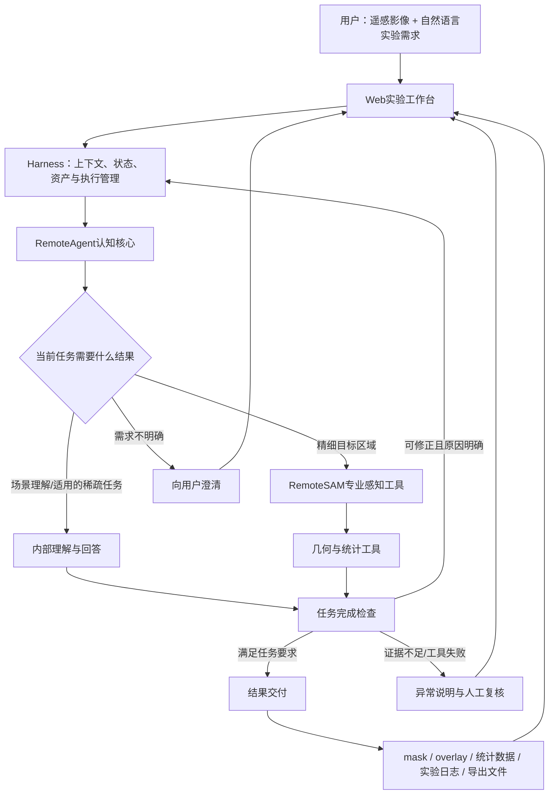

# 技术方案调整稿 v3：需求驱动的遥感科研实验智能体

> 2026-09-17  
> 参赛方向：AI + 学科交叉  
> 项目定位：面向遥感科研实验的自然语言智能工作台  
> 核心技术主线：RemoteAgent + RemoteSAM + Harness + 几何统计工具 + Web实验工作台  
> 本版重点：整体架构基本保持不变，重新明确目标用户、真实需求、应用场景与系统价值，使技术方案由“模型组合”转向“需求驱动”。

---

## 一、项目背景与现实需求

遥感影像分析广泛应用于国土调查、城市变化监测、灾害评估、生态监测等科研与教学任务。实际实验过程中，使用者往往需要围绕一幅遥感影像连续完成场景理解、目标定位、目标提取、面积统计、条件修改和结果导出等操作。

当前遥感实验流程中，一个完整任务通常并不是由单一模型一次完成，而是需要用户在多个模型、脚本和分析程序之间切换。例如，用户首先判断场景和目标位置，再调用分割模型获得目标区域，随后使用程序进行面积、占比或空间关系计算，最后整理实验结果并保存中间产物。

对于遥感专业学生、研究生和科研人员而言，真正的需求并不是“调用某一个模型”，而是：

1. 能够直接用自然语言描述实验意图；
2. 系统能够理解任务中包含的目标、位置、空间条件和输出要求；
3. 自动选择合适的遥感模型和计算工具完成任务；
4. 在用户修改实验条件时保留上下文，而不是重新开始整个流程；
5. 输出能够继续用于科研实验的真实结果，例如 mask、overlay、像素面积、比例和运行记录；
6. 当任务失败、条件含糊或结果无法验证时，能够明确说明当前状态，而不是仅返回一个看似合理的答案。

因此，本项目关注的不是单一遥感模型能力，而是**如何将用户的遥感实验意图自动转化为可执行、可检查、可迭代、可导出的实验流程。**

---

## 二、目标用户与核心场景

### 2.1 目标用户

本项目主要面向：

- 遥感科学与技术、地理信息科学等专业的本科生与研究生；
- 需要进行遥感影像预标注、目标提取和实验分析的科研人员；
- 在课程实验或科研项目中需要频繁进行“影像理解—目标提取—统计分析—结果整理”的使用者。

首版不追求覆盖所有遥感业务，而是优先服务**遥感科研实验与科研预标注**这一具体场景。

### 2.2 典型使用任务

例如用户上传一张遥感影像，并提出：

> “提取影像右侧的建筑区域，并计算这些建筑占整幅影像的比例。”

这条任务实际上包含多个子问题：

- 识别目标类别：建筑；
- 理解空间条件：影像右侧；
- 判断需要的输出粒度：精细目标区域；
- 调用专业模型获得目标 mask；
- 对 mask 进行面积与占比统计；
- 将结果可视化并保存；
- 若用户继续说“改成左侧建筑”，系统需要继承当前影像和任务上下文，只重新执行受影响步骤。

因此，系统需要解决的不是一次模型推理，而是一个完整实验闭环。

---

## 三、用户真实痛点与系统响应

| 用户真实需求 | 现有实验中的典型问题 | 本系统对应能力 |
|---|---|---|
| 自然描述实验任务 | 用户需要自己将需求拆成模型调用和脚本操作 | RemoteAgent 理解需求并组织任务 |
| 获得可继续使用的结果 | 大模型文本回答无法直接进入后续实验 | RemoteSAM 输出真实 mask，统计程序生成定量结果 |
| 连续修改实验条件 | 修改一次条件往往需要重新组织脚本流程 | Harness 保存上下文、状态和结果版本 |
| 准确执行空间条件 | “右侧”“靠近道路”等条件容易在模型回答中被忽略 | 几何工具进行确定性空间检查 |
| 明确知道任务是否完成 | 工具运行成功并不代表用户需求已经完成 | 任务完成检查与异常状态管理 |
| 可复查与可复现 | 实验中间过程和参数容易丢失 | 运行日志、结果资产和实验包导出 |

本项目的核心价值可以概括为：

> **让遥感实验人员从“自己组织模型和脚本”转变为“直接描述实验目标，由系统自动完成流程组织和结果交付”。**

---

## 四、项目定位与总体目标

项目暂定名：**遥感科研实验智能体**。

本项目构建一个面向遥感科研实验的自然语言智能工作台。用户上传遥感影像后，通过自然语言描述实验任务，系统自动理解需求、判断任务粒度、选择内部能力或调用专业遥感工具，最终生成可视化结果、统计数据和可下载实验产物。

系统重点解决四类问题：

1. **任务理解**：识别用户真正想完成的遥感实验目标；
2. **工具组织**：根据不同任务选择合适的专业模型与计算程序；
3. **连续实验**：保持会话、影像、条件和结果之间的上下文关系；
4. **结果交付**：输出可以复查、保存、继续使用的科研实验结果。

技术主线为：

> **RemoteAgent 组织任务 → RemoteSAM 完成专业感知 → 几何与统计工具完成确定性计算 → Harness 管理状态与执行 → Web 工作台完成交互与结果交付。**

---

## 五、整体架构



整个系统不是多个独立智能体的堆叠，而是一个认知核心围绕不同实验任务按需调用专业工具。

---

## 六、核心模块设计

### 6.1 RemoteAgent：理解“用户到底想做什么”

RemoteAgent承担系统的认知和任务组织功能。

主要职责包括：

- 读取真实影像内容和用户文本需求；
- 判断用户需要场景理解、目标定位、精细分割还是统计结果；
- 提取目标类别、空间条件、输出类型等关键信息；
- 决定直接回答、调用 RemoteSAM、调用计算工具或向用户澄清；
- 根据工具实际返回结果组织最终回答。

例如：

| 用户输入 | 系统行为 |
|---|---|
| “这张影像主要是什么场景？” | 认知核心直接回答 |
| “右侧那片建筑大概在哪里？” | 使用内部定位能力 |
| “提取右侧建筑的轮廓。” | 调用 RemoteSAM |
| “计算这些建筑占整图的比例。” | 基于当前 mask 调用统计工具 |
| “改成左侧建筑。” | 修改条件并重新执行受影响步骤 |
| “把那个区域标出来。” | 指代不明确时先澄清 |

RemoteAgent不承担所有专业计算，而负责判断“下一步应该做什么”。

---

### 6.2 RemoteSAM：完成专业遥感感知

RemoteSAM作为首版核心遥感视觉工具，重点提供目标分割能力。

首版主要封装：

#### 1. 指代表达分割

输入：

- 遥感影像；
- 目标文本，例如“右侧的建筑”。

输出：

- 与原图对齐的目标 mask；
- 目标条件；
- 结果资产引用；
- 基础运行信息。

#### 2. 按类别分割

输入：

- 遥感影像；
- 类别列表，例如“建筑、道路”。

用于需要参考物或多类别分析的任务。

首版不追求一次开放 RemoteSAM 的全部任务能力，而是优先保证“目标提取”这一关键能力稳定可用。

---

### 6.3 几何与统计工具：完成“确定性计算”

大模型和分割模型负责理解与感知，但面积、比例和几何关系不由大模型估算。

程序根据真实 mask 计算：

- 目标像素面积；
- 目标占整图比例；
- 外接框；
- 轮廓；
- 连通区域；
- 支持条件下的左右、上下和区域范围关系；
- 后续扩展的目标与参考物距离关系。

没有可靠 GSD 或地理参考时，只输出像素面积与比例，不直接输出实际平方米面积。

---

### 6.4 Harness：保证实验流程“连续、可靠、不混乱”

Harness不是另一个模型，而是系统运行框架。

主要职责：

- 保存当前影像；
- 保存用户原始任务；
- 保存已确认目标和空间条件；
- 管理模型调用和工具调用；
- 检查调用参数；
- 保存 mask、overlay 和统计结果；
- 管理不同版本实验结果；
- 处理失败和重试；
- 保存运行日志；
- 将工具返回结果重新交给 Agent 判断下一步动作。

例如用户先完成“右侧建筑”，随后输入：

> “改成左侧的。”

Harness需要知道：

- 当前仍然是同一张影像；
- 目标类别仍是建筑；
- 仅空间条件从“右侧”变成“左侧”；
- 原有右侧结果仍应作为旧版本保留；
- 新任务只需要重新执行受影响步骤。

---

### 6.5 Web实验工作台：让科研流程真正可操作

系统采用单页工作台形式。

| 页面区域 | 功能 |
|---|---|
| 左侧任务区 | 上传影像、输入自然语言任务、会话记录与澄清 |
| 中间影像区 | 原图、mask、overlay、缩放和切换 |
| 右侧结果区 | 当前目标、空间条件、面积占比、执行状态 |
| 下方运行区 | 工具调用、运行耗时、结果版本、日志和导出 |

普通用户不需要直接看到 RemoteAgent、RemoteSAM 等论文名称。

模型名称、模型版本、运行参数等放在“运行详情”中，用于科研复查。

---

## 七、任务完成检查与异常处理

本项目不将“模型产生了输出”直接等同于“用户任务已经完成”。

首版主要检查：

### 7.1 执行检查

- 工具是否正常返回；
- 输出文件是否真实存在；
- mask尺寸是否与原图匹配；
- 结果是否能够正常加载和显示。

### 7.2 任务检查

- 用户要求的目标区域是否已经产生；
- 用户要求的统计结果是否已经计算；
- 结果是否对应当前实验条件；
- 导出任务是否真正生成文件。

### 7.3 空间条件检查

对于已经支持的：

- 左侧；
- 右侧；
- 上方；
- 下方；
- 指定区域；

使用实际坐标进行检查，而不是仅依赖模型文本判断。

“影像右侧”只表示图像坐标意义上的右侧，不自动解释为地理意义上的东侧。

### 7.4 异常处理

系统需要区分：

- 工具执行失败；
- 未检出有效目标；
- 用户条件无法判断；
- 描述存在歧义；
- 输出格式错误；
- 结果需要人工复核。

空结果不能直接解释为“现实中不存在目标”。

首版允许一次有明确原因的自动修正，例如修复非法参数或重新组织目标表达；仍无法完成时明确提示用户复核。

---

## 八、连续遥感实验流程

系统围绕一个连续实验任务工作，而不是多个互相独立的功能页面。

### 示例流程

用户上传遥感影像：

> “这张影像主要是什么场景？”

系统直接进行场景理解。

用户继续：

> “提取右侧的建筑并计算面积占比。”

系统执行：

1. 解析“建筑 + 右侧 + 分割 + 面积占比”；
2. 调用 RemoteSAM 获得建筑 mask；
3. 检查目标是否满足“右侧”条件；
4. 调用统计程序计算面积和比例；
5. 生成 overlay；
6. 返回结果。

用户继续：

> “改成左侧的建筑。”

系统：

1. 保留当前影像；
2. 保留目标类别“建筑”；
3. 将空间条件由“右侧”改为“左侧”；
4. 重新执行必要步骤；
5. 生成新的结果版本。

用户最后：

> “导出刚才的结果。”

系统生成本次实验包。

---

## 九、首版 Demo 设计

首个演示不追求功能数量，而强调一个任务能否完整闭环。

### 9.1 主演示任务

建议使用一张目标清晰、具备建筑分布的 RGB 遥感影像。

演示流程：

| 步骤 | 用户操作 | 系统展示 |
|---|---|---|
| 1 | 上传影像并询问场景 | Agent真实读取影像并回答 |
| 2 | “提取右侧建筑并计算面积占比” | Agent调用RemoteSAM和统计工具 |
| 3 | 查看结果 | 原图、mask、overlay、面积与比例 |
| 4 | “改成左侧建筑” | 系统继承上下文并重新执行 |
| 5 | 导出结果 | 下载结果文件和运行记录 |

### 9.2 辅助演示任务

额外准备一个模糊需求：

> “把那个区域提出来。”

系统不直接猜测，而询问：

> “请确认您指的是刚才的左侧建筑区域，还是其他区域？”

用于展示系统并非只会“强行执行”，而是能够处理需求不完整情况。

---

## 十、实验结果与产物设计

每一次完整运行形成一个实验包：

```text
experiment_xxx/
├── original.png
├── mask.png
├── overlay.png
├── result.json
├── statistics.json
└── run_log.json
```

其中：

- `original.png`：原始影像；
- `mask.png`：目标区域；
- `overlay.png`：可视化叠加结果；
- `result.json`：目标类别、空间条件、任务状态；
- `statistics.json`：面积、比例等统计数据；
- `run_log.json`：模型、参数、工具调用、耗时和错误记录。

实验结果不是只能“看”，而是能够继续用于后续科研或教学分析。

---

## 十一、系统验证方案

项目验证分为三个层次。

### 11.1 感知能力验证

验证 RemoteSAM 输出质量：

- mask 与人工标注之间的 IoU、Dice 等指标；
- 不同类别、不同目标位置下的稳定性；
- 非正方形影像的空间对齐。

### 11.2 任务完成能力验证

设计包含不同条件的任务：

- 单类别目标提取；
- 左右位置约束；
- 连续条件修改；
- 分割 + 面积统计；
- 模糊指代；
- 空结果与失败情况。

统计：

- 任务完成率；
- 空间条件满足率；
- 工具执行成功率；
- 异常状态识别率；
- 人工介入次数。

### 11.3 使用效率验证

设置三种对照方式：

1. 用户手工调用模型和脚本；
2. RemoteAgent基础流程；
3. 本项目完整实验工作台。

比较：

- 完成相同任务的总操作时间；
- 用户操作步骤数；
- 人工介入次数；
- 结果整理时间；
- 任务失败率。

本项目不预设提升百分比，最终结论以真实实验记录为依据。

---

## 十二、与上一届参赛作品相同的叙事逻辑

本项目在表达方式上采用“需求—问题—技术—验证”的结构，而不是直接罗列模型。

上一届“多源先验的无人机自主导引系统”的核心逻辑是：

> 无人机真实自主飞行需求  
> → 现有目标检测与自主导引存在实时性和多传感器依赖问题  
> → 设计尺度特征、高度估计、目标跟踪和多源先验融合  
> → 最终验证无人机是否能够抵达目标并完成悬停。

本项目对应为：

> 遥感科研人员需要连续完成影像理解、目标提取与分析  
> → 当前实验流程需要人工组织多个模型和脚本，条件修改与结果复查成本较高  
> → 使用 RemoteAgent 组织任务、RemoteSAM 完成感知、Harness 管理实验状态、几何程序完成确定性计算  
> → 最终验证用户是否能够更完整、更高效地完成真实遥感实验任务。

二者都遵循同一原则：

> **技术模块必须服务于一个明确的真实任务，而不是先有模型再寻找应用。**

---

## 十三、首版功能边界

首版完成：

- 单张遥感影像上传；
- 场景理解；
- 自然语言任务输入；
- 指代表达目标分割；
- 基础左右/上下空间条件；
- mask 可视化；
- 像素面积与占比统计；
- 会话上下文保持；
- 一次条件修改；
- 状态反馈；
- 实验结果导出；
- 运行日志记录。

首版暂不强制实现：

- 多智能体协作；
- RemoteReasoner；
- RemoteZero；
- RemoteShield；
- RemoteCLIP；
- 全部复杂空间关系；
- 自动地理面积计算；
- 实例级精确计数；
- 全自动人工标注替代；
- 多时相遥感分析；
- 超大幅遥感影像切片调度。

后续是否增加上述功能，以首版实验中暴露出的真实问题为依据。

---

## 十四、系统实现顺序

| 阶段 | 主要工作 | 验收标准 |
|---|---|---|
| Stage 1 | RemoteAgent推理流程复现 | 模型真实读取影像，能够区分直接回答和工具调用 |
| Stage 2 | RemoteSAM接入 | 用户自定义影像能够输出真实且对齐的mask |
| Stage 3 | 几何与统计模块 | 面积、占比和空间条件使用程序真实计算 |
| Stage 4 | Harness闭环 | Agent、工具、结果、状态和日志能够连续运行 |
| Stage 5 | Web实验工作台 | 用户能够完成上传—任务—查看—修改—导出的完整流程 |
| Stage 6 | 测试与验证 | 有人工标注和真实任务记录支撑结果结论 |
| Stage 7 | 参赛Demo与材料 | PPT、文档和演示视频均来自真实系统能力 |

---

## 十五、作品核心价值表述

推荐最终统一表述为：

> 本项目面向遥感科研实验中模型调用分散、实验流程依赖人工组织、条件修改成本高和结果难以连续复查的问题，构建自然语言驱动的遥感科研实验智能体。系统以 RemoteAgent 负责实验任务理解与工具组织，以 RemoteSAM 提供专业遥感感知能力，以 Harness 管理上下文、执行状态和结果资产，并通过几何统计程序完成确定性计算。用户能够直接描述遥感实验目标，在同一工作台中完成目标提取、条件修改、结果统计和实验导出，从而将自然语言意图转化为可执行、可检查、可迭代和可复用的遥感实验流程。

---

## 十六、答辩时一句话介绍

### 版本一：偏应用

> 我们不是再做一个遥感分割模型，而是希望解决科研人员做遥感实验时需要自己来回组织模型、脚本和结果的问题，让用户直接描述实验目标，系统自动完成后续工具调用、分析和结果整理。

### 版本二：偏技术

> 本项目以 RemoteAgent 负责遥感任务理解和工具路由，以 RemoteSAM 完成目标感知，以 Harness 管理实验状态和执行流程，最终形成一个能够将自然语言实验需求转化为真实遥感实验结果的智能工作台。

### 版本三：偏比赛展示

> 用户只需要告诉系统“我想从这张影像里得到什么”，系统负责判断“应该怎么做、调用什么工具、任务有没有真正完成”，并最终交付可复查、可修改、可导出的实验结果。
