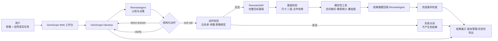

# GeoScope 技术方案 v4：可验证、可追溯的遥感科研实验智能体

> 版本日期：2026-09-23  
> 参赛方向：2026 全球校园人工智能算法精英大赛——AI+学科交叉  
> 交叉学科：人工智能 × 遥感科学与地理信息科学  
> 当前系统版本：GeoScope v0.5.0  
> 文档性质：国赛申报阶段技术方案；已实现能力与待验证计划分开表述

---

## 一、项目摘要

遥感科研实验通常不是一次模型推理，而是一条由影像理解、目标提取、空间筛选、统计计算、条件修改和结果整理组成的连续流程。现有工具往往要求使用者在大模型、遥感模型、脚本和文件之间反复切换。对于缺少算法开发经验的遥感专业学生和科研人员，这种工作方式存在操作门槛高、实验上下文容易丢失、模型输出真假难判断、结果难复查和难复现等问题。

GeoScope 面向遥感科研实验与科研预标注场景，构建自然语言驱动的遥感科研实验智能体。用户上传影像并描述研究目标后，RemoteAgent 负责理解影像和实验意图，决定直接回答、请求澄清或调用专业工具；GeoScope Harness 对智能体动作进行白名单、参数、影像和状态校验；RemoteSAM 生成像素级目标蒙版；确定性程序完成空间范围筛选、面积统计和结果验证；Web 工作台负责结果展示、版本管理与实验包导出。

项目已经完成官方 RemoteAgent、GeoScope Harness 与官方 RemoteSAM 的真实闭环联调，并形成可交互 Demo。当前证据能够证明系统链路真实可运行、失败时不会伪造结果；尚不能证明系统在多场景下的语义精度和效率优势。下一阶段将通过多图标注实验、三组流程对照和目标用户试用，形成完整的应用效果证据。

### 一句话定位

> **GeoScope 将遥感研究者的自然语言实验意图，转化为可执行、可验证、可修改、可追溯、可导出的遥感实验流程。**

---

## 二、学科场景与真实需求

### 2.1 目标用户

GeoScope 首版主要服务三类使用者：

- 遥感科学与技术、地理信息科学等专业的本科生和研究生；
- 需要快速进行目标提取、科研预标注和定量分析的科研人员；
- 在课程实验中需要完成“影像理解—目标提取—统计分析—实验整理”的教师和学生。

首版聚焦单张 RGB 遥感影像的交互式科研实验，不追求覆盖所有遥感业务。

### 2.2 典型任务

用户上传一张城市遥感影像，并提出：

> “提取影像右侧的建筑区域，并计算这些建筑占整幅影像的比例。”

这句话同时包含：

1. 目标类别：建筑；
2. 空间条件：影像右侧；
3. 任务类型：像素级目标提取；
4. 定量要求：计算面积和占比；
5. 交付要求：展示并保存结果。

如果用户随后输入“改成左侧的”，系统还需要继承当前影像和“建筑”目标，只修改空间条件，并保留此前结果作为可恢复版本。

### 2.3 用户真正需要的不是单个模型

目标用户的核心需求可以归纳为：

- 用自然语言描述实验目标，不必先学习模型命令和脚本接口；
- 系统自动理解目标、位置、输出形式和后续计算要求；
- 获得与原图对齐的真实 mask、叠加图和统计数据；
- 连续修改条件时保留上下文和旧结果；
- 明确区分“已完成”“需澄清”“工具失败”和“需人工复核”；
- 保存模型、参数、输入、输出和日志，使实验能够复查和复现。

因此，本项目解决的是**遥感实验流程组织问题**，不是再次训练一个单一的遥感分割模型。

---

## 三、现有方式及其不足

| 现有方式 | 能够完成的工作 | 面向真实实验的不足 | GeoScope 的改进 |
|---|---|---|---|
| 通用多模态大模型 | 理解影像、回答问题 | 文字回答不能替代像素级结果，数值可能来自估计 | 只让 Agent 理解和决策，像素结果交给 RemoteSAM，数值由程序计算 |
| 单独使用遥感分割模型 | 根据类别或表达生成 mask | 用户仍需准备输入、运行命令、处理 mask、编写统计脚本 | Agent 组织流程，Harness 执行和管理结果 |
| 简单的 Agent 调用工具 | 自动选择工具 | 容易出现非法参数、多工具混用、假成功、上下文丢失 | 白名单、影像绑定、参数校验、失败关闭和完成条件检查 |
| 传统遥感软件或零散脚本 | 完成专业处理和计算 | 操作链条长，条件修改与结果整理依赖人工 | 使用自然语言连续修改，自动形成版本和实验包 |

GeoScope 不以替代专业遥感软件为目标，而是降低实验想法进入可验证结果的门槛，并保留后续进入专业工作流的真实产物。

---

## 四、作品设计意图

### 4.1 核心目标

本项目希望把“用户自己组织模型和脚本”转变为“用户描述实验目标，系统组织并交付实验结果”。系统需同时满足以下要求：

1. **会理解**：理解影像、目标、空间条件和输出要求；
2. **会选择**：区分直接回答、澄清和专业工具调用；
3. **会执行**：把合法动作交给真实遥感模型和确定性程序；
4. **会检查**：验证工具输出、空间条件和任务完成状态；
5. **会连续工作**：继承上下文，保留实验版本；
6. **会交付**：输出可视化、数据、日志和实验文件。

### 4.2 设计原则

- 模型负责认知与感知，确定性程序负责可以精确计算的结果；
- 智能体提出动作，Harness 掌握工具执行权；
- 工具返回成功不等于用户任务完成；
- 失败时停止并说明原因，不生成伪蒙版或伪统计；
- 默认演示数据、模拟接口和真实模型结果必须清晰区分；
- 所有关键结果都能够追溯到影像、任务、模型版本和产物文件。

### 4.3 首版边界

首版聚焦单张 RGB 影像、场景理解、单类别目标提取、左右/上下范围、像素面积与占比、连续条件修改、结果版本和实验导出。

首版不宣称支持多时相变化检测、超大影像切片调度、复杂地理拓扑推理、实例级精确计数或没有地理参考信息时的平方米面积计算。

---

## 五、总体技术架构



### 5.1 各组成部分的关系

| 组成部分 | 性质 | 在系统中的职责 | 是否为本项目原创重点 |
|---|---|---|---|
| RemoteAgent | 已有多模态模型与推理方法 | 读取影像和任务，输出直接回答、澄清或受限工具动作 | 否，属于上游认知核心 |
| RemoteSAM | 已有遥感视觉模型 | 根据目标提示生成完整像素级蒙版 | 否，属于上游专业工具 |
| 几何与统计工具 | 确定性程序 | 完成左右/上下筛选、像素面积、占比和叠加图计算 | 属于系统实现组成 |
| GeoScope Harness | 智能体运行框架 | 约束动作、执行工具、校验结果、管理上下文、版本和资产 | **是，核心系统创新载体** |
| Web 实验工作台 | 用户系统 | 统一承载任务、影像、结果、结论和导出 | **是，应用落地载体** |

RemoteAgent、RemoteSAM 与 Harness 不是三个并列方法。RemoteAgent 是决策者，RemoteSAM 是被调用的专业工具，Harness 是保证整个智能体能够可靠运行的执行框架。

---

## 六、端到端推理与执行流程

### 6.1 任务分类

Harness 首先区分两类任务：

- 场景描述、分类、普通看图问答：交给 RemoteAgent 直接回答；
- 提取、分割、标注、蒙版、面积和占比：进入像素级工具流程。

该分流避免把普通问答错误地当作分割任务，也避免用纯文字回答冒充像素级结果。

### 6.2 Agent 决策

RemoteAgent 接收当前影像、用户请求和经过压缩的实验上下文，并只允许返回三类状态：

1. `completed`：直接回答任务；
2. `needs_clarification`：信息不足，需要用户确认；
3. `tool_call`：调用白名单中的单个分割工具。

当前开放的工具为：

- `semantic_segmentation`；
- `referring_expression_segmentation`。

同一次规划包含多个工具、调用未开放工具或参数无法解析时，Harness 拒绝执行。

### 6.3 工具执行

通过校验后，Harness 将当前实验影像绑定到工具请求，防止模型把路径改为任意本地文件。RemoteSAM 返回完整目标蒙版，Harness 再执行：

1. 返回状态检查；
2. mask 与原图尺寸检查；
3. 二值编码检查；
4. 完整蒙版与文件哈希保存；
5. 左、右、上、下等确定性空间裁切；
6. 目标像素和整图占比计算；
7. 叠加图和结构化结果生成。

当前空间条件采用图像像素坐标。“右侧”表示图像坐标中的右半幅，不自动解释为地理方向“东侧”。

### 6.4 工具结果回填

Harness 不把大体积 Base64 蒙版重新放入模型上下文，只向 RemoteAgent 回填：

- 原始任务摘要；
- 实际执行的工具和目标；
- mask 尺寸与校验状态；
- 像素面积和占比；
- 产物引用与哈希；
- 服务版本和运行状态。

RemoteAgent 根据真实工具结果组织最终说明，不能覆盖 Harness 计算出的确定性数值，也不能在反馈阶段继续自行调用工具。

### 6.5 连续实验与结果版本

每个有效结果保存影像、目标类别、空间条件、完整蒙版、当前蒙版、统计和运行记录。用户输入“改成左侧的”时，系统继承影像和类别，只更新空间条件。

只有在影像、目标、提示、服务地址、模型版本与完整蒙版哈希一致时，系统才复用完整蒙版；条件不满足时重新运行 RemoteSAM。旧结果不被覆盖，用户可以切换并恢复历史版本。

---

## 七、GeoScope Harness 的核心设计

### 7.1 工具调用约束

- 只允许预先注册的遥感工具；
- 每次规划只执行一个分割调用；
- 校验工具名、参数类型、目标类别和任务状态；
- 强制使用当前上传影像；
- 拒绝模型构造的任意文件路径；
- 不把解析失败的文本猜测成工具参数。

### 7.2 结果可信性检查

- HTTP 返回成功不直接视为任务成功；
- 响应必须包含明确成功状态与可解码的 mask；
- mask 必须与原图尺寸完全一致；
- mask 必须是合法二值数据，概率图不能静默当作二值结果；
- 统计量只根据实际 mask 逐像素计算；
- 工具失败时不生成新的有效版本。

### 7.3 状态和资产管理

系统关联以下对象：

```text
会话
 └─ 当前影像
     ├─ 用户原始任务
     ├─ 已确认目标与空间条件
     ├─ Agent 决策
     ├─ 工具执行记录
     ├─ 完整蒙版
     ├─ 当前范围蒙版
     ├─ 统计结果
     └─ 结果版本与导出资产
```

这种关系使用户的后续表达可以引用当前实验，同时使每一个结果都能追溯到产生它的条件。

### 7.4 失败关闭与人工复核

系统区分：

- 描述含糊，需要澄清；
- Agent 动作无法解析；
- 调用了未开放工具；
- 模型服务不可达；
- RemoteSAM 返回错误或空结果；
- mask 尺寸或编码不合法；
- 结果已经生成，但语义正确性仍需人工复核。

失败不会覆盖旧结果。空 mask 只表示本次任务没有获得有效目标，不能直接解释为现实中不存在目标。

---

## 八、作品创新点

### 8.1 遥感实验意图到可执行任务的转换

项目将自然语言中的目标、空间条件、任务类型和输出要求转换为受约束的遥感实验动作，使用户请求不再停留在聊天回答层面。

### 8.2 面向遥感智能体的可验证 Harness

项目把 Agent 的决策权与工具执行权分离。Agent 决定“做什么”，Harness 决定动作“能否安全、正确地执行”，并以真实产物判断任务是否完成。

### 8.3 感知结果与确定性计算分离

RemoteSAM 负责获得目标区域，空间裁切、像素面积和占比由确定性程序完成，避免让大模型估算精确数值或让分割模型承担不必要的流程逻辑。

### 8.4 连续实验的上下文与版本关系

系统把影像、任务、目标、空间条件、完整蒙版和派生结果组织为连续实验状态，使“改成左侧”“恢复上一版”等操作可以复用有效结果并保留历史证据。

### 8.5 可追溯的实验交付

每次完整运行可导出原图、mask、叠加图、结构化结果、统计数据和运行日志，使作品从“展示一个答案”升级为“交付一组可复查的实验资产”。

### 8.6 创新归属说明

本项目使用并注明 RemoteAgent 与 RemoteSAM 的公开研究成果，不将其模型结构、训练方法或论文指标作为团队原创。团队贡献集中在遥感任务协议、Agent 与工具的执行边界、Harness 校验机制、连续实验状态、结果版本、失败保护和工作台交付设计。

---

## 九、当前系统实现

### 9.1 已经实现的功能

- 单张影像上传和样例选择；
- RemoteAgent 场景理解与普通看图问答；
- 像素任务识别与受限工具决策；
- RemoteSAM 语义分割和指代表达分割接口；
- 当前影像绑定、工具白名单和参数校验；
- mask 尺寸、二值数据和返回状态检查；
- 左、右、上、下空间范围处理；
- 像素面积和整图占比计算；
- 原图、蒙版、叠加图和对比视图；
- 连续条件修改与结果版本；
- 服务失败、非法输入和模糊任务反馈；
- 页面刷新后的实验恢复；
- 包含六类文件的实验包导出；
- 演示模式与真实模型模式来源标识。

### 9.2 当前部署组成

| 模块 | 已验证配置 |
|---|---|
| RemoteAgent | `AIMGroup/RemoteAgent`，Qwen2.5-VL 架构，BF16，vLLM 0.15.1 |
| Agent 服务 | 模型 id `RemoteAgent`，实验室 GPU0；队长电脑通过 SSH 转发访问 |
| RemoteSAM | 服务版本 1.1.0，CUDA 0，FP16 |
| 工作台 | Python 本地服务 + 单页 Web 界面 |
| 测试 | 整仓 51 项自动检查及浏览器流程检查 |

模型权重、访问令牌和本地实验缓存不进入 Git。模型文件通过版本信息和 SHA-256 标识。

---

## 十、真实联调结果与证据边界

### 10.1 完整闭环

2026-09-22，团队在一张 800×600 真实影像上完成以下链路：

```text
中文实验请求
→ RemoteAgent 产生单一受限工具动作
→ Harness 校验并绑定当前影像
→ RemoteSAM 返回完整二值蒙版
→ Harness 完成空间裁切与像素统计
→ 实际结果回填 RemoteAgent
→ 生成最终回答与实验资产
```

### 10.2 实测记录

| 任务 | 关键结果 | 结论 |
|---|---|---|
| 全图建筑提取 | 完整建筑蒙版 133,780 px，占整图 27.8708%；输入输出均为 800×600 | 真实模型和完整蒙版链路可运行 |
| 右侧建筑提取并统计 | 右半幅建筑 74,476 px，占整图 15.5158%；RemoteSAM 服务耗时 533.15 ms | 空间约束和确定性统计可运行 |
| 全图飞机后改成左侧飞机 | 左半幅 22,804 px，占整图 3.5631%；安全复用完整蒙版 | 上下文继承和版本派生可运行 |
| 普通树状图场景问答 | RemoteAgent 直接回答，未调用 RemoteSAM | 问答与像素任务分流可运行 |
| Agent 首次返回两个工具 | Harness 拒绝执行，没有产生 mask 和统计 | 工具白名单与失败关闭有效 |

### 10.3 工程验证

当前 51 项自动检查覆盖：

- RemoteAgent 决策和工具结果反馈；
- 官方模型可能产生的单工具输出格式；
- 多工具调用拒绝；
- 工具白名单和当前影像绑定；
- RemoteSAM 两类接口合同；
- mask 尺寸、二值编码和失败处理；
- 场景问答与像素任务分流；
- 上下文、版本、完整蒙版复用；
- 像素统计、导出和磁盘恢复。

浏览器流程已经检查主任务、条件修改、版本切换、实验导出、需求澄清、工具故障和移动端显示。

### 10.4 证据边界

上述结果证明系统、服务、工具编排、蒙版传输、确定性计算和结果反馈能够真实运行。当前真实闭环样例数量不足，不能用于证明 RemoteSAM 在多场景下的语义精度、系统泛化能力或对用户效率的提升。正式参赛结论必须以多图标注实验和真实用户记录为依据。

### 10.5 冲刺阶段量化评测（2026-09-28）

团队进一步完成了两组可复算实验：

| 评测对象 | 样本 | 主要结果 | 结论 |
|---|---:|---|---|
| RemoteAgent + Harness | 40 条任务 | 路由正确率 75.0%，合法工具调用率 76.9%；16 条错误或越界动作被拦截/校正 | Harness 具有明确保护作用，Agent 的飞机任务仍是短板 |
| RemoteSAM | 20 幅带真值影像 | 20/20 接口成功；总体 IoU 0.2554、Dice 0.3698 | 服务稳定，但语义精度尚不足 |
| RemoteSAM 建筑 | 10 幅 | IoU 0.3522、Dice 0.5115 | 可作为预标注起点，仍需人工复核 |
| RemoteSAM 飞机基线 | 10 幅 | IoU 0.1585、Dice 0.2281 | 冻结基线，暴露小目标与提示敏感问题 |
| RemoteSAM 飞机改进 | 同一 10 幅、16 组实验 | 最佳 IoU 0.3056、Dice 0.4133；客户端约 12.39 秒/图 | 达到阶段目标，但阈值在同一诊断集选择，需独立样本复核 |

两组实验使用不同的任务样本，只能分别评价决策层和感知工具层，不能相乘或拼接成“系统总准确率”。同批任务的端到端精度、三组流程对照和真实用户试用仍需补齐。逐项证据、复算方法和失败案例见 `docs/队长整合验收报告_2026-09-28.md`。

---

## 十一、Demo 设计

### 11.1 演示目标

三分钟内让评委看清三个重点：

1. 用户只描述实验目标，不手工组织模型和脚本；
2. Agent 会选择工具，Harness 会检查动作和结果；
3. 系统交付的是像素级结果、统计和实验资产，不是只有一段文本。

### 11.2 主演示流程

| 步骤 | 用户操作 | 页面重点 | 证明的能力 |
|---|---|---|---|
| 1 | 上传城市影像，询问主要场景 | RemoteAgent 的场景说明 | 直接理解影像，不滥用分割工具 |
| 2 | 输入“提取右侧建筑并计算面积占比” | 叠加图、mask、像素与比例 | Agent→Harness→RemoteSAM→统计闭环 |
| 3 | 输入“改成左侧的” | 新版本与旧版本并存 | 上下文继承和局部重执行 |
| 4 | 切换结果版本 | 同一影像的不同条件结果 | 实验过程可追溯 |
| 5 | 输入“把那个区域提出来” | 系统要求澄清 | 不对含糊任务强行执行 |
| 6 | 展示故障用例 | 保留旧结果并说明失败 | 失败保护 |
| 7 | 导出实验包 | 六个真实生成的文件 | 结果可继续用于科研 |

### 11.3 页面信息层级

答辩首屏只突出：

> ① 描述分析任务 → ② 查看像素级结果 → ③ 读取分析结论

模型版本、工具过程、日志和数据来源放入可展开的“查看依据”，避免技术细节抢占演示重点。

---

## 十二、国赛验证方案

### 12.1 需要回答的研究问题

- **RQ1：** GeoScope 能否正确完成不同场景下的遥感目标提取与空间约束任务？
- **RQ2：** Harness 能否降低非法工具调用、假成功和结果错配？
- **RQ3：** 相比手工组织模型和脚本，GeoScope 能否减少用户操作和完成时间？
- **RQ4：** 连续条件修改、版本和实验包能否提高实验复查与复现效率？

### 12.2 数据与任务设计

建议形成一个来源和授权明确的小型评测集：

- 30—50 幅不同场景、尺寸和目标分布的遥感影像；
- 建筑、飞机、道路、水体等 3—4 个首版稳定类别；
- 由人工核验的目标 mask 或公开数据集标注；
- 至少 60 条任务，覆盖全图、左右/上下、连续修改、含糊表达、空结果和服务失败；
- 独立保留成功案例与失败案例，不只展示最好结果。

如果时间不足，应减少类别数量，优先保证建筑与飞机两类的标注质量和任务覆盖。

### 12.3 三组对照

| 组别 | 操作方式 | 目的 |
|---|---|---|
| A：人工流程 | 用户手工运行模型、脚本并整理文件 | 作为传统实验流程基线 |
| B：基础 Agent | RemoteAgent 直接决定并调用工具，不使用完整 GeoScope Harness 能力 | 判断仅使用 Agent 的效果 |
| C：GeoScope | RemoteAgent + Harness + RemoteSAM + 确定性工具 + 工作台 | 评价完整系统贡献 |

### 12.4 指标

#### 感知质量

- IoU；
- Dice；
- Boundary F1；
- 空 mask 率与明显错误率。

#### 任务完成质量

- 端到端任务完成率；
- 空间条件满足率；
- 合法工具调用率；
- 结果与当前影像/条件匹配率；
- 异常状态识别率；
- 实验包完整率。

#### 使用效率

- 单任务总用时；
- 用户操作步骤数；
- 人工介入次数；
- 条件修改用时；
- 结果整理和导出用时。

#### 系统性能

- Agent 决策耗时；
- RemoteSAM 推理耗时；
- 端到端耗时；
- 峰值显存；
- 服务失败后的正确恢复率。

### 12.5 消融实验

为证明团队设计的贡献，至少进行以下消融：

1. 去掉工具白名单和单工具约束，观察非法调用和失败率；
2. 去掉确定性空间裁切，观察左右条件满足率；
3. 去掉结果版本与完整蒙版复用，比较连续修改耗时；
4. 去掉任务完成检查，统计“接口成功但用户任务未完成”的比例；
5. 去掉实验包与来源记录，比较结果复查完整率。

### 12.6 用户试用

建议邀请 8—12 名遥感/GIS 专业学生或科研人员，每人完成 4—6 个统一任务。记录完成时间、操作步骤、失败点和主观评分，并访谈以下问题：

- 是否能够不用阅读模型文档完成任务；
- 是否能判断结果来自真实模型还是演示数据；
- 修改实验条件是否比原有方式更方便；
- 导出的结果是否足以继续开展实验；
- 哪些结果仍需专业人员复核。

实验前固定任务、数据和记录表，完成后再计算改进比例，不预设“提升百分比”。

---

## 十三、与赛道评分标准的对应关系

| 评分维度 | 分值 | GeoScope 对应内容 | 当前证据 | 参赛前必须补齐 |
|---|---:|---|---|---|
| 创新性 | 20 | 遥感实验任务协议、受约束 Harness、确定性验证、连续实验版本 | 已有系统实现和失败保护案例 | 消融实验、与简单 Agent 方案对比 |
| 需求分析 | 15 | 遥感科研实验和预标注用户、连续任务痛点 | 已形成用户和场景分析 | 真实访谈记录、需求频次与痛点证据 |
| 可行性 | 20 | 官方模型部署、跨机器服务、SSH 接入、完整闭环 | 已有真实联调和版本记录 | 固定部署、离线预案、资源说明 |
| 作品实现 | 20 | Web 工作台、Agent、Harness、RemoteSAM、统计、版本、导出 | v0.5.0 Demo 与 51 项检查 | 多图稳定性、完整答辩录像 |
| 应用效果 | 20 | 准确率、任务完成率、效率和用户反馈 | 已有 20 图分割评测和 40 条 Agent 任务评测 | 同批端到端评测、三组对照、用户试用 |
| 总结与展望 | 5 | 应用边界、推广路径和后续方向 | 已明确首版边界 | 根据实验失败案例形成可信展望 |

当前最需要补强的是“应用效果”，而不是继续增加更多模型名称或页面功能。

---

## 十四、可行性与落地方式

### 14.1 技术可行性

- RemoteAgent 与 RemoteSAM 已取得可用权重并完成真实部署；
- 两个模型通过独立服务运行，避免依赖冲突；
- 工作台通过标准 HTTP 接口连接模型服务；
- Harness 与模型解耦，可以继续接入新的遥感工具；
- 演示模式可在没有 GPU 和实验室网络时稳定展示交互流程；
- 真实模式保留服务版本、模型哈希和运行日志。

### 14.2 应用方式

1. **课程实验助手**：帮助学生将自然语言任务快速转化为可检查的遥感实验；
2. **科研预实验**：在正式批处理前快速验证目标、范围和分析方式；
3. **科研预标注**：生成可人工复核和修订的初始 mask；
4. **模型服务入口**：用统一交互方式组织实验室已有遥感模型；
5. **实验记录工具**：自动保存任务、模型、参数、结果和日志。

### 14.3 推广路径

首版先在遥感/GIS 专业教学与科研小组中试用，积累真实任务和失败样例。后续在不改变 Harness 主体的情况下增加经过验证的变化检测、目标检测和地理量算工具，逐步形成面向遥感实验的工具注册与评测体系。

---

## 十五、风险、限制与应对

| 风险或限制 | 影响 | 当前处理方式 | 后续工作 |
|---|---|---|---|
| RemoteSAM 对开放类别的精度不稳定 | mask 语义可能错误 | 结果标记为待语义复核，保存原图与叠加图 | 建立标注集并统计类别级指标 |
| Agent 输出格式存在波动 | 工具动作可能无法解析 | 兼容已验证的单工具格式，多工具仍拒绝 | 固定提示合同并统计合法调用率 |
| 实验室服务地址与网络变化 | 现场无法连接 | 服务检查、SSH 转发、演示模式 | 固定答辩环境与离线录像 |
| 当前只支持基础空间关系 | 无法完成复杂地理语义 | 明确使用像素坐标与首版边界 | 按真实需求增加可验证的空间工具 |
| 没有 GSD 或地理参考 | 无法可靠输出平方米 | 只输出像素面积与比例 | 有可靠元数据时再增加地理量算 |
| 当前评测规模仍有限 | 不能充分证明泛化和效率优势 | 已完成 20 图感知评测和 40 条决策评测并公开失败案例 | 扩充同批端到端实验并完成用户试用 |

---

## 十六、团队分工

| 角色 | 主要职责 | 核心交付 |
|---|---|---|
| 队长 | 产品定位、Harness、工作台、接口整合、验收、实验设计与答辩 | 完整系统、评测方案、申报材料和演示 |
| 队员 A | RemoteAgent 权重、vLLM 服务、推理接口和结果反馈合同 | 可复现的 Agent 服务、版本与真实任务记录 |
| 队员 B | RemoteSAM 权重、推理服务、二值蒙版接口和性能记录 | 可复现的分割服务、版本与真图结果 |

三人的交付最终都以同一条端到端任务是否完成为验收标准，不把“模型能够启动”单独视为作品完成。

---

## 十七、下一阶段工作

按获奖价值排序，后续工作为：

1. 使用统一提示口径完成至少 20 条同批端到端任务评测；
2. 针对飞机任务修复 Agent 错误路由、工具命名漂移和参数越界；
3. 在新增且独立的飞机样本上复核 `all planes` 与 1024/256 切片、0.88 阈值；
4. 完成快速模式与高精度模式的端到端耗时、准确率和适用场景对照；
5. 扩充来源明确的评测影像，补充 Boundary F1 和最好/中等/最差可视化；
6. 完成人工流程、基础 Agent 与 GeoScope 三组对照；
7. 邀请目标用户试用并记录时间、步骤与反馈；
8. 固定模型版本、演示影像、运行环境和三分钟答辩脚本；
9. 形成说明书、PPT、演示视频、实验表格和可复现附件。

---

## 十八、参赛材料中的统一表述

### 18.1 作品核心价值

> GeoScope 面向遥感科研实验中模型调用分散、流程依赖人工组织、条件修改成本高和结果难以复查的问题，构建自然语言驱动的遥感科研实验智能体。RemoteAgent 负责理解任务和选择工具，RemoteSAM 提供像素级遥感感知，GeoScope Harness 约束工具执行、验证结果并管理连续实验状态，确定性程序完成空间筛选与统计计算。用户能够在同一工作台中完成影像理解、目标提取、条件修改、结果统计和实验导出，将自然语言研究意图转化为真实、可检查和可复现的实验资产。

### 18.2 三十秒介绍

> 做一次遥感实验，研究者通常需要在大模型、分割模型、脚本和文件之间反复切换。GeoScope 让用户直接说出实验目标，由 RemoteAgent 判断下一步动作，Harness 检查并执行，RemoteSAM 生成像素级结果，程序完成精确统计。用户还能继续修改条件、恢复旧版本并导出完整实验包。我们已经跑通真实模型闭环，下一步通过多图评测和用户对照实验验证其精度与效率。

### 18.3 答辩时必须说清楚的边界

- RemoteAgent 和 RemoteSAM 是采用的上游研究成果；
- GeoScope 的贡献是面向遥感实验的智能体 Harness、连续工作流和结果交付；
- 单次成功证明系统可运行，不代表已经证明多场景精度；
- 页面默认样例用于稳定演示，真实模型证据另有完整运行记录；
- 没有可靠地理参考时，只报告像素面积与比例。

---

## 十九、技术来源与项目证据

### 19.1 上游技术来源

- RemoteAgent 模型：<https://modelscope.cn/models/AIMGroup/RemoteAgent/files>
- RemoteAgent 上游代码：<https://github.com/1e12Leon/RemoteAgent>
- RemoteSAM 上游代码：<https://github.com/1e12Leon/RemoteSAM>

正式说明书中需要继续补充 RemoteAgent、RemoteSAM 对应论文的完整作者、题名、会议或期刊、年份与引用格式。

### 19.2 项目内部证据

- `docs/完整现场联调验收_2026-09-22.md`
- `docs/队长整合验收报告_2026-09-28.md`
- `docs/RemoteAgent工作流交付报告.md`
- `evaluation/results/captain_integrated_summary.json`
- `docs/model_manifest.json`
- `docs/上游代码来源.md`
- `docs/验收用例.csv`
- `README.md`

### 19.3 赛道依据

- 2026 AI+学科交叉赛题说明：<https://www.aicomp.cn/tracks/tracks-2/3806.html>
- 2026 算法创新赛总体说明：<https://www.aicomp.cn/tracks/tracks-2/3775.html>

---

## 二十、当前结论

GeoScope 已经从技术构想进入可交互、可运行的系统原型阶段。现阶段最有价值的成果是：团队已经把 RemoteAgent 的认知与工具选择、RemoteSAM 的像素感知、Harness 的执行约束、确定性空间统计和 Web 工作台的结果交付连接成真实闭环，并验证了失败不会被伪装成成功。

距离国赛高水平作品的主要差距不在于继续堆叠模型，而在于把“系统能运行”进一步证明为“系统在多场景下有效、比现有流程更高效、对真实遥感使用者有价值”。后续开发和材料制作均应围绕多图精度、任务完成率、对照实验和用户证据展开。
